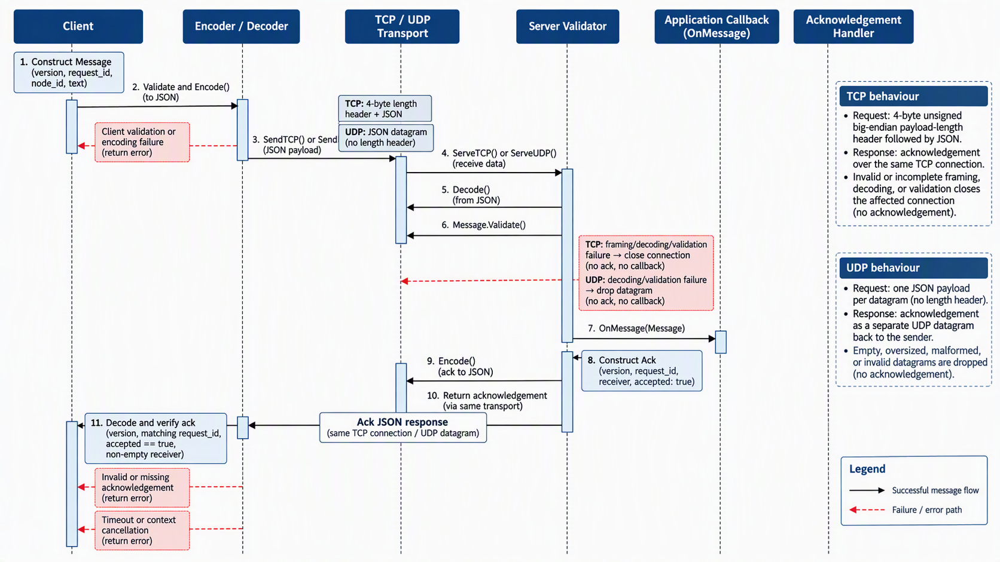

# API and Protocols

## 1. Request Matrix

| Request                                                     | Target status | Meaning                                             |
| ----------------------------------------------------------- | ------------: | --------------------------------------------------- |
| GET `/healthz`                                              |           200 | Process liveness and identity, retained from Week 1 |
| GET `/v1/status`                                            |           200 | Current simulated status                            |
| POST valid JSON to `/v1/status`                             |           200 | Existing status changed and returned                |
| Unsupported method                                          |           405 | Method not supported; include `Allow`               |
| Wrong or missing JSON media type on POST                    |           415 | Unsupported representation                          |
| Malformed JSON, unknown field, null, array or invalid value |           400 | Invalid request under this contract                 |
| Body above 4096 bytes                                       |           413 | Request content exceeds the documented limit        |

## 2. GET `/v1/status`

The GET request returns the current simulated status of the service.

### Example request

```http
GET /v1/status HTTP/1.1
Host: 127.0.0.1:8081
```

### Example response

```http
HTTP/1.1 200 OK
Content-Type: application/json

{"status":"healthy"}
```

The returned value represents the current local simulated status. It does not represent the actual health or connectivity of other processes.

## 3. POST `/v1/status`

The POST request changes the existing simulated status.

### Example request

```http
POST /v1/status HTTP/1.1
Host: 127.0.0.1:8081
Content-Type: application/json

{"status":"degraded"}
```

### Example response

```http
HTTP/1.1 200 OK
Content-Type: application/json

{"status":"degraded"}
```

A successful POST returns `200` because the operation changes and returns an existing resource rather than creating a new individually addressable resource.

## 4. Permitted Status Values

The `status` field is required and accepts only the following values:

* `healthy`
* `degraded`

For example:

```json
{"status":"healthy"}
```

or:

```json
{"status":"degraded"}
```

Other values are rejected with HTTP `400`.

## 5. Content-Type and Charset

POST requests must use the `application/json` media type.

A charset parameter is accepted. For example:

```http
Content-Type: application/json; charset=utf-8
```

is accepted by this API.

Missing or unsupported media types are rejected with HTTP `415`.

## 6. Request Body Limit

The maximum request body size is **4096 bytes**.

Requests exceeding this limit are rejected with HTTP `413 Request Content Too Large`.

The size limit is enforced while reading the request body rather than relying only on the `Content-Length` header.

## 7. Error Schema

Errors use a consistent JSON structure:

```json
{"error":"error_label"}
```

Examples include:

```json
{"error":"invalid_status"}
```

```json
{"error":"invalid_json"}
```

The HTTP status code identifies the category of failure, while the `error` field provides a machine-readable label.

The API does not expose stack traces, local file paths or other internal implementation details in error responses.

## 8. Validation and State Mutation

Requests are validated before the current status is changed.

The processing order is:

1. Check the HTTP method.
2. Check the media type.
3. Apply the request body size limit.
4. Decode one JSON object.
5. Validate the request fields and status value.
6. Change the stored status only after validation succeeds.
7. Return the current status.

**Invariant:** If a request is rejected or otherwise fails validation, the previous status value must remain unchanged.

For example, if the current status is `healthy` and a request containing an invalid status is rejected, a subsequent GET request must still return:

```json
{"status":"healthy"}
```

This ensures that invalid requests cannot partially update the resource.

### API Rationale

The `/v1/status` endpoint is designed around one resource, which is the current status of the node. A `GET` request is used to read the status, while a `POST` request is used to change it. I chose this approach because the endpoint has a clear purpose and each method has a specific job. This is easier to understand and test than having one general endpoint that handles several unrelated operations depending on parameters in the request.

The handler also separates different types of errors instead of treating every failed request in the same way. For example, if a client uses an unsupported HTTP method, the service returns `405 Method Not Allowed`. If the request does not use JSON, it returns `415 Unsupported Media Type`. These checks deal with how the request is being sent before the application needs to process its contents.

Once the request has the correct media type, the JSON itself is checked. Malformed JSON, unknown fields, multiple JSON objects and oversized request bodies are rejected. The service also checks that the JSON contains a valid status value. Only `healthy` and `degraded` are accepted. This separates problems with the request format from problems with the actual value being requested.

The tests provide evidence that these rules work as intended. The supplied `TestWeek02_REST` test passed all of the required cases, including malformed JSON, unknown fields, invalid values, incorrect media types, oversized content and unsupported methods. I also added an independent test for valid JSON followed by trailing junk. This test first sets the status to `degraded`, sends the invalid request, and then checks the status again. The status remains `degraded`, showing that a rejected request does not change the existing state.

The manual Node A and Node B testing also showed that the status is maintained between requests and that each node keeps its own status. These results provide practical evidence for the behaviour of the API rather than relying on a general claim that the service is secure or RESTful.


# IPC Protocol and Network Communication

## 1. Purpose

This document describes how nodes exchange messages using TCP and UDP in the Week 4 implementation. It defines the JSON request and acknowledgement schemas, message validation rules, TCP framing, UDP datagram handling, size limits and expected failure behaviour.

The sequence diagram shows how a message moves from the client through encoding and network transmission to decoding, validation, inbox processing and acknowledgement verification.

## 2. Request Schema

Messages are encoded as JSON before being transmitted over the network. The request uses the following structure:
```
{
  "version": 1,
  "request_id": "tcp-1",
  "node_id": "node-a",
  "text": "Hello from node-a"
}
```

The request fields are defined by the Go `Message` struct in `internal/ipc/protocol.go`.

| Field        | Type    | Description                                                                   |
| ------------ | ------- | ----------------------------------------------------------------------------- |
| `version`    | Integer | Protocol version. Must equal `1`.                                             |
| `request_id` | String  | Identifier for the request. Must pass `config.ValidID`.                       |
| `node_id`    | String  | Identifier of the originating node. Must pass `config.ValidID`.               |
| `text`       | String  | Message content. Must be non-empty, valid UTF-8 and no longer than 512 bytes. |

The example uses illustrative IDs. Their validity depends on the rules implemented by `config.ValidID`.

The decoder rejects unknown JSON fields, malformed JSON, empty input, payloads exceeding the size limit and multiple JSON values in a single payload. The decoded message must also pass `Message.Validate()` before it is delivered to the application callback.

## 3. Acknowledgement Schema

After a valid request is processed by the server's message callback, the receiver creates an acknowledgement with the following structure:
```
{
  "version": 1,
  "request_id": "tcp-1",
  "receiver": "node-b",
  "accepted": true
}
```

The acknowledgement fields are defined by the Go `Ack` struct.

| Field        | Type    | Description                                  |
| ------------ | ------- | -------------------------------------------- |
| `version`    | Integer | Protocol version, currently `1`.             |
| `request_id` | String  | Identifier copied from the original request. |
| `receiver`   | String  | Identifier of the receiving node.            |
| `accepted`   | Boolean | Indicates whether the request was accepted.  |

The current server implementation generates acknowledgements with `accepted` set to `true`, copies the request ID from the received message and uses its configured node ID as the receiver.

The client verifies that the acknowledgement has the expected protocol version and request ID, that `accepted` is `true`, and that the receiver field is non-empty. It does not verify that the receiver matches a separately configured expected node ID.

The acknowledgement is sent only after the message has passed decoding and validation and the callback has been invoked. The implementation does not provide a separate error acknowledgement for rejected requests.

## 4. Message Limits and Validation

The implementation enforces the following limits:

| Rule                         | Limit or behaviour                 |
| ---------------------------- | ---------------------------------- |
| Protocol version             | `1`                                |
| Maximum encoded JSON payload | 4096 bytes                         |
| Minimum encoded payload      | 1 byte                             |
| Maximum message text         | 512 bytes                          |
| Text encoding                | Valid UTF-8                        |
| Request and node IDs         | Must pass `config.ValidID`         |
| JSON fields                  | Unknown fields are rejected        |
| JSON values                  | Exactly one JSON value per payload |

The 4096-byte limit applies to the encoded JSON payload, not the complete TCP frame. A TCP frame also contains a four-byte length header.

`Encode()` rejects empty or oversized encoded output. `Decode()` rejects empty or oversized input, unknown fields, malformed JSON and multiple JSON values.

`Message.Validate()` checks the protocol version, request ID, node ID and text constraints. The network handlers call this validation before passing a message to the application callback.

## 5. TCP Frame Layout

TCP provides a byte stream rather than separate message boundaries. The implementation uses a four-byte unsigned, big-endian length prefix followed by the JSON payload.
```
+--------------------------+----------------------------+
| Length header (4 bytes)  | JSON payload (N bytes)     |
+--------------------------+----------------------------+
```

The header records the number of bytes in the JSON payload. It does not include the four-byte header itself.

The payload length must be between 1 and 4096 bytes. The receiver reads the complete header using `io.ReadFull`, checks the length, allocates a buffer for the payload and reads the complete payload before returning it for JSON decoding.

A zero-length or oversized frame is rejected. If the header or payload is incomplete, `ReadFrame()` returns an error. In the server implementation, the affected connection handler stops processing and closes its connection.

TCP connections use a deadline based on the configured timeout and the context deadline, if one exists. The default timeout is two seconds when the supplied timeout is zero or negative.

## 6. UDP Datagram Rule

UDP preserves datagram boundaries, so the implementation sends the JSON payload directly in each datagram. A separate TCP-style length header is not used.
```
One UDP datagram = One JSON payload
```

The receiver reads into a buffer of `MaxMessage + 1` bytes so it can detect datagrams larger than the permitted payload size. Empty and oversized datagrams are dropped.

Each accepted datagram is decoded and validated independently. Malformed JSON and invalid messages are discarded without invoking the application callback or sending an acknowledgement.

The sender transmits one encoded JSON payload and waits for one acknowledgement within its operation timeout. UDP does not guarantee delivery, ordering or retransmission, so the sender must treat a missing acknowledgement as a failed or unconfirmed exchange rather than assuming the request was delivered.

## 7. Request and Acknowledgement Flow

The request flow is as follows:

1. The client constructs a `Message`.
2. The encoder serialises the message as JSON and checks the payload size.
3. The client sends the payload over TCP with a four-byte length prefix, or directly as one UDP datagram.
4. The receiver reads the complete TCP frame or receives the UDP datagram.
5. The decoder parses the JSON and rejects malformed input, unknown fields or multiple JSON values.
6. The validator checks the message version, IDs and text constraints.
7. The server invokes the application callback with the validated message.
8. The server creates and encodes an acknowledgement.
9. The server sends the acknowledgement over the same transport.
10. The client decodes and verifies the acknowledgement.

The acknowledgement confirms that the receiver reached the acknowledgement stage after invoking the callback. It does not independently prove that data was persisted or that any subsequent application operation completed successfully.

## 8. Failure Behaviour and Resource Cleanup

| Failure point                           | Actual behaviour                                                                                                                                                                             |
| --------------------------------------- | -------------------------------------------------------------------------------------------------------------------------------------------------------------------------------------------- |
| Message validation at the client        | `SendTCP()` and `SendUDP()` return an error before starting network communication.                                                                                                           |
| Encoding                                | The encoding operation returns an error if serialisation fails or the payload exceeds the permitted size.                                                                                    |
| TCP connection establishment            | `SendTCP()` returns the dial error.                                                                                                                                                          |
| TCP frame header or payload             | Invalid frame lengths or incomplete reads cause an error; the server handler closes the connection.                                                                                          |
| TCP connection read or write            | The operation stops on error and the affected connection is closed.                                                                                                                          |
| Malformed or invalid TCP message        | The server handler stops processing and closes the connection without invoking the callback or sending an acknowledgement.                                                                   |
| Malformed or invalid UDP message        | The server drops the datagram without invoking the callback or sending an acknowledgement.                                                                                                   |
| Oversized UDP datagram                  | The server drops the datagram without invoking the callback or sending an acknowledgement.                                                                                                   |
| Acknowledgement encoding or write       | The server does not complete the acknowledgement exchange; the TCP handler returns and closes the connection, while the UDP handler continues its receive loop if encoding or writing fails. |
| Missing or invalid acknowledgement      | The client returns an error rather than reporting a successful exchange.                                                                                                                     |
| Request timeout or context cancellation | The client operation is bounded by its context and timeout. Cancellation closes the client connection through the registered callback.                                                       |
| Server cancellation                     | The TCP listener or UDP socket is closed to unblock the network operation, allowing the server to exit.                                                                                      |
| Fatal listener or socket error          | The server waits for active TCP handlers where applicable and returns the error.                                                                                                             |

### Connection Errors Versus Listener Errors

An error while handling an accepted TCP connection affects that connection. The handler returns and closes the connection; it does not directly terminate the listener.

A listener-level error is handled by `ServeTCP()`. If the context has been cancelled, the server waits for active handlers and returns `nil`. Otherwise, a non-temporary listener error is returned after active handlers finish. Temporary accept errors are retried.

For UDP, malformed and oversized datagrams are discarded so the receive loop can continue. Other socket errors are returned unless they occur during context cancellation.

The implementation does not send explicit negative acknowledgements for invalid requests. In addition, the application callback has no return value, so the network layer cannot directly detect whether the callback's internal processing succeeded or failed.

## 9. Sequence Diagram

The following sequence diagram illustrates the implemented request path,
including the differences between TCP and UDP and the acknowledgement
returned to the client.



## 10. Listener Lifecycle

`ServeTCP()` accepts incoming connections and processes them concurrently, with a maximum of 32 active connection handlers. Each connection is closed when its handler finishes or encounters an error. When the server context is cancelled, the listener is closed to unblock `Accept()`, and the server waits for active handlers to finish.

`ServeUDP()` receives datagrams on the supplied UDP socket. Invalid datagrams are discarded without terminating the receive loop. When the context is cancelled, the socket is closed to unblock the receive operation and allow the server to exit.

Both server functions use a default timeout of two seconds when the supplied timeout is zero or negative. The actual deadline also respects an earlier context deadline.

## 11. Implementation Reference

The protocol definitions and behaviours described here are based on the Week 4 implementation in:

- `internal/ipc/protocol.go`: message and acknowledgement schemas, version and size constants, JSON encoding and decoding, validation, and TCP frame functions.
- `internal/ipc/network.go`: TCP and UDP servers and clients, acknowledgement generation and verification, timeouts and cancellation.
- `internal/ipc/failure_test.go`: tests for oversized TCP frames, malformed and oversized UDP datagrams, incomplete TCP frame timeouts and server shutdown.

The maximum encoded payload is 4096 bytes, the text limit is 512 bytes, and the protocol version is `1`, as defined in the source code.

# Event Contract

## 1. Event Structure

For Week 6, the event system uses an `Event` structure with four fields. Each field provides information about what happened, where the event came from and which file was affected.

| Field | Type | Description |
|---|---|---|
| `ID` | String | A unique identifier used to distinguish one event from another. |
| `Kind` | String | Describes the type of event and is used by subscribers to receive events they are interested in. |
| `Origin` | String | Identifies the node or component that generated the event. |
| `Name` | String | Contains the name of the file affected by the event. |

## 2. Example Event

The following is an example of an event generated when a file is added:

```json
{
  "ID": "event-001",
  "Kind": "file.added",
  "Origin": "node-a",
  "Name": "alpha.txt"
}
```

The values are examples to show how the event is structured.

## 3. How Events Work

The `Kind` field helps the event bus decide which subscribers should receive an event. For example, a subscriber interested in `file.added` will receive events with that topic.

The `Name` field identifies the file involved. The event only carries information about what happened; it does not contain the actual file or a complete list of files.

The event bus works within a single Go process. This means its channels are used for communication between components running in that process. Sending events to other nodes is handled separately through the network transport adapter.

For Week 6, a `file.added` event represents successful file metadata registration. It does not mean that the actual file content has been stored. This distinction will be important in Week 7, when the event will be connected to successful content storage.

Finally, when an event is successfully published, it means that it has been accepted into a subscriber's queue. It does not necessarily mean that the subscriber has already received or processed it.