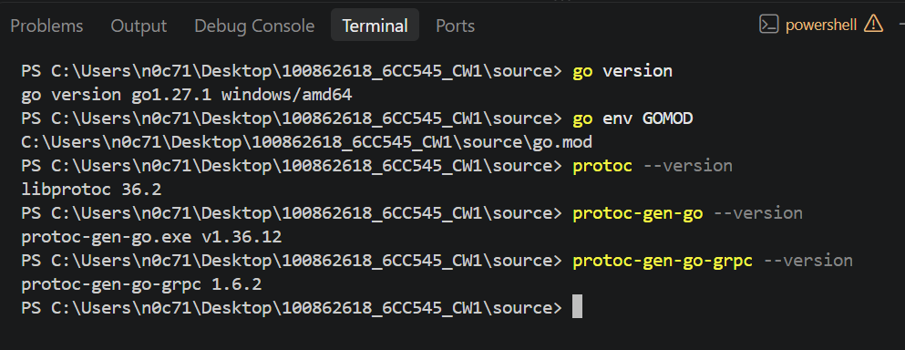
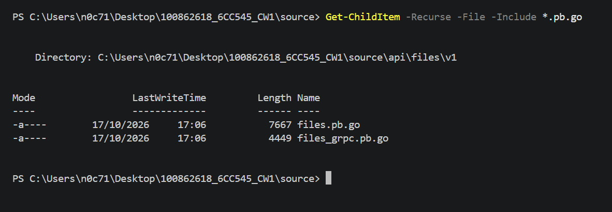
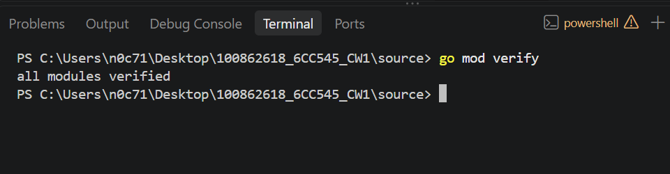
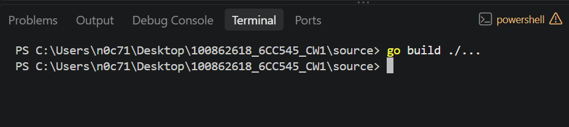
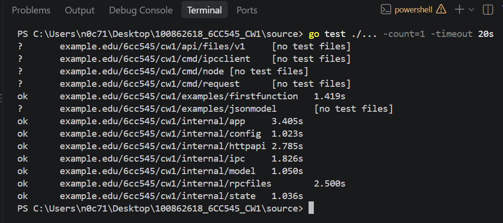
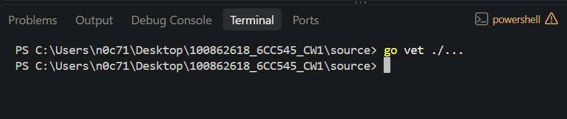
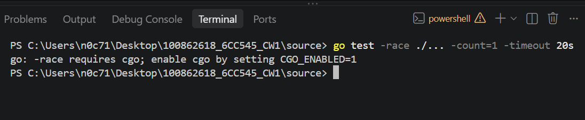

# CW1-AT1: Clean Build and Full Test Transcript

## 1. Purpose

This evidence records the Go environment, Protocol Buffers tools, module verification, build, test suite and vet checks for the CW1 project.

## 2. Environment and Generated Files

The project uses Go 1.27.1 on Windows/amd64. The Protocol Buffers compiler and Go generators were checked, along with the module files, source `.proto` file and generated Go bindings.

## 3. Module Verification

Command:

`go mod verify`

Result: All modules verified successfully.

## 4. Build

Command:

`go build ./...`

Result: The command completed without errors.

## 5. Full Test Suite

Command:

`go test ./... -count=1 -timeout 20s`

Result: All packages containing tests passed. Packages without tests were reported as `[no test files]`.

## 6. Static Analysis

Command:

`go vet ./...`

Result: The command completed without reporting errors.

## 7. Race Test

Command:

`go test -race ./... -count=1 -timeout 20s`

Result: The race test could not run because CGO was disabled in the environment. Go reported that the race detector requires CGO to be enabled. Therefore, the race test result remains unverified.

## 8. Acceptance Result

The module verification, build, full test suite and vet checks completed successfully. The race test was blocked by the CGO environment requirement and is recorded as unverified, not as a passing test.

The full terminal output should be retained in `docs/test-results.txt` for reference.