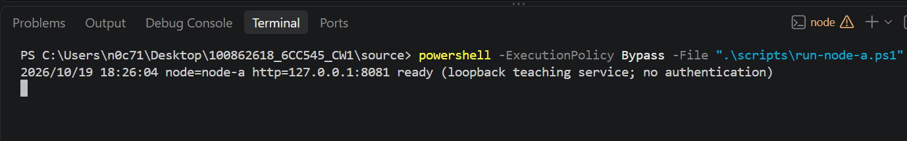
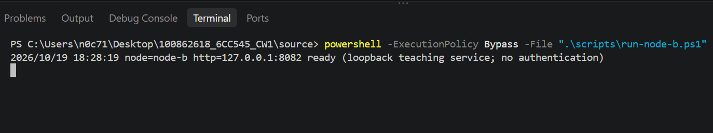
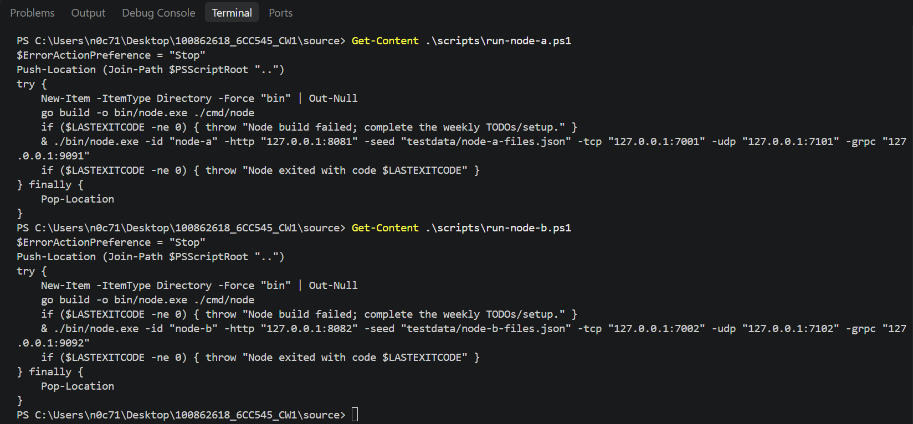
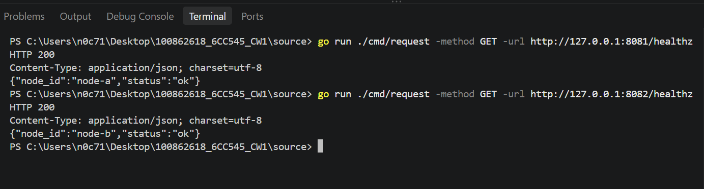
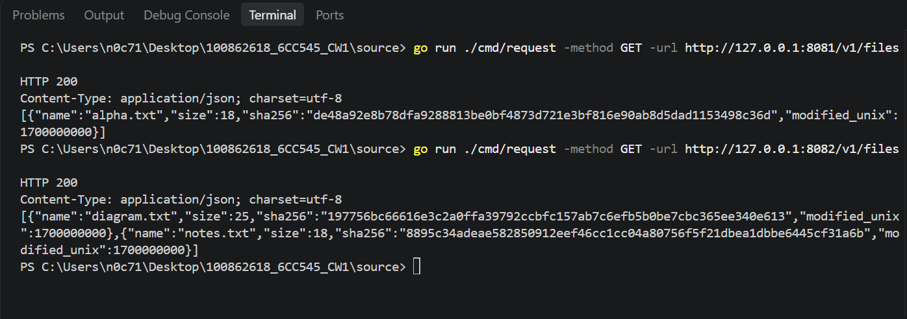

# CW1-AT6: Two-Node Configuration and Startup

## 1. Purpose

This evidence shows that the Week 5 run scripts start two separate node processes using the same application code but different identities, network endpoints and seeded file catalogues.

## 2. Starting Node A and Node B

Node A was started in a separate PowerShell terminal using `scripts/run-node-a.ps1`. It reported that it was ready on `127.0.0.1:8081`.

Node B was started in another PowerShell terminal using `scripts/run-node-b.ps1`. It reported that it was ready on `127.0.0.1:8082`.

## 3. Endpoint Configuration

The run scripts configure the nodes with the following addresses.

| Interface | Node A | Node B |
|---|---|---|
| HTTP | `127.0.0.1:8081` | `127.0.0.1:8082` |
| TCP | `127.0.0.1:7001` | `127.0.0.1:7002` |
| UDP | `127.0.0.1:7101` | `127.0.0.1:7102` |
| gRPC | `127.0.0.1:9091` | `127.0.0.1:9092` |

The scripts also use different node IDs and seed files.

## 4. Health Checks and Node Identities

The `/healthz` endpoint was queried on both nodes using the Go request client.

Node A returned HTTP 200 with `node_id` set to `node-a` and status `ok`.

Node B returned HTTP 200 with `node_id` set to `node-b` and status `ok`.

## 5. Separate File Catalogues

The `/v1/files` endpoint was queried on both nodes.

Node A returned `alpha.txt`.

Node B returned `diagram.txt` and `notes.txt`.

The different results confirm that the nodes have separate seeded file catalogues.

## 6. Result

The Step B checks confirmed that both nodes started successfully, reported different identities, used the expected HTTP, TCP, UDP and gRPC endpoints, and returned different file catalogues.

The nodes share the application code, but each runs as a separate process with its own configuration and in-memory state.