# CW1 Final Integration Rehearsal

## Step C: Status Updates and Peer Registration

### 1. Purpose

This step verifies status updates, rejection of invalid and malformed status requests, preservation of the existing status after rejected requests, bidirectional peer registration, peer registry contents, and duplicate-peer rejection.

### 2. Status Update

**Command:**

```powershell
go run ./cmd/request -method POST -url http://127.0.0.1:8081/v1/status -file testdata/status-degraded.json
```

**Output:**

```text
HTTP 200
Content-Type: application/json; charset=utf-8
{"status":"degraded"}
```

**Result:** PASS. Node A accepted the degraded status update.

### 3. Retrieve Updated Status

**Command:**

```powershell
go run ./cmd/request -method GET -url http://127.0.0.1:8081/v1/status
```

**Output:**

```text
HTTP 200
Content-Type: application/json; charset=utf-8
{"status":"degraded"}
```

**Result:** PASS. Node A returned the updated status.

### 4. Reject Invalid Status

**Fixture:** `testdata/status-invalid.json`

```json
{
  "status": "broken"
}
```

**Command:**

```powershell
go run ./cmd/request -method POST -url http://127.0.0.1:8081/v1/status -file testdata/status-invalid.json -expect 400
```

**Output:**

```text
HTTP 400
Content-Type: application/json; charset=utf-8
{"error":"invalid_status"}
```

**Result:** PASS. The unsupported status value was rejected with HTTP 400.

### 5. Verify Status After Invalid Request

**Command:**

```powershell
go run ./cmd/request -method GET -url http://127.0.0.1:8081/v1/status
```

**Output:**

```text
HTTP 200
Content-Type: application/json; charset=utf-8
{"status":"degraded"}
```

**Result:** PASS. The invalid request did not overwrite the stored status.

### 6. Reject Malformed JSON

**Fixture:** `testdata/status-malformed.json`

**Command:**

```powershell
go run ./cmd/request -method POST -url http://127.0.0.1:8081/v1/status -file testdata/status-malformed.json -expect 400
```

**Output:**

```text
HTTP 400
Content-Type: application/json; charset=utf-8
{"error":"invalid_json"}
```

**Result:** PASS. The malformed JSON request was rejected with HTTP 400.

### 7. Verify Status After Malformed Request

**Command:**

```powershell
go run ./cmd/request -method GET -url http://127.0.0.1:8081/v1/status
```

**Output:**

```text
HTTP 200
Content-Type: application/json; charset=utf-8
{"status":"degraded"}
```

**Result:** PASS. The stored status remained degraded after the malformed request.

### 8. Register Node B with Node A

**Fixture:** `testdata/peer-b.json`

**Command:**

```powershell
go run ./cmd/request -method POST -url http://127.0.0.1:8081/v1/peers -file testdata/peer-b.json -expect 201
```

**Output:**

```text
HTTP 201
Content-Type: application/json; charset=utf-8
{"id":"node-b","http_address":"127.0.0.1:8082","grpc_address":"127.0.0.1:9092","status":"unknown"}
```

**Result:** PASS. Node A registered Node B successfully.

### 9. Register Node A with Node B

**Fixture:** `testdata/peer-a.json`

**Command:**

```powershell
go run ./cmd/request -method POST -url http://127.0.0.1:8082/v1/peers -file testdata/peer-a.json -expect 201
```

**Output:**

```text
HTTP 201
Content-Type: application/json; charset=utf-8
{"id":"node-a","http_address":"127.0.0.1:8081","grpc_address":"127.0.0.1:9091","status":"unknown"}
```

**Result:** PASS. Node B registered Node A successfully.

### 10. Query Node A's Peer Registry

**Command:**

```powershell
go run ./cmd/request -method GET -url http://127.0.0.1:8081/v1/peers
```

**Output:**

```text
HTTP 200
Content-Type: application/json; charset=utf-8
[{"id":"node-b","http_address":"127.0.0.1:8082","grpc_address":"127.0.0.1:9092","status":"unknown"}]
```

**Result:** PASS. Node A's registry contained Node B.

### 11. Query Node B's Peer Registry

**Command:**

```powershell
go run ./cmd/request -method GET -url http://127.0.0.1:8082/v1/peers
```

**Output:**

```text
HTTP 200
Content-Type: application/json; charset=utf-8
[{"id":"node-a","http_address":"127.0.0.1:8081","grpc_address":"127.0.0.1:9091","status":"unknown"}]
```

**Result:** PASS. Node B's registry contained Node A.

### 12. Reject Duplicate Peer Registration

**Command:**

```powershell
go run ./cmd/request -method POST -url http://127.0.0.1:8081/v1/peers -file testdata/peer-b.json -expect 409
```

**Output:**

```text
HTTP 409
Content-Type: application/json; charset=utf-8
{"error":"duplicate_peer"}
```

**Result:** PASS. Node A rejected the duplicate registration with HTTP 409 and the `duplicate_peer` error.

### 13. Evidence Screenshots

The screenshots below are stored in the `screenshots` subfolder beside this Markdown file.

#### 13.1 Status Update and Invalid Status Rejection

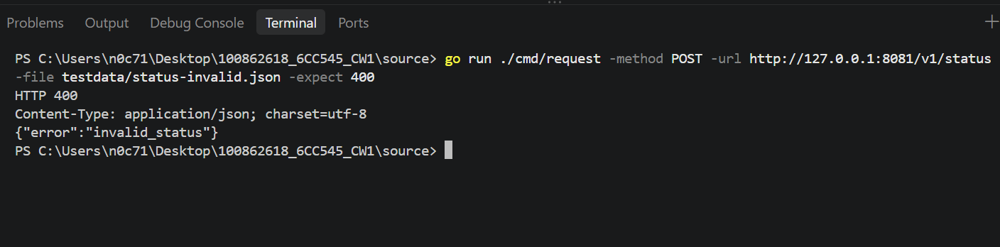

#### 13.2 Status Update Result

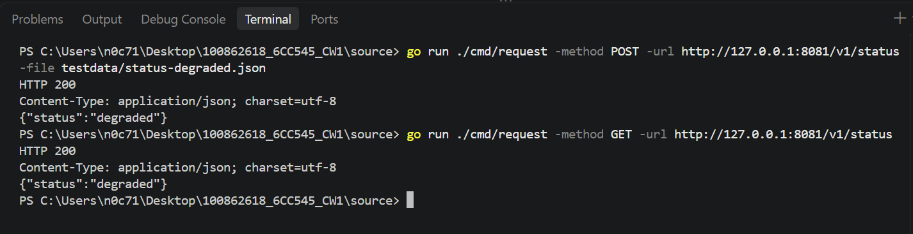

#### 13.3 Status Unchanged After Invalid Request

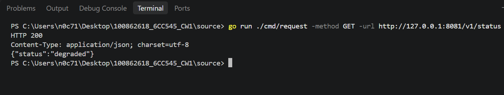

#### 13.4 Malformed JSON Rejection

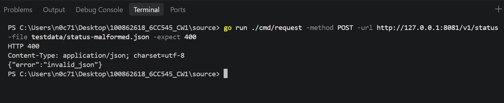

#### 13.5 Status Unchanged After Malformed Request

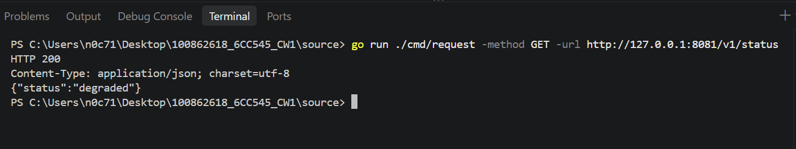

#### 13.6 Node A Peer Fixture

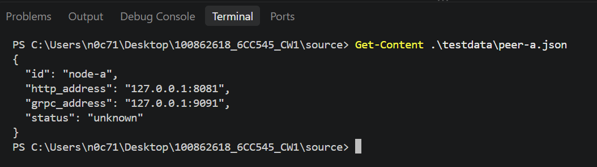

#### 13.7 Register Node B with Node A

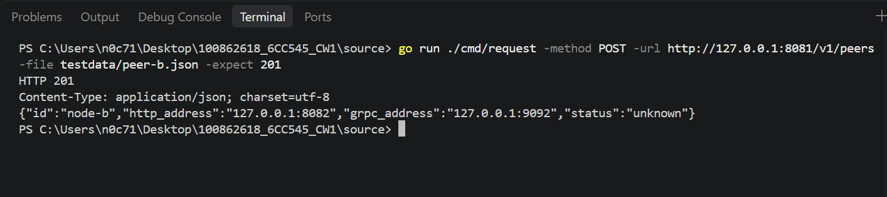

#### 13.8 Register Node A with Node B

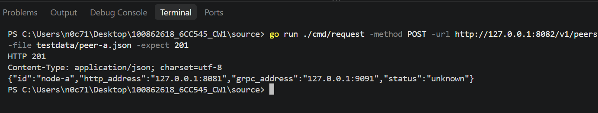

#### 13.9 Node A Peer Registry

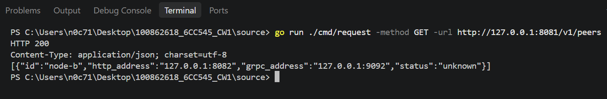

#### 13.10 Node B Peer Registry

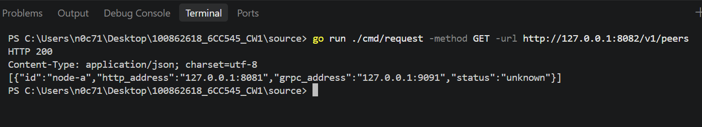

#### 13.11 Duplicate Peer Rejection

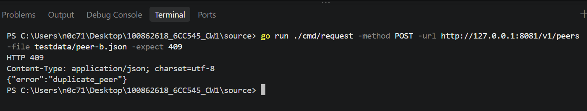

### 14. Overall Result

The recorded checks passed. Node A accepted the degraded status, rejected invalid and malformed requests, and retained the existing status after both rejected requests. Both nodes registered each other successfully, their peer registries returned the expected entries, and duplicate registration was rejected.

### 15. Limitations

This step verifies status handling and peer registry behaviour using two running local processes. TCP/UDP messaging and remote file retrieval are covered by later integration steps.


