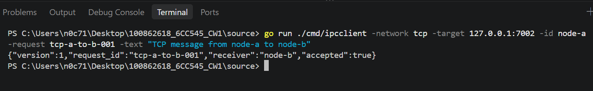
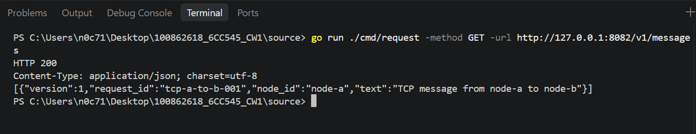
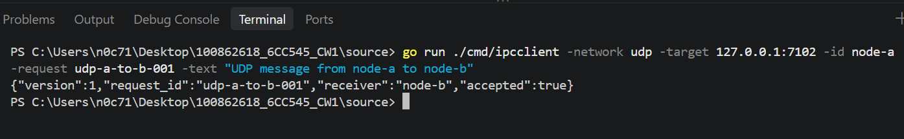
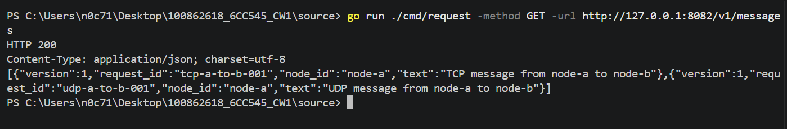
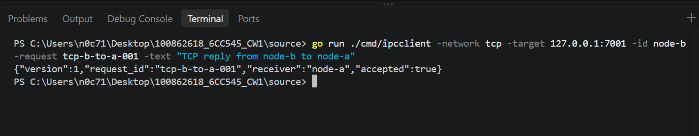
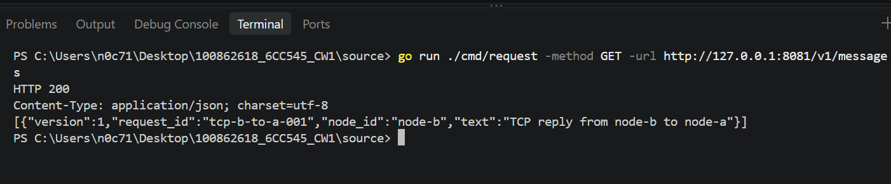
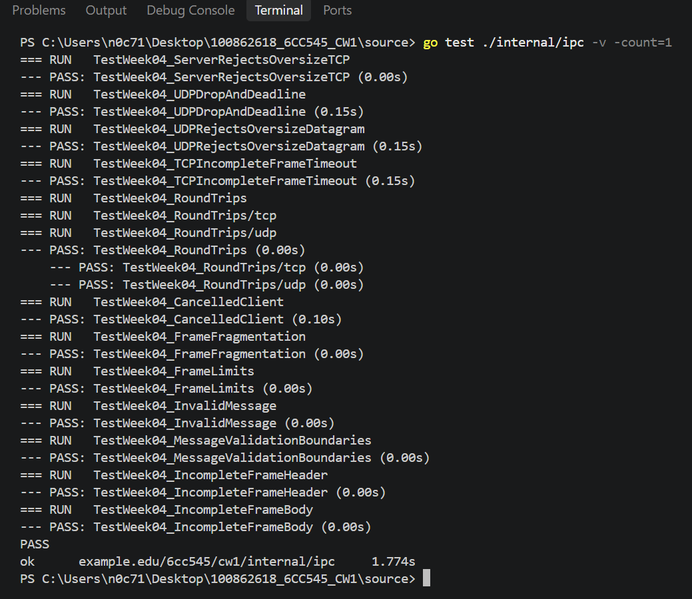
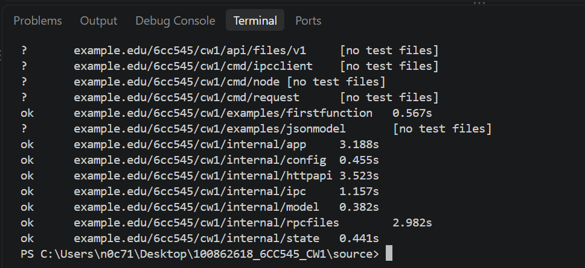

# Step D: Exercise Both IPC Transports

## 1. Purpose

This step verifies TCP and UDP messaging between Node A and Node B, confirms that messages are acknowledged and recorded in the receiving node's inbox, tests messaging in the reverse direction, and verifies malformed-message, oversized-message, timeout and cancellation handling.

## 2. TCP Message from Node A to Node B

**Command**

```powershell
go run ./cmd/ipcclient -network tcp -target 127.0.0.1:7002 -id node-a -request tcp-a-to-b-001 -text "TCP message from node-a to node-b"
```

**Observed result**

```json
{"version":1,"request_id":"tcp-a-to-b-001","receiver":"node-b","accepted":true}
```

The acknowledgement confirms that Node B accepted the TCP message using the matching request ID.



## 3. Verify Node B's TCP Inbox

**Command**

```powershell
go run ./cmd/request -method GET -url http://127.0.0.1:8082/v1/messages
```

**Observed result**

```json
[{"version":1,"request_id":"tcp-a-to-b-001","node_id":"node-a","text":"TCP message from node-a to node-b"}]
```

The inbox contains the TCP message with the expected request ID, sender and text.



## 4. UDP Message from Node A to Node B

**Command**

```powershell
go run ./cmd/ipcclient -network udp -target 127.0.0.1:7102 -id node-a -request udp-a-to-b-001 -text "UDP message from node-a to node-b"
```

**Observed result**

```json
{"version":1,"request_id":"udp-a-to-b-001","receiver":"node-b","accepted":true}
```

The acknowledgement confirms that Node B accepted the UDP message.



## 5. Verify Both Messages in Node B's Inbox

**Command**

```powershell
go run ./cmd/request -method GET -url http://127.0.0.1:8082/v1/messages
```

**Observed result**

```json
[{"version":1,"request_id":"tcp-a-to-b-001","node_id":"node-a","text":"TCP message from node-a to node-b"},{"version":1,"request_id":"udp-a-to-b-001","node_id":"node-a","text":"UDP message from node-a to node-b"}]
```

Both messages appear in Node B's inbox with different request IDs, confirming the TCP and UDP paths were exercised separately.



## 6. Message from Node B to Node A

**Command**

```powershell
go run ./cmd/ipcclient -network tcp -target 127.0.0.1:7001 -id node-b -request tcp-b-to-a-001 -text "TCP reply from node-b to node-a"
```

**Observed result**

```json
{"version":1,"request_id":"tcp-b-to-a-001","receiver":"node-a","accepted":true}
```

Node A acknowledged the reverse-direction TCP message.



## 7. Verify Node A's Inbox

**Command**

```powershell
go run ./cmd/request -method GET -url http://127.0.0.1:8081/v1/messages
```

**Observed result**

```json
[{"version":1,"request_id":"tcp-b-to-a-001","node_id":"node-b","text":"TCP reply from node-b to node-a"}]
```

Node A's inbox confirms receipt of the message sent by Node B.



## 8. Malformed, Oversized and Cancellation Tests

**Command**

```powershell
go test ./internal/ipc -v -count=1
```

**Observed result**

All tests in `internal/ipc` passed, including:

- `TestWeek04_InvalidMessage`
- `TestWeek04_ServerRejectsOversizeTCP`
- `TestWeek04_UDPRejectsOversizeDatagram`
- `TestWeek04_UDPDropAndDeadline`
- `TestWeek04_TCPIncompleteFrameTimeout`
- `TestWeek04_CancelledClient`

Additional passing tests covered TCP and UDP round trips, frame fragmentation, frame limits, message validation boundaries and incomplete TCP frame handling.



## 9. Full Project Test Suite

**Command**

```powershell
go test ./... -count=1 -timeout 20s
```

**Observed result**

All packages containing tests returned `ok`. Packages without test files were reported as `[no test files]`. The full test command completed without reported failures.



## 10. TCP Length Prefix and UDP Datagram

TCP provides a byte stream rather than preserving application message boundaries. The implementation uses a four-byte big-endian length prefix to indicate the number of bytes in the following message. The receiver reads the frame according to that length and can reject an oversized frame before delivering it for processing. TCP reads may return partial data, so the receiver must handle incomplete headers, incomplete bodies and timeouts.

UDP preserves message boundaries as datagrams. Each datagram is received as a separate unit, so the receiver validates the datagram size directly rather than relying on TCP-style stream framing. UDP does not guarantee delivery or ordering, so the sender cannot assume that every transmitted datagram will arrive.

## 11. Results and Limitations

The TCP and UDP happy-path tests produced acknowledgements with matching request IDs. Node B's inbox contained both messages from Node A, and Node A's inbox contained the return TCP message from Node B. The IPC failure tests and the full project test suite passed.

The malformed, oversized, incomplete-frame and cancellation results were verified through automated tests using local listeners. These tests confirm the covered behaviours but do not establish delivery guarantees for UDP under real network loss.