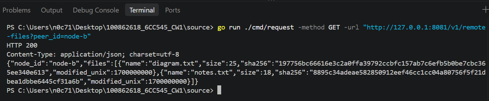
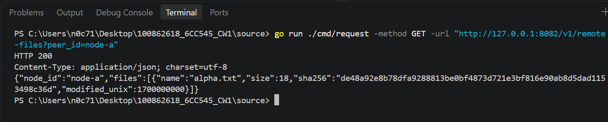
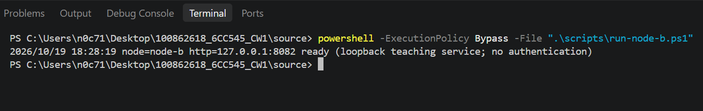
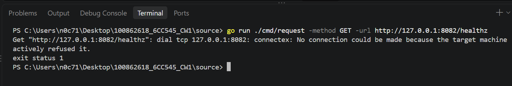
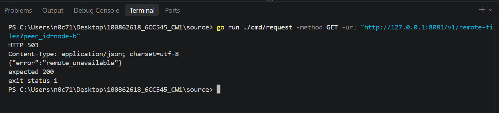
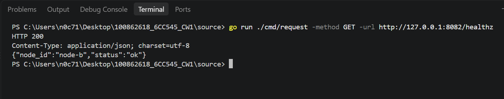
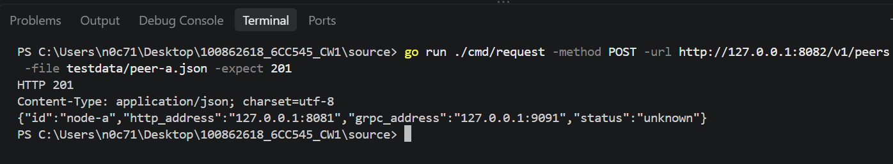
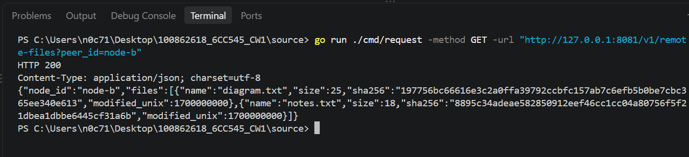
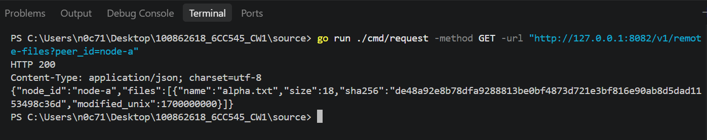

# Step E: Obtain Genuinely Remote Metadata

## 1. Purpose

This step verifies that nodes retrieve file metadata from a remote peer through gRPC rather than returning their own local catalogue. It also tests remote failure handling, local endpoint availability during peer failure, and recovery after restarting a node.

## 2. Verify Node B's Availability

Node B's health endpoint returned HTTP 200 with status `ok` before the remote metadata tests. Node A's peer registry contained Node B with HTTP address `127.0.0.1:8082` and gRPC address `127.0.0.1:9092`. Node B's peer registry initially contained Node A.

## 3. Compare Node B's Local Catalogue with Remote Metadata

Node B's local `/v1/files` endpoint returned two files:

- `diagram.txt`, size 25 bytes, SHA-256 `197756bc66616e3c2a0ffa39792ccbfc157ab7c6efb5b0be7cbc365ee340e613`
- `notes.txt`, size 18 bytes, SHA-256 `8895c34adeae582850912eef46cc1cc04a80756f5f21dbea1dbbe6445cf31a6b`

The following request was made through Node A:

```powershell
go run ./cmd/request -method GET -url "http://127.0.0.1:8081/v1/remote-files?peer_id=node-b"
```

The request returned HTTP 200 with `node_id` set to `node-b` and both files matching Node B's local catalogue.



## 4. Verify Remote Retrieval in the Reverse Direction

The following request was made through Node B:

```powershell
go run ./cmd/request -method GET -url "http://127.0.0.1:8082/v1/remote-files?peer_id=node-a"
```

The request returned HTTP 200 with `node_id` set to `node-a` and the metadata for `alpha.txt`, matching Node A's local catalogue.



## 5. Stop Node B and Test Remote Failure Handling

Node B was stopped using Ctrl+C. A subsequent request to Node B's health endpoint failed because the connection to `127.0.0.1:8082` was refused.





The remote metadata request through Node A was repeated:

```powershell
go run ./cmd/request -method GET -url "http://127.0.0.1:8081/v1/remote-files?peer_id=node-b"
```

The service returned HTTP 503 with `{"error":"remote_unavailable"}`. The request tool also reported `expected 200` because it defaults to expecting a successful response. The service's HTTP 503 response was the expected failure behaviour for an unavailable remote peer.



## 6. Verify Node A's Local Endpoints During Remote Failure

While Node B was unavailable, Node A's local endpoints continued to respond:

- `GET /healthz` returned HTTP 200 with node ID `node-a` and status `ok`.
- `GET /v1/files` returned HTTP 200 with Node A's local `alpha.txt` metadata.
- `GET /v1/status` returned HTTP 200 with status `degraded`.

These results show that Node A's local health, file catalogue and status endpoints remained available despite the remote peer failure.

## 7. Restart Node B and Restore the Peer Registry

Node B was restarted successfully and its health endpoint returned HTTP 200 with status `ok`.



Node A's peer registry still contained Node B. However, Node B's peer registry was empty after the restart, so Node A was registered again using:

```powershell
go run ./cmd/request -method POST -url http://127.0.0.1:8082/v1/peers -file testdata/peer-a.json -expect 201
```

The registration returned HTTP 201 and Node A's HTTP and gRPC addresses.



## 8. Verify Recovery

After restarting Node B, the remote metadata request from Node A to Node B returned HTTP 200, identifying `node-b` and returning `diagram.txt` and `notes.txt` with their expected sizes and SHA-256 values.



After restoring Node A's registration on Node B, the reverse remote metadata request also returned HTTP 200, identifying `node-a` and returning the expected `alpha.txt` metadata.



## 9. Results and Limitations

The remote metadata checks succeeded in both directions. The returned identities and file metadata matched the respective peers' local catalogues. When Node B was unavailable, Node A returned HTTP 503 with `remote_unavailable`, while its local health, file and status endpoints continued responding. Remote retrieval worked again after Node B restarted and the lost peer registration was restored.

The `node_id` field is an unauthenticated identity claim in this teaching prototype. Successful retrieval does not establish peer trust or provide confidentiality.

