# Step F: Stop, Restart and Curate Evidence

## 1. Purpose

This step verifies that the nodes can be stopped and restarted, that their HTTP health endpoints become unavailable after shutdown, and that startup fails when a required listener is already occupied. It also records the application lifecycle and TCP/UDP tests performed during the final integration rehearsal.

## 2. Stop Node B and Verify Unavailability

Node B was stopped using Ctrl+C. A subsequent request to its health endpoint failed because the connection to `127.0.0.1:8082` was refused.

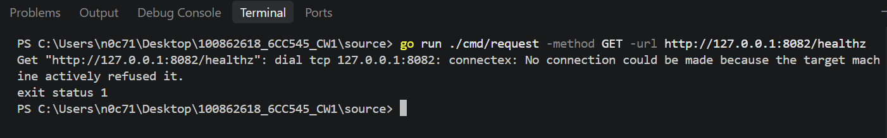

## 3. Verify Node A Remains Available

While Node B was unavailable, Node A's health endpoint returned HTTP 200 with node ID `node-a` and status `ok`. This confirmed that Node A remained available while Node B was stopped.

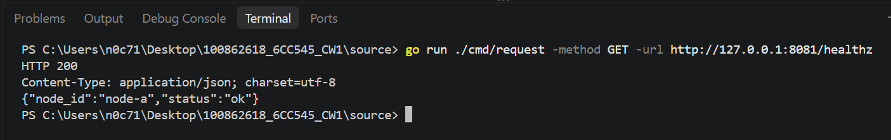

Node A was then stopped. A subsequent health request to `127.0.0.1:8081` failed because the connection was refused.

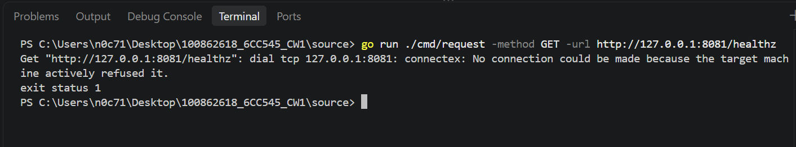

## 4. Test Startup Failure on an Occupied Port

Node A was started using the existing `scripts\run-node-a.ps1` script. Running the script again while the first instance was active caused startup to fail because the TCP listener at `127.0.0.1:7001` was already in use.

The node reported a socket binding error and exited with code 1. This demonstrated the expected startup failure when a required listener is occupied.

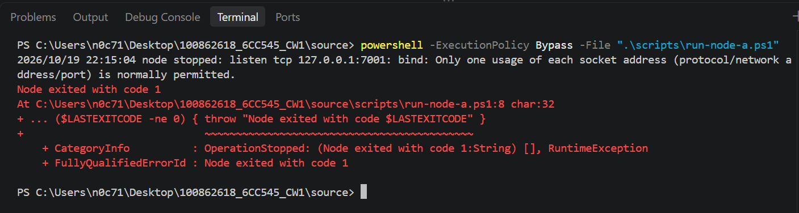

## 5. Restart Node A and Verify Recovery

After the original Node A process was stopped, the startup script ran successfully again. Node A reported that it was ready on `127.0.0.1:8081`.

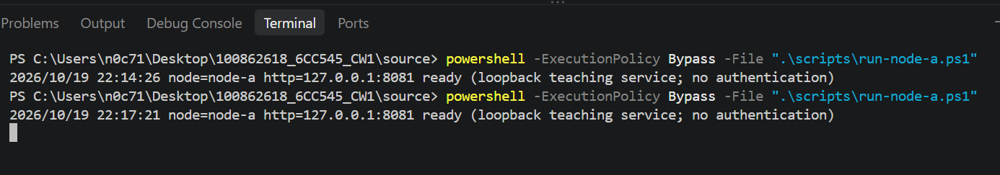

The health request returned HTTP 200 with node ID `node-a` and status `ok`.

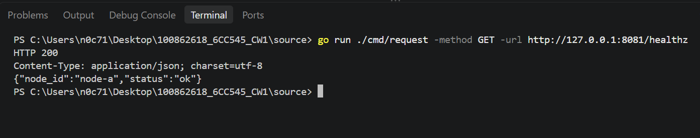

## 6. Restart Node B and Verify Recovery

Node B was restarted using `scripts\run-node-b.ps1`. The node reported that it was ready on `127.0.0.1:8082`.

Its health endpoint returned HTTP 200 with node ID `node-b` and status `ok`.

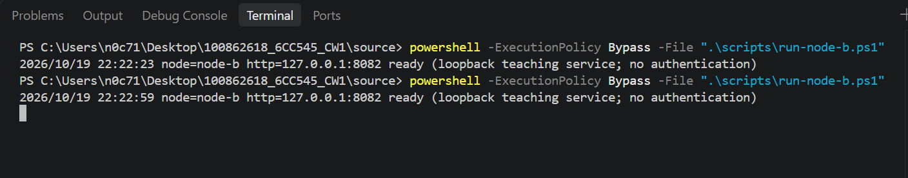

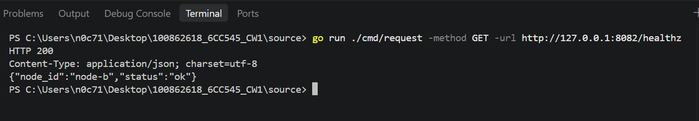

These checks confirmed that both nodes could be restarted and their HTTP health endpoints responded successfully afterward.

## 7. Verify Application Lifecycle Tests

The application occupied-port test was run using:

```powershell
go test ./internal/app -run '^TestWeek01_OccupiedPort$' -v -count=1
```

The test passed, verifying the application's behaviour when its configured HTTP listener could not be opened.

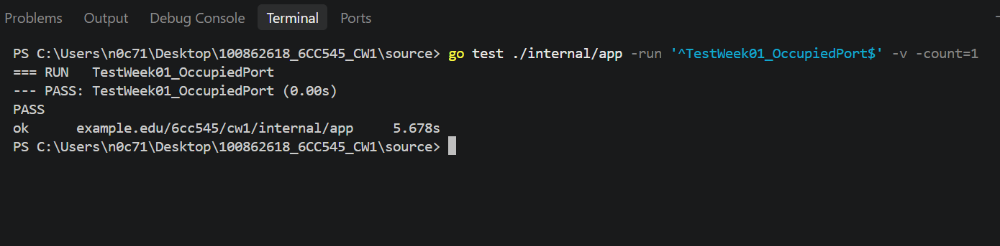

The cancelled-lifecycle test was run using:

```powershell
go test ./internal/app -run '^TestWeek01_CancelledLifecycle$' -v -count=1
```

The test passed, verifying the tested application lifecycle when the context was cancelled.

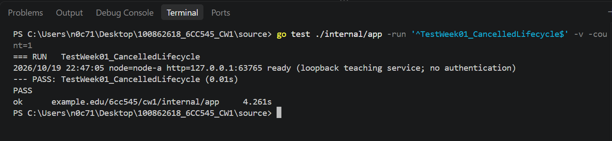

## 8. Verify TCP and UDP Communication and Shutdown

The TCP and UDP round-trip test was run using:

```powershell
go test ./internal/ipc -run '^TestWeek04_RoundTrips$' -v -count=1
```

Both the TCP and UDP subtests passed. The test exercised message and acknowledgement exchanges and checked that the test servers stopped following context cancellation.

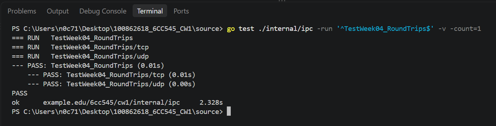

## 9. Results and Limitations

Both nodes were stopped and restarted successfully. Their health endpoints returned HTTP 200 after restart, and Node A remained healthy while Node B was unavailable. Starting a second Node A instance while the first instance was active produced the expected occupied-listener error on TCP port `7001`.

The application occupied-port and cancelled-lifecycle tests passed. The TCP and UDP round-trip tests also passed, including their shutdown checks.

The manual restart checks verified HTTP health after restart. The occupied-port test demonstrated a conflict on Node A's TCP listener at `127.0.0.1:7001`; the evidence does not establish that every listener was individually tested for rebinding after shutdown.
