# Weekly evidence record

Student number: 100862618 
Week: 3  
Repository URL: 
Immutable tag:  
Commit hash:  
Go version / OS: Go 1.27.1 / Windows

## Commands actually executed

The following commands were used to verify the model validation, registry, catalogue and HTTP API:

```text
go test ./internal/model -v -count=1
go test ./internal/state -run "^TestWeek03_InvalidPeer$" -v -count=1
go test ./internal/state -run "^TestWeek03_Registry$" -v -count=1
go test ./internal/state -run "^TestWeek03_ConcurrentRegistry$" -v -count=1
go test ./internal/state -run "^TestWeek03_Catalog$" -v -count=1
go test ./internal/state -v -count=1
go test ./internal/httpapi -run "^TestWeek03_PeerAPI$" -v -count=1
go test ./internal/httpapi -v -count=1
```

The nodes were started and tested using the following commands:

```text
powershell -ExecutionPolicy Bypass -File .\scripts\run-node-a.ps1
powershell -ExecutionPolicy Bypass -File .\scripts\run-node-b.ps1
go run ./cmd/request -url http://127.0.0.1:8081/v1/peers -method POST -file testdata/peer-b.json -expect 201
go run ./cmd/request -url http://127.0.0.1:8081/v1/peers -method POST -file testdata/peer-b.json -expect 409
go run ./cmd/request -url http://127.0.0.1:8081/v1/files -method GET -expect 200
go run ./cmd/request -url http://127.0.0.1:8082/v1/files -method GET -expect 200
```

The concurrency tests and final verification were run with:

```text
go test ./internal/state -run "^TestWeek03_ConcurrentDuplicatePeer$" -v -count=1
go test ./internal/state -run "^TestWeek03_" -v -count=1
go test ./... -count=1
go test -race ./... -count=1 -timeout 30s
```

## Observed results (do not paste expected examples as results)

The model validation tests passed. The screenshots below show the invalid peer validation and metadata validation test results.

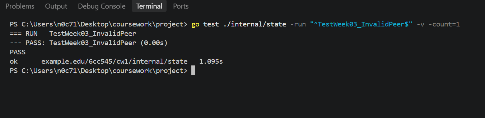

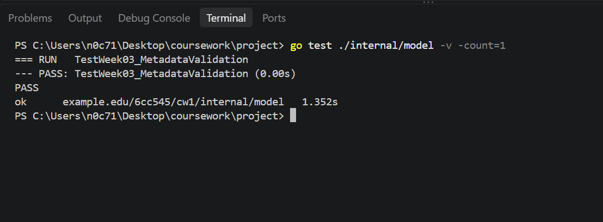

The registry tests passed, including concurrent access. The registry prevents duplicate peer IDs and returns independent, sorted snapshots.

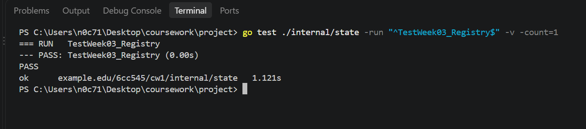

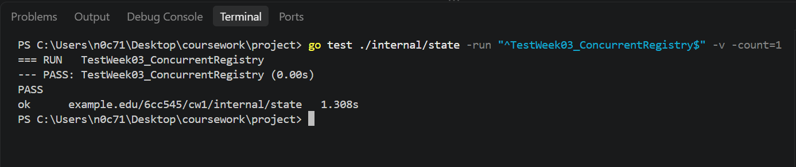

The catalogue tests passed. Candidate records are validated before replacement, and snapshots do not expose the internal collection.

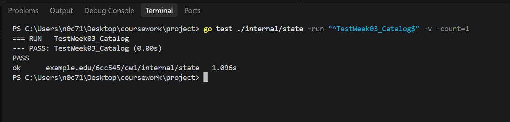

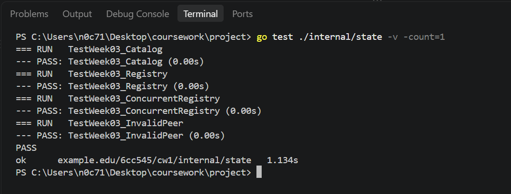

The HTTP API tests passed for peer registration and related request handling.

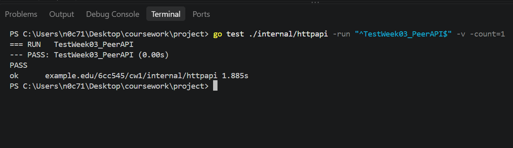

The peer registration example is stored in `testdata/peer-b.json`. This JSON file provides the peer information used by the request client when registering Node B with Node A. The screenshot below shows the contents of the JSON file used for the registration request.

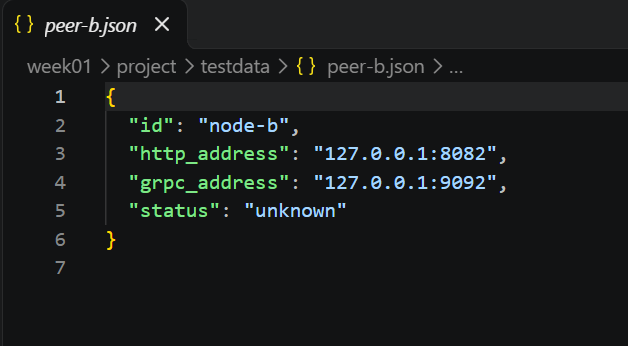

Node A started at `127.0.0.1:8081` and Node B at `127.0.0.1:8082`. Registering Node B with Node A returned HTTP `201 Created`. Repeating the same request returned HTTP `409 Conflict` with the `duplicate_peer` error. This demonstrated that the registry accepted the initial registration and rejected a second registration using the same peer ID.

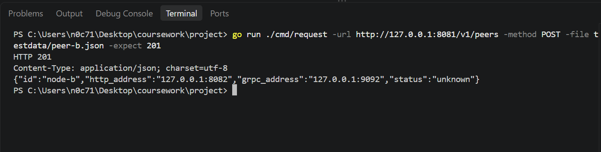

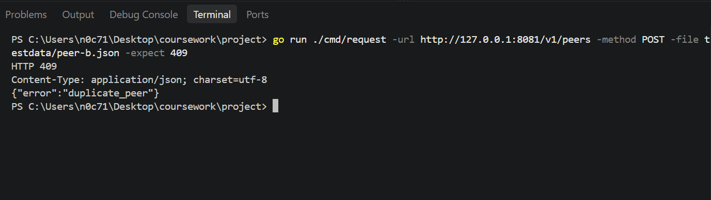

Both nodes returned HTTP `200 OK` for their file catalogue requests. Node A returned `alpha.txt`, while Node B returned `diagram.txt` and `notes.txt`. This confirmed that the nodes maintained separate in-memory catalogues rather than sharing one catalogue automatically.

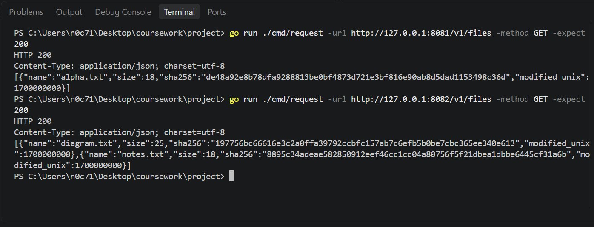

The concurrent duplicate-peer test passed. Twenty goroutines attempted to register the same peer ID. One registration succeeded, the remaining attempts were rejected as duplicates, and the registry contained one peer. This provided evidence that the duplicate check and insertion were protected against concurrent registration attempts.

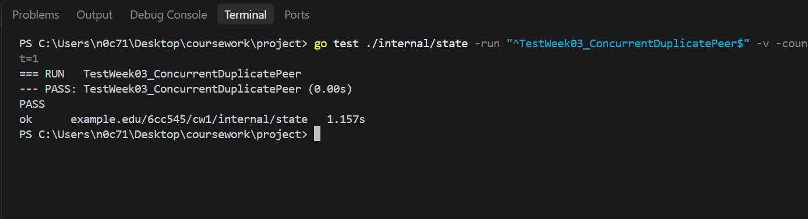

The Week 3 concurrency tests and the final full test suite passed.

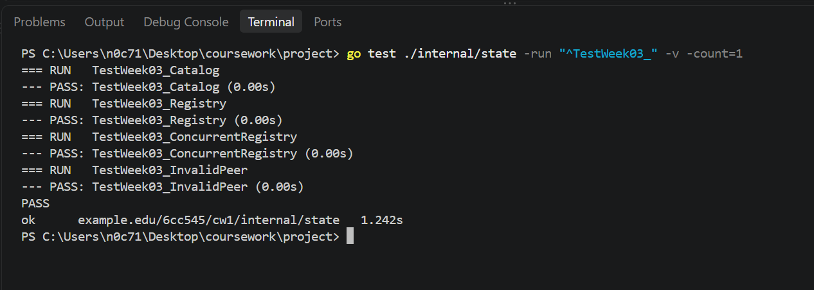

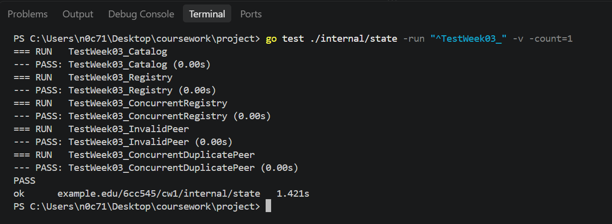

The final full test suite completed successfully with `go test ./... -count=1`. The tested application, configuration, HTTP API, model and state packages passed. Packages without test files were reported accordingly.

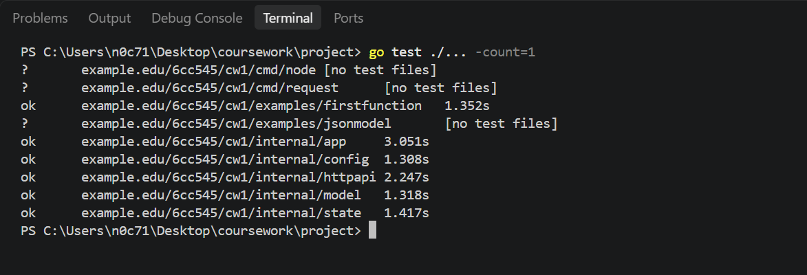

## Failure case and diagnosis

The race-detector command could not run because CGO was disabled and GCC was unavailable. Go returned the following error:

```text
go: -race requires cgo; enable cgo by setting CGO_ENABLED=1
```

`go env CGO_ENABLED` returned `0`, and `gcc --version` failed because GCC was not available as a command. The race-detector result therefore remains unverified.

The ordinary test suite passed, but that result does not prove that the implementation is race-free. The race detector can report certain data races when the relevant code paths execute during a test run, but it cannot prove the absence of every possible race. Since the detector could not run in this environment, no conclusion about a successful race-detector result can be drawn from this attempt.

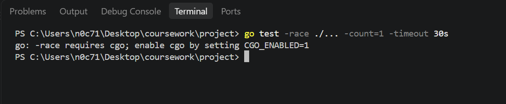

## Design decision and alternative

I used mutexes to protect the registry and catalogue because multiple goroutines may access their data. The registry checks for duplicate peer IDs and inserts peers while holding the write lock. This makes the duplicate check and insertion a single protected operation. Without that protection, two concurrent requests could both check that an ID was absent before either request inserted it.

The registry and catalogue return sorted snapshots instead of exposing their internal collections. Sorting a copy allows callers to receive predictable output without modifying the shared collection. It also helps maintain a clear ownership boundary between the internal state and the data returned to callers.

The catalogue validates candidate records before replacing its current data. This prevents an invalid replacement from partially updating the catalogue. Each node maintains its own catalogue, so registering a peer does not automatically copy its file metadata or prove that its files are accessible.

An alternative would be to expose the internal collections directly, but this would make data ownership less clear and increase the risk of accidental modification or concurrency problems. Another approach would be to add explicit communication between nodes to exchange file metadata or perform connectivity checks. That would be separate functionality rather than an automatic consequence of registering a peer.

The architecture diagram shows the main components and their state boundaries.

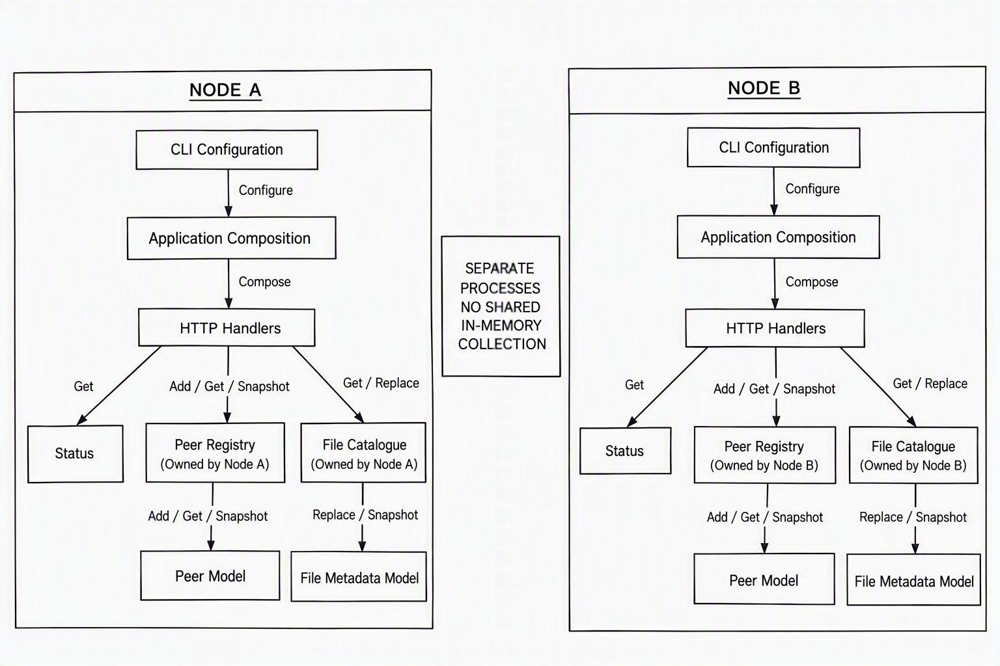

## Remaining limitations

The race detector could not be run in the current environment because CGO was disabled and GCC was unavailable. The ordinary test suite passed, but further race-detector testing in an environment with the required CGO toolchain is needed to check for data races along the exercised code paths.

The nodes are local teaching services without authentication. Their stored peer addresses and status values represent configured information; they do not, by themselves, establish that a peer is currently reachable. A connectivity measurement would require an actual communication attempt or health check.

The metadata checks do not prove that file contents have been transferred or that the contents match the recorded SHA-256 value. A valid-looking hash string only establishes that the string meets the applicable format checks. To verify file integrity, the received bytes must be hashed and the calculated value compared with the recorded hash.

The additional validation requirement for either a valid IPv6 loopback address or a malformed status value should be checked against the test code before claiming that every validation requirement is complete.

If the same model is later used through gRPC, the transport and message encoding will change. gRPC uses RPC methods and Protocol Buffers rather than the current HTTP/JSON request format. The application should still enforce the model’s validation rules and preserve its state ownership boundaries, with suitable conversion between gRPC messages and internal model types.

## Sources and AI-use disclosure

AI assistance was used to help interpret requirements, troubleshoot errors and explain design decisions.