# Weekly evidence record

Student number: 100862618  
Week: 4  
Repository URL:
Immutable tag:  
Commit hash:  
Go version / OS: Go 1.27.1 / Windows

## Commands actually executed

The following commands were used to test the IPC implementation, including TCP and UDP communication, message validation and socket failure handling.

```text
go test ./internal/ipc -v -count=1
go test ./internal/ipc -run "^TestWeek04_(ServerRejectsOversizeTCP|UDPDropAndDeadline|UDPRejectsOversizeDatagram|TCPIncompleteFrameTimeout)$" -v -count=1
```

The nodes were started using the supplied PowerShell scripts:

```text
powershell -ExecutionPolicy Bypass -File .\scripts\run-node-a.ps1
powershell -ExecutionPolicy Bypass -File .\scripts\run-node-b.ps1
```

For the two-node communication tests, I used the client to send messages from Node A to Node B over TCP and UDP, then checked Node B's inbox:

```text
go run ./cmd/ipcclient -network tcp -target 127.0.0.1:7002 -id node-a -request tcp-1
go run ./cmd/ipcclient -network udp -target 127.0.0.1:7102 -id node-a -request udp-1
go run ./cmd/request -url http://127.0.0.1:8082/v1/messages
```

I then tested communication in the reverse direction and checked Node A's inbox:

```text
go run ./cmd/ipcclient -network tcp -target 127.0.0.1:7001 -id node-b -request tcp-2
go run ./cmd/ipcclient -network udp -target 127.0.0.1:7101 -id node-b -request udp-2
go run ./cmd/request -url http://127.0.0.1:8081/v1/messages
```

For the live connection failure test, I stopped Node B and ran:

```text
go run ./cmd/ipcclient -network tcp -target 127.0.0.1:7002 -id node-a -request tcp-fail-1
```

After restarting both nodes, I checked TCP and UDP communication again:

```text
go run ./cmd/ipcclient -network tcp -target 127.0.0.1:7002 -id node-a -request tcp-restart-1
go run ./cmd/ipcclient -network udp -target 127.0.0.1:7102 -id node-a -request udp-restart-1
```

## Observed results (do not paste expected examples as results)

### Protocol documentation and sequence diagram

For Task 4.1, I documented the message format, acknowledgement fields, size limits, TCP framing, UDP datagram handling and failure behaviour in `docs/api-and-protocols.md`.

The sequence diagram below shows the message exchange between the client and the receiving node, from constructing and encoding a message to sending it over the network, decoding and validating it, and passing it to the inbox. It also shows the acknowledgement returning to the client and identifies where failures can occur.

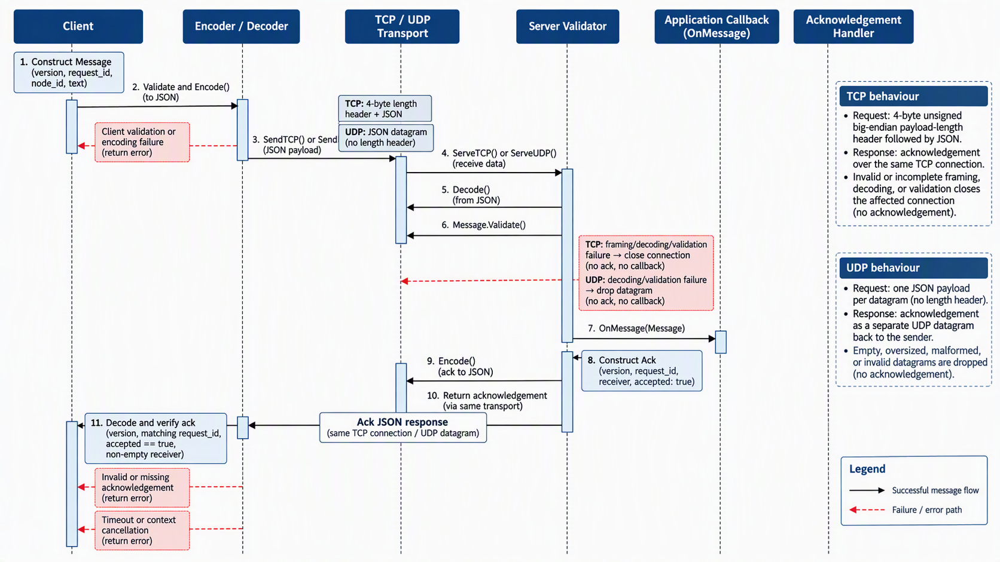

The diagram helped me follow the order of operations and understand where validation and failure handling take place. The tests described below provided evidence of successful communication and the handling of selected failure cases.

### IPC tests and validation

The IPC test suite passed. It covered TCP and UDP round trips, message validation, TCP frame limits, fragmented frames, incomplete frames, cancellation and socket failure handling.

The additional oversized UDP datagram test and TCP incomplete-frame timeout test also passed. These tests checked that invalid or incomplete input was handled without incorrectly triggering the inbox callback.

The screenshots below show the recorded test results.

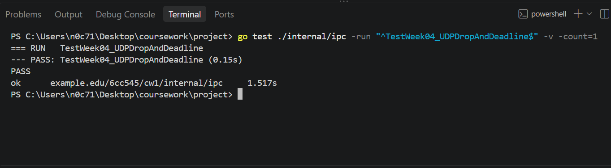

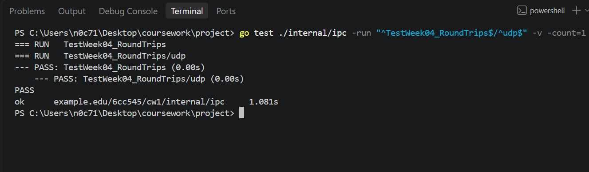

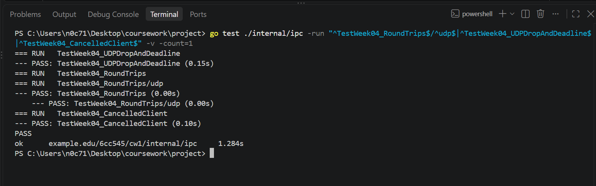

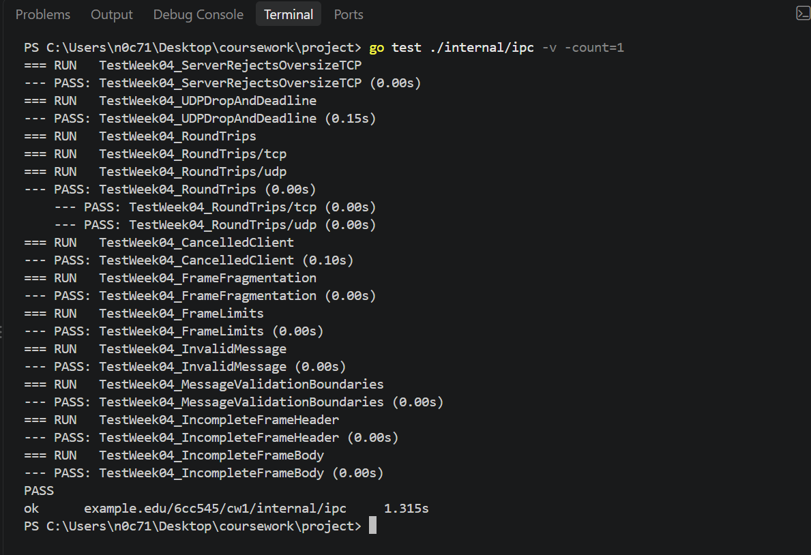

### Two-node communication

Node A used HTTP port `8081`, TCP port `7001` and UDP port `7101`. Node B used HTTP port `8082`, TCP port `7002` and UDP port `7102`.

When I sent messages from Node A to Node B, the TCP client received an acknowledgement with request ID `tcp-1`, receiver `node-b` and `accepted: true`. The UDP request also received a successful acknowledgement for `udp-1`.

Node B's inbox returned HTTP `200 OK` and contained the messages received from Node A. This helped confirm that the messages reached the receiving node's application, rather than relying only on the client acknowledgements.

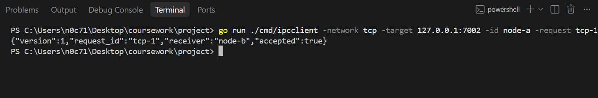

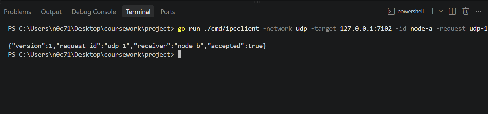

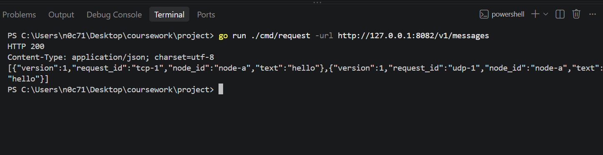

I then tested the reverse direction. Node B sent `tcp-2` over TCP and `udp-2` over UDP to Node A. Both requests received successful acknowledgements identifying `node-a` as the receiver. Node A's inbox also showed the received messages.

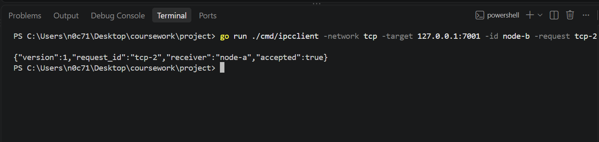

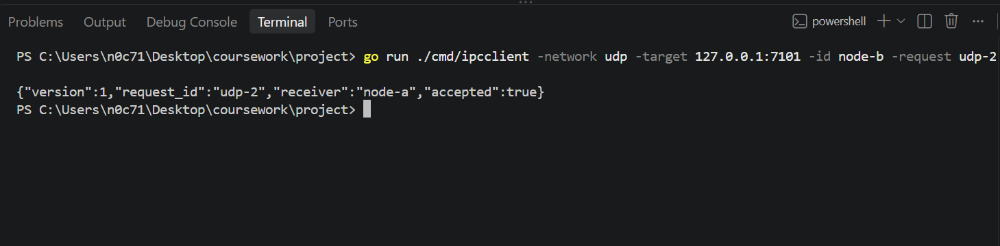

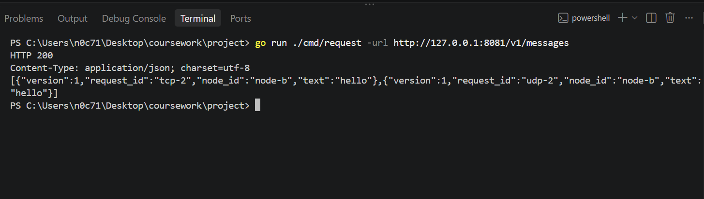

### Failure handling and restart verification

For the live failure test, I stopped Node B and tried to connect to its previous TCP endpoint. Windows returned a connection-refused error, and the client exited with an error instead of hanging indefinitely. This was the actual result in my environment.

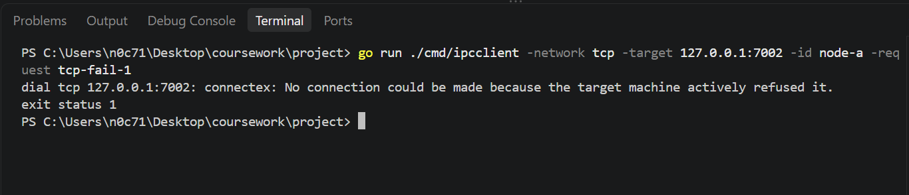

The socket failure tests passed for the oversized TCP frame and UDP drop/deadline cases. The additional oversized UDP datagram and incomplete TCP frame timeout tests also passed.

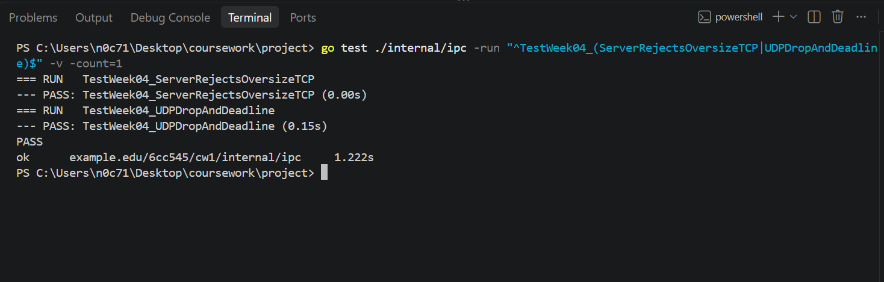

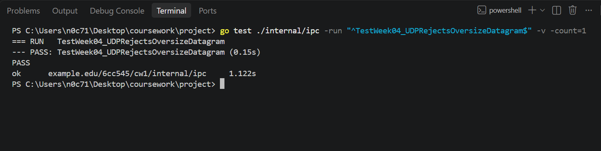

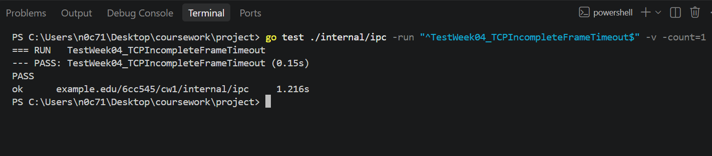

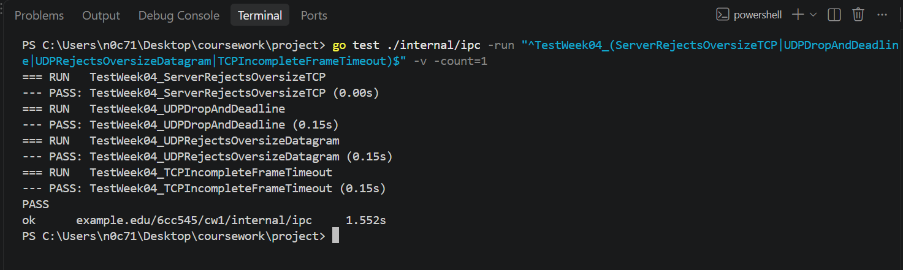

After the failure test, I stopped both nodes and restarted them using the supplied scripts on their original endpoints. The screenshots record the startup output for each node.

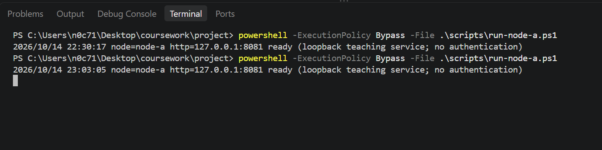

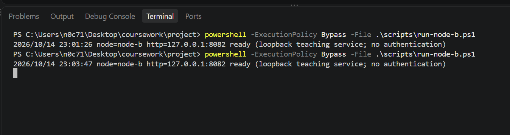

I then tested TCP and UDP against Node B again. Both requests received successful acknowledgements after the restart. This confirmed that the tested endpoints were available and working again.

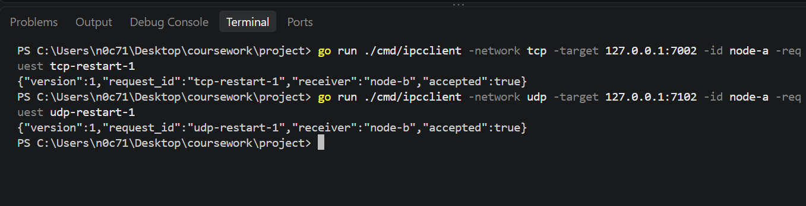

### TCP and UDP comparison

**Reliability:** TCP provides reliable, ordered delivery of bytes while a connection is operating successfully. UDP does not guarantee delivery, so a datagram can be lost without the sender being notified. Both implementations returned successful acknowledgements during my loopback tests. However, a successful acknowledgement only confirms acceptance according to this teaching protocol. It does not prove that every later application operation has completed.

**Ordering:** TCP provides an ordered byte stream, but it does not preserve application message boundaries. The application therefore needs framing to identify complete messages. UDP preserves datagram boundaries, but it does not guarantee delivery or ordering. My tests demonstrated successful message exchange in both directions, but they did not measure ordering under congestion or packet loss.

**Framing:** TCP uses length-prefixed frames so the receiver can identify where each message ends. The implementation checks frame limits and handles incomplete frames. UDP uses datagrams, which already provide message boundaries, but incoming datagrams still require validation and size checks.

**Overhead:** TCP has connection-management and stream-framing overhead, while UDP has a simpler datagram model. I cannot conclude that UDP is always faster from these tests. Workload, payload size, connection setup, acknowledgement handling and network conditions can all affect the observed results.

Overall, the tests showed that both implementations met the teaching protocol on loopback. They do not establish which transport would perform better in an Internet deployment, and they do not demonstrate secure file transfer.

## Failure case and diagnosis

One live failure case involved stopping Node B and attempting to connect to its previous TCP endpoint. The operating system refused the connection because the service was no longer listening there. The client returned an immediate error in my environment instead of waiting indefinitely.

The unit tests also covered oversized TCP frames, malformed UDP input, oversized UDP datagrams and incomplete TCP frames. These tests helped check that unsuitable input was rejected or handled within the intended timeout behaviour rather than being passed to the inbox callback incorrectly.

After both nodes were restarted, TCP and UDP communication succeeded again. This showed that the tested endpoints were available after restarting the services. It does not prove that every possible shutdown or network failure has been tested.

## Design decision and alternative

I kept TCP and UDP as separate transport options so I could compare their behaviour using the same teaching message protocol. TCP needs explicit framing because it provides a byte stream rather than individual application messages. UDP uses datagrams, so each datagram provides a message boundary.

I also kept validation and failure handling as part of the implementation. Without size checks, oversized or invalid input could reach parts of the application where it should not be processed. The incomplete-frame timeout test checks that the TCP server does not wait indefinitely for a complete message.

One alternative would be to use TCP for all communication, which would simplify the transport choices and provide a reliable ordered byte stream. Another would be to use UDP with additional application-level mechanisms for retries, acknowledgements and duplicate detection where stronger delivery guarantees are needed.

For this coursework, retaining both transports allowed me to test their differences and demonstrate selected failure cases.

## Remaining limitations

The tests were performed on loopback, so they do not represent performance across an Internet connection. I did not conduct a controlled benchmark of throughput, latency or packet loss. The results therefore cannot establish that one transport is universally faster or more suitable for every workload.

UDP does not provide TCP's built-in delivery and ordering guarantees. An application requiring stronger guarantees over UDP would need additional application-level handling. Similarly, TCP's reliable byte stream does not prove that the receiving application has completed processing a message.

The implementation is a teaching prototype rather than a secure file-transfer system. These tests do not establish authentication, confidentiality or protection against an attacker on an untrusted network.

## Sources and AI-use disclosure

AI assistance was used to help interpret the task requirements and troubleshoot errors 