# CW2 evidence record

**Student number:** 100862618

---

**Week and task:** Week 6, baseline repository and regression checks.

**Immutable tag and full commit hash:** The checks were carried out against the Week 6 working tree. The repository's previous committed baseline was `8a9c05a4c39602feb9435a6a3effe2c76246b68b` (`CW1 final integration: Weeks 1-5 complete`, 1 November 2026). This is the baseline commit, not the Week 6 checkpoint commit.

**Date/time and timezone:** 3 November 2026. The environment check was recorded at 11:55:27 (UTC+00:00).

**OS, architecture, go version, CGO_ENABLED, C compiler:** Microsoft Windows 11 Pro, 64-bit, version `10.0.26200`. Go version `go1.27.1 windows/amd64`. `CGO_ENABLED=0`. GCC was not found on the system.

**Docker/Compose versions and image digest where relevant:** Not applicable to these local Go tests. Docker and Docker Compose were not available in the environment.

**Exact command and working directory:** Working directory: `C:\Users\n0c71\Desktop\100862618_6CC545_CW1\source`

```powershell
go test ./... -count=1
```

**Expected behaviour and requirement ID:** The existing regression suite should run across the project packages and identify any problems introduced by the Week 6 changes. This supports the Week 6 checkpoint requirement to run the existing regression suite.

**Observed output (attach complete, sanitised transcript):**

The regression suite completed successfully. The tested packages included `examples/firstfunction`, `internal/app`, `internal/config`, `internal/events`, `internal/httpapi`, `internal/ipc`, `internal/model`, `internal/rpcfiles` and `internal/state`. The command-line packages and the JSON model example reported that they had no test files.

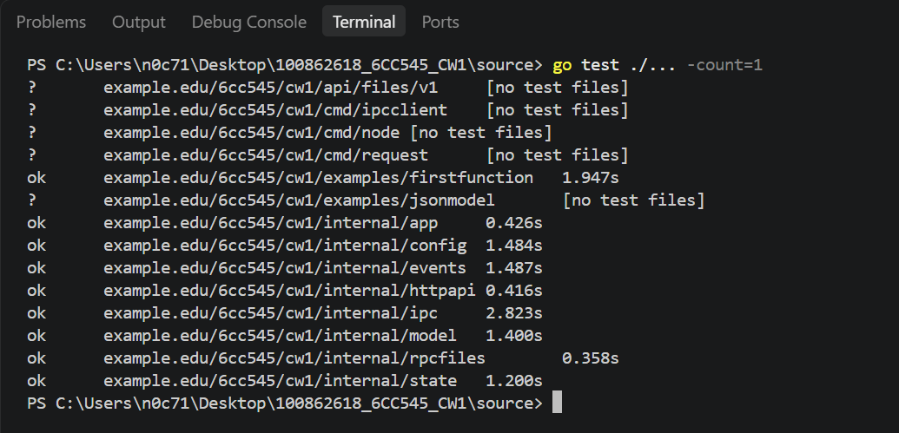

**Pass / fail / not run and explanation:** Pass. All packages containing tests returned successful results.

**Interpretation and limit of what the test establishes:** This confirms that the existing automated tests passed with the Week 6 working-tree changes. It does not, by itself, prove that two separate node processes can exchange a notification. That behaviour was checked separately in the live demonstration below.

**Failure correction and next action:** No regression failure remained from this run. The next step was to check the Week 6 acceptance tests and demonstrate forwarding between the two running nodes.

**AI/source acknowledgement where applicable:** ChatGPT assisted with interpreting test output and organising the evidence. The test results recorded here are from the actual terminal run.

---

**Week and task:** Week 6, event bus and forwarding implementation checks.

**Immutable tag and full commit hash:** The Week 6 changes were still in the working tree during these checks. The previous committed baseline was `8a9c05a4c39602feb9435a6a3effe2c76246b68b`.

**Date/time and timezone:** 3 November 2026. The exact time of each individual test run was not retained in the recorded output. The environment timezone was verified as GMT Standard Time, UTC+00:00.

**OS, architecture, go version, CGO_ENABLED, C compiler:** Microsoft Windows 11 Pro, 64-bit, version `10.0.26200`; Go `go1.27.1`, `windows/amd64`; `CGO_ENABLED=0`; GCC was not found.

**Docker/Compose versions and image digest where relevant:** Not applicable. These checks used the local Go test environment.

**Exact command and working directory:**

Working directory: `C:\Users\n0c71\Desktop\100862618_6CC545_CW1\source`

The focused package checks included:

```powershell
go test ./internal/httpapi ./internal/app ./internal/events ./internal/state -count=1
```

The event forwarding retry and drop behaviour was also checked with:

```powershell
go test ./internal/events -run "^TestForwardRetriesFailedPeerSendThenDropsAndContinues$" -count=1 -v
```

**Expected behaviour and requirement ID:** The event bus should support publishing and subscribing, and the forwarding worker should handle failed sends without remaining blocked indefinitely. The worker should stop when its context is cancelled and should release its subscription.

**Observed output (attach complete, sanitised transcript):**

The focused package tests passed for `internal/httpapi`, `internal/app`, `internal/events` and `internal/state`.

The forwarding implementation uses a one-second timeout for each send, allows three attempts in total, and moves on after the final failed attempt. The subscription is cancelled when the forwarding function exits.

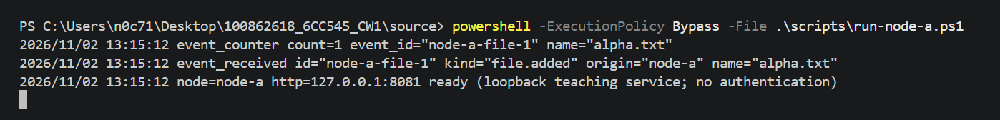

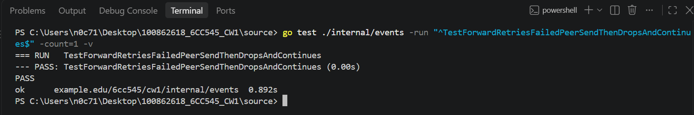

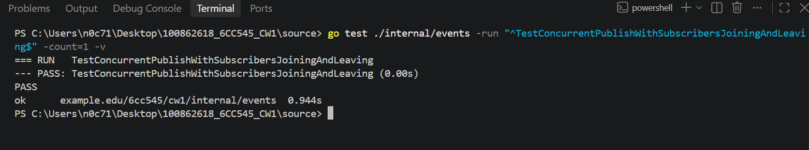

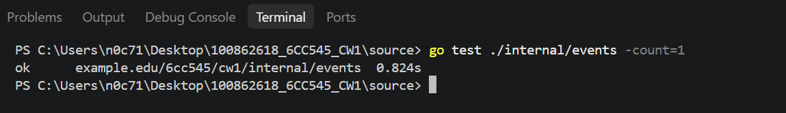

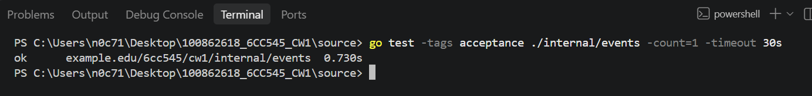

**Pass / fail / not run and explanation:** Pass for the focused package tests and the recorded forwarding tests. The race-detector limitation is recorded separately below.

**Interpretation and limit of what the test establishes:** These tests check the event bus and forwarding behaviour in the test environment. They do not establish that peer communication is secure or encrypted. The live two-node demonstration provides separate evidence that the notification reached the other node.

**Failure correction and next action:** The earlier event-test failures were investigated during development. The final ordinary and acceptance test runs passed. The next step was to verify the forwarding behaviour between two running nodes.

**AI/source acknowledgement where applicable:** ChatGPT assisted with reviewing test output and discussing the forwarding policy. The implementation was checked against the actual project tests and terminal results.

---

**Week and task:** Week 6, two-node peer forwarding demonstration.

**Immutable tag and full commit hash:** The demonstration was performed before the Week 6 checkpoint commit and tag were created. The repository's previous committed baseline was `8a9c05a4c39602feb9435a6a3effe2c76246b68b` (`CW1 final integration: Weeks 1-5 complete`). This baseline does not contain the uncommitted Week 6 changes.

**Date/time and timezone:** 3 November 2026. The Node A event log recorded the notification at `10:29:18`. The Windows system timezone was verified as GMT Standard Time, UTC+00:00.

**OS, architecture, go version, CGO_ENABLED, C compiler:** Microsoft Windows 11 Pro, 64-bit, version `10.0.26200`; Go `go1.27.1`, `windows/amd64`; `CGO_ENABLED=0`; GCC was not found.

**Docker/Compose versions and image digest where relevant:** Not applicable. Both nodes were run locally using the Go application. Docker and Docker Compose were not available in the environment.

**Exact command and working directory:**

Working directory: `C:\Users\n0c71\Desktop\100862618_6CC545_CW1\source`

The two node processes were started separately:

```powershell
powershell -ExecutionPolicy Bypass -File .\scripts\run-node-a.ps1
```

```powershell
powershell -ExecutionPolicy Bypass -File .\scripts\run-node-b.ps1
```

The peer registrations were submitted using:

```powershell
go run ./cmd/request -url http://127.0.0.1:8081/v1/peers -method POST -file testdata/peer-b.json -expect 201
```

```powershell
go run ./cmd/request -url http://127.0.0.1:8082/v1/peers -method POST -file testdata/peer-a.json -expect 201
```

The new file metadata was submitted to Node A:

```powershell
go run ./cmd/request -url http://127.0.0.1:8081/v1/files -method POST -file testdata/new-file.json -expect 201
```

Node B's inbox was then checked:

```powershell
go run ./cmd/request -url http://127.0.0.1:8082/v1/messages -method GET
```

**Expected behaviour and requirement ID:** Both nodes should start independently and register each other as peers. When new file metadata is added to Node A, the application should publish a `file.added` event and forward a corresponding message to Node B. The receiving node should retain the message with the original event ID and node identity.

**Observed output (attach complete, sanitised transcript):**

Both peer registration requests returned HTTP 201.

The file metadata request to Node A also returned HTTP 201 and included the event ID `new-file-1`:

```json
{
  "event_id": "new-file-1",
  "file": {
    "name": "gamma.txt",
    "size": 256,
    "sha256": "aaaaaaaaaaaaaaaaaaaaaaaaaaaaaaaaaaaaaaaaaaaaaaaaaaaaaaaaaaaaaaaa",
    "modified_unix": 1793700000
  }
}
```

Node A recorded the event:

```text
event_counter count=2 event_id="new-file-1" name="gamma.txt"
event_received id="new-file-1" kind="file.added" origin="node-a" name="gamma.txt"
```

Node B's inbox returned HTTP 200 and contained the forwarded message:

```json
[
  {
    "version": 1,
    "request_id": "new-file-1",
    "node_id": "node-a",
    "text": "file.added:gamma.txt"
  }
]
```

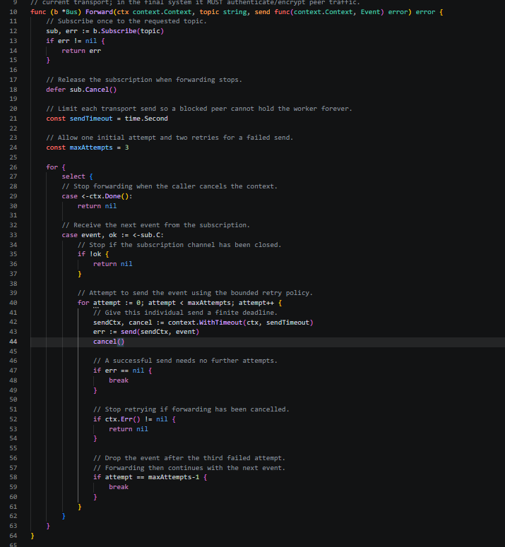

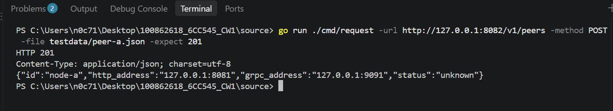

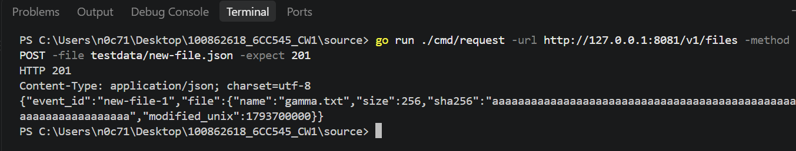

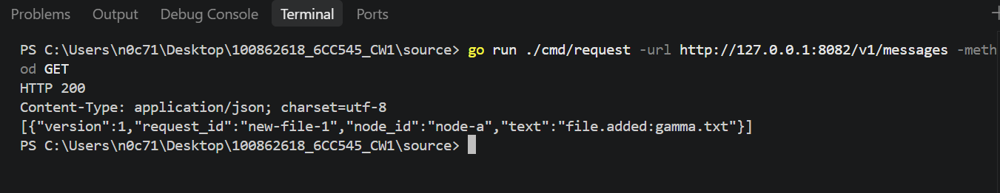

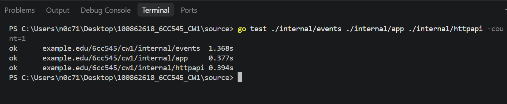

**Pass / fail / not run and explanation:** Pass. Node A accepted the new metadata, generated the event ID and forwarded the notification. Node B returned the corresponding message from its inbox.

**Interpretation and limit of what the test establishes:** This demonstrates notification forwarding between two separate local node processes. It confirms that the event ID and origin were preserved in the received message. The demonstration used local HTTP endpoints and does not establish secure communication over an untrusted network. Authentication and encryption remain outside the scope of this Week 6 demonstration.

**Failure correction and next action:** No outstanding failure remained in this demonstration. The next step was to complete the required event acceptance checks and prepare the Week 6 checkpoint.

**AI/source acknowledgement where applicable:** ChatGPT assisted with interpreting the forwarding flow and preparing the evidence description. The commands and results above are based on the actual terminal demonstration.

---

**Week and task:** Week 6, two-subscriber demonstration.

**Immutable tag and full commit hash:** The test was run against the Week 6 working tree before the checkpoint commit and tag were created. The previous committed baseline was `8a9c05a4c39602feb9435a6a3effe2c76246b68b`.

**Date/time and timezone:** 3 November 2026. The exact test time was not retained in the saved output. The verified system timezone was UTC+00:00.

**OS, architecture, go version, CGO_ENABLED, C compiler:** Microsoft Windows 11 Pro, 64-bit, version `10.0.26200`; Go `go1.27.1`, `windows/amd64`; `CGO_ENABLED=0`; GCC was not found.

**Docker/Compose versions and image digest where relevant:** Not applicable. The test ran locally using Go.

**Exact command and working directory:**

```powershell
go test -tags acceptance ./internal/events -run "^TestTwoSubscribersAndTopics$" -count=1 -v
```

Working directory: `C:\Users\n0c71\Desktop\100862618_6CC545_CW1\source`

**Expected behaviour and requirement ID:** Two subscribers should be able to receive events for their subscribed topics. This provides evidence for the required two-subscriber demonstration in Task 6.8.

**Observed output (attach complete, sanitised transcript):**

```text
=== RUN   TestTwoSubscribersAndTopics
--- PASS: TestTwoSubscribersAndTopics (0.00s)
PASS
ok example.edu/6cc545/cw1/internal/events 0.937s
```

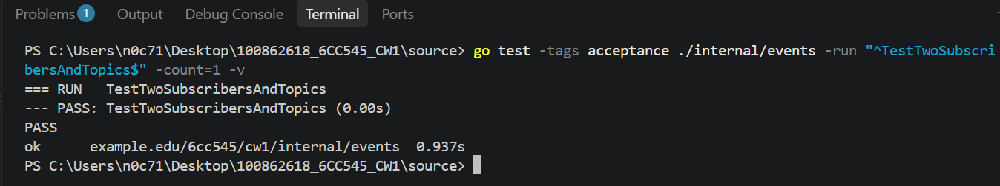

**Pass / fail / not run and explanation:** Pass. The two-subscriber acceptance test completed successfully.

**Interpretation and limit of what the test establishes:** This confirms the tested subscription and topic behaviour. It does not, by itself, demonstrate forwarding between separate node processes; that was checked in the two-node demonstration.

**Failure correction and next action:** No correction was required after this successful run. The next check covered the slow-consumer behaviour.

**AI/source acknowledgement where applicable:** ChatGPT assisted with identifying the acceptance-test command and explaining the result. The pass result is from the actual test output.

---

**Week and task:** Week 6, slow-consumer demonstration.

**Immutable tag and full commit hash:** The test was run against the Week 6 working tree before the checkpoint commit and tag were created. The previous committed baseline was `8a9c05a4c39602feb9435a6a3effe2c76246b68b`.

**Date/time and timezone:** 3 November 2026. The exact test time was not retained in the saved output. The verified system timezone was UTC+00:00.

**OS, architecture, go version, CGO_ENABLED, C compiler:** Microsoft Windows 11 Pro, 64-bit, version `10.0.26200`; Go `go1.27.1`, `windows/amd64`; `CGO_ENABLED=0`; GCC was not found.

**Docker/Compose versions and image digest where relevant:** Not applicable. The test ran locally using Go.

**Exact command and working directory:**

```powershell
go test -tags acceptance ./internal/events -run "^TestSlowSubscriberDropsNewest$" -count=1 -v
```

Working directory: `C:\Users\n0c71\Desktop\100862618_6CC545_CW1\source`

**Expected behaviour and requirement ID:** A slow subscriber should not block event publishing indefinitely. The acceptance test checks the defined behaviour when the subscriber cannot keep up.

**Observed output (attach complete, sanitised transcript):**

```text
=== RUN   TestSlowSubscriberDropsNewest
--- PASS: TestSlowSubscriberDropsNewest (0.00s)
PASS
ok example.edu/6cc545/cw1/internal/events 0.888s
```

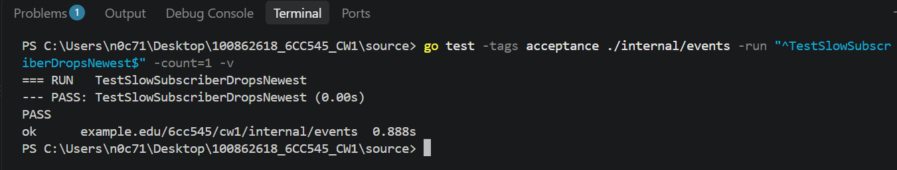

**Pass / fail / not run and explanation:** Pass. The slow-subscriber acceptance test completed successfully.

**Interpretation and limit of what the test establishes:** The test confirms the implemented slow-subscriber policy under the conditions exercised by the test. It does not establish delivery guarantees beyond that policy.

**Failure correction and next action:** No correction was required after this successful run. The next check covered cancellation and shutdown.

**AI/source acknowledgement where applicable:** ChatGPT assisted with explaining the test and documenting the result. The pass result is from the actual terminal output.

---

**Week and task:** Week 6, cancellation and shutdown demonstration.

**Immutable tag and full commit hash:** The test was run against the Week 6 working tree before the checkpoint commit and tag were created. The previous committed baseline was `8a9c05a4c39602feb9435a6a3effe2c76246b68b`.

**Date/time and timezone:** 3 November 2026. The exact test time was not retained in the saved output. The verified system timezone was UTC+00:00.

**OS, architecture, go version, CGO_ENABLED, C compiler:** Microsoft Windows 11 Pro, 64-bit, version `10.0.26200`; Go `go1.27.1`, `windows/amd64`; `CGO_ENABLED=0`; GCC was not found.

**Docker/Compose versions and image digest where relevant:** Not applicable. The test ran locally using Go.

**Exact command and working directory:**

```powershell
go test -tags acceptance ./internal/events -run "^TestCancelAndCloseAreIdempotent$" -count=1 -v
```

Working directory: `C:\Users\n0c71\Desktop\100862618_6CC545_CW1\source`

**Expected behaviour and requirement ID:** Cancelling a subscription and closing the event bus should be handled safely. Repeated cancellation or closure should not cause a panic or leave the test hanging.

**Observed output (attach complete, sanitised transcript):**

```text
=== RUN   TestCancelAndCloseAreIdempotent
--- PASS: TestCancelAndCloseAreIdempotent (0.00s)
PASS
ok example.edu/6cc545/cw1/internal/events 0.934s
```

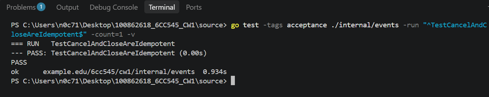

**Pass / fail / not run and explanation:** Pass. The cancellation and close acceptance test completed successfully.

**Interpretation and limit of what the test establishes:** This confirms the idempotent cancellation and shutdown behaviour exercised by the test. It does not prove that every possible shutdown timing or external network failure has been covered.

**Failure correction and next action:** No correction was required after this successful run. The final step was to run the complete acceptance suite.

**AI/source acknowledgement where applicable:** ChatGPT assisted with interpreting and documenting the test. The result is based on the actual terminal output.

---

**Week and task:** Week 6, complete event acceptance suite.

**Immutable tag and full commit hash:** The acceptance suite was run against the Week 6 working tree before the checkpoint commit and tag were created. The previous committed baseline was `8a9c05a4c39602feb9435a6a3effe2c76246b68b`.

**Date/time and timezone:** 3 November 2026. The exact test time was not retained in the saved output. The verified system timezone was UTC+00:00.

**OS, architecture, go version, CGO_ENABLED, C compiler:** Microsoft Windows 11 Pro, 64-bit, version `10.0.26200`; Go `go1.27.1`, `windows/amd64`; `CGO_ENABLED=0`; GCC was not found.

**Docker/Compose versions and image digest where relevant:** Not applicable. The tests ran locally using Go.

**Exact command and working directory:**

```powershell
go test -tags acceptance ./internal/events -count=1 -v
```

Working directory: `C:\Users\n0c71\Desktop\100862618_6CC545_CW1\source`

**Expected behaviour and requirement ID:** All Week 6 event acceptance tests should complete successfully, including subscriber behaviour, slow-consumer handling, cancellation, concurrent publish and close, invalid event rejection, forwarding cancellation, retry and drop behaviour, and subscriber lifecycle.

**Observed output (attach complete, sanitised transcript):**

All nine acceptance tests passed:

```text
=== RUN   TestTwoSubscribersAndTopics
--- PASS: TestTwoSubscribersAndTopics (0.00s)
=== RUN   TestSlowSubscriberDropsNewest
--- PASS: TestSlowSubscriberDropsNewest (0.00s)
=== RUN   TestCancelAndCloseAreIdempotent
--- PASS: TestCancelAndCloseAreIdempotent (0.00s)
=== RUN   TestPublishCancelCloseConcurrent
--- PASS: TestPublishCancelCloseConcurrent (0.00s)
=== RUN   TestInvalidEventRejected
--- PASS: TestInvalidEventRejected (0.00s)
=== RUN   TestForwardDeliversThenCancels
--- PASS: TestForwardDeliversThenCancels (0.00s)
=== RUN   TestScaffoldAllocation
--- PASS: TestScaffoldAllocation (0.00s)
=== RUN   TestForwardRetriesFailedPeerSendThenDropsAndContinues
--- PASS: TestForwardRetriesFailedPeerSendThenDropsAndContinues (0.00s)
=== RUN   TestConcurrentPublishWithSubscribersJoiningAndLeaving
--- PASS: TestConcurrentPublishWithSubscribersJoiningAndLeaving (0.00s)
PASS
ok example.edu/6cc545/cw1/internal/events 0.883s
```

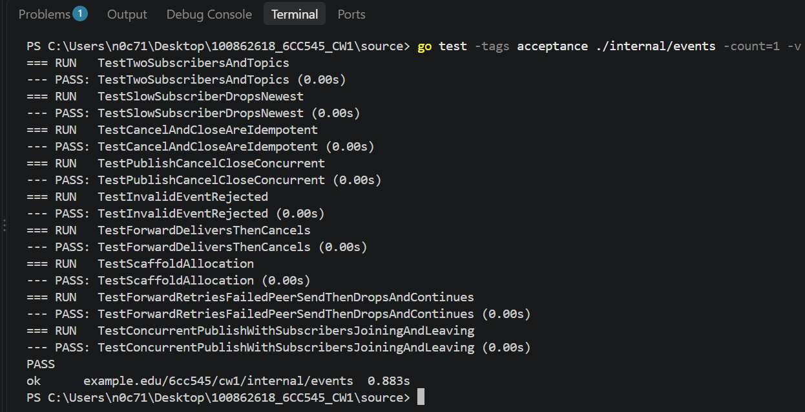

**Pass / fail / not run and explanation:** Pass. All nine acceptance tests completed successfully.

**Interpretation and limit of what the test establishes:** This confirms the event acceptance tests passed with the acceptance build tag enabled. It complements the full project regression suite and the separate two-node demonstration.

**Failure correction and next action:** No remaining acceptance-test failure was reported in this run. The next checkpoint action is to verify the final repository contents, commit the Week 6 work and create the immutable tag required by Blackboard.

**AI/source acknowledgement where applicable:** ChatGPT assisted with identifying the build-tag requirement, interpreting the test output and organising the evidence. The test results are taken from the actual terminal output.

---

**Week and task:** Week 6, race-detector environment check.

**Immutable tag and full commit hash:** The check was carried out before the Week 6 checkpoint commit and tag were created. The previous committed baseline was `8a9c05a4c39602feb9435a6a3effe2c76246b68b`.

**Date/time and timezone:** 3 November 2026. The exact time of the race-test attempt was not retained in the saved output. The verified system timezone was UTC+00:00.

**OS, architecture, go version, CGO_ENABLED, C compiler:** Microsoft Windows 11 Pro, 64-bit, version `10.0.26200`; Go `go1.27.1`, `windows/amd64`; `CGO_ENABLED=0`; GCC was not found.

**Docker/Compose versions and image digest where relevant:** Not applicable.

**Exact command and working directory:** The race-test attempt and compiler check were recorded in the Week 6 screenshots. The environment check confirmed `CGO_ENABLED=0` and that GCC was not found.

**Expected behaviour and requirement ID:** The race detector should be used where the Go environment supports it, to check concurrent event publishing and subscriber lifecycle behaviour.

**Observed output (attach complete, sanitised transcript):**

The race-detector check could not be completed in this environment because CGO was disabled and a GCC compiler was not available.

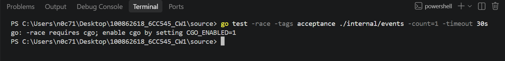

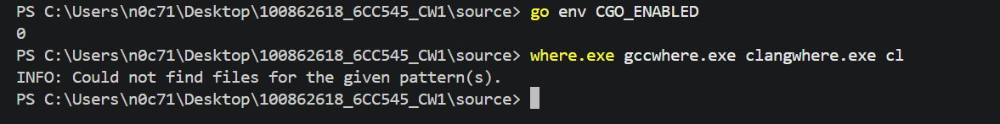

**Pass / fail / not run and explanation:** Not run successfully. The limitation is environmental: CGO was disabled and GCC was unavailable. This is not recorded as a passing race-detector result.

**Interpretation and limit of what the test establishes:** The ordinary and acceptance tests passed, including concurrent lifecycle tests. However, those results are not a substitute for a successful race-detector run. Race-detector verification remains a limitation of this environment.

**Failure correction and next action:** A CGO-enabled environment with a supported C compiler would be needed to run the race detector. The limitation should remain clearly stated rather than treating the test as passed.

**AI/source acknowledgement where applicable:** ChatGPT assisted with explaining the CGO limitation. The environment values were checked using Go and PowerShell.

---

**Week and task:** Week 6, forwarding delivery policy.

**Immutable tag and full commit hash:** The policy was checked in the Week 6 working tree before the checkpoint commit and tag were created. The previous committed baseline was `8a9c05a4c39602feb9435a6a3effe2c76246b68b`.

**Date/time and timezone:** 3 November 2026. The exact time of the focused test was not retained in the saved output. The verified system timezone was UTC+00:00.

**OS, architecture, go version, CGO_ENABLED, C compiler:** Microsoft Windows 11 Pro, 64-bit, version `10.0.26200`; Go `go1.27.1`, `windows/amd64`; `CGO_ENABLED=0`; GCC was not found.

**Docker/Compose versions and image digest where relevant:** Not applicable.

**Exact command and working directory:**

```powershell
go test ./internal/events -run "^TestForwardRetriesFailedPeerSendThenDropsAndContinues$" -count=1 -v
```

Working directory: `C:\Users\n0c71\Desktop\100862618_6CC545_CW1\source`

**Expected behaviour and requirement ID:** The forwarding worker should make a bounded number of attempts when a peer send fails. It should not wait indefinitely for a blocked send, and it should continue processing later events after the failed event reaches the retry limit.

**Observed output (attach complete, sanitised transcript):**

The implementation applies the following policy:

- Each send has a one-second timeout.
- There are three attempts in total: the initial attempt and two retries.
- If all three attempts fail, that event is dropped and forwarding continues with the next event.
- If the forwarding context is cancelled, the worker stops.
- The subscription is cancelled when the forwarding function exits.


**Pass / fail / not run and explanation:** Pass. The forwarding retry and drop test completed successfully.

**Interpretation and limit of what the test establishes:** This is a bounded retry policy, not a guaranteed-delivery mechanism. An event can be dropped after the final failed attempt. The test verifies the defined behaviour, not delivery under every possible network condition.

**Failure correction and next action:** No correction was required after the successful test. The policy should be described as bounded retry with drop after the final failed attempt.

**AI/source acknowledgement where applicable:** ChatGPT assisted with reviewing and explaining the delivery policy. The policy description reflects the implementation and test evidence.

---

**Week and task:** Week 6, checkpoint preparation and repository review.

**Immutable tag and full commit hash:** The last committed baseline identified during the repository review was `8a9c05a4c39602feb9435a6a3effe2c76246b68b`. The existing tag was `final-cw1`. The Week 6 checkpoint commit and immutable tag had not yet been created at the time of this review.

**Date/time and timezone:** 3 November 2026, 11:55:27 (UTC+00:00), when the environment and Git information were collected.

**OS, architecture, go version, CGO_ENABLED, C compiler:** Microsoft Windows 11 Pro, 64-bit, version `10.0.26200`; Go `go1.27.1`, `windows/amd64`; `CGO_ENABLED=0`; GCC was not found.

**Docker/Compose versions and image digest where relevant:** Docker and Docker Compose were not available in the environment. No container image was used for the local Week 6 demonstrations.

**Exact command and working directory:**

```powershell
git status --short
git log -1 --format="%H%n%h%n%ci%n%s"
git tag --list
```

Working directory: `C:\Users\n0c71\Desktop\100862618_6CC545_CW1\source`

**Expected behaviour and requirement ID:** The repository should be reviewed before creating the immutable Week 6 checkpoint. The final commit and tag must identify the actual Week 6 source and evidence state, rather than the earlier Weeks 1–5 baseline.

**Observed output (attach complete, sanitised transcript):**

The latest commit was:

```text
8a9c05a4c39602feb9435a6a3effe2c76246b68b
8a9c05a
2026-11-01 13:24:32 +0000
CW1 final integration: Weeks 1-5 complete
```

The existing tag list contained:

```text
final-cw1
```

The working tree showed Week 6 modifications and untracked files. It also showed older `docs` paths as deleted and a modified `README.md` and API documentation file. These repository changes need to be reviewed before committing the checkpoint.

**Pass / fail / not run and explanation:** Repository review completed. The Week 6 checkpoint commit and tag were not created during this review because the working tree still required inspection.

**Interpretation and limit of what the test establishes:** The Git output establishes the identity of the previous committed baseline and confirms that Week 6 work was not yet included in that commit. It does not establish the final checkpoint commit or tag.

**Failure correction and next action:** Review the reported file moves and deletions, confirm the intended repository structure, then commit the verified Week 6 work and create the immutable tag according to Blackboard's instructions.

**AI/source acknowledgement where applicable:** ChatGPT assisted with interpreting the Git status and identifying the information needed for the checkpoint. The Git values and environment details were taken from the actual PowerShell output.