# CW2 evidence record

**Student number:** 100862618

---

## Record 1: Docker deployment and Compose configuration

**Student number:** 100862618

**Week and task:** Week 8, Docker deployment and Compose configuration

**Immutable tag and full commit hash:** `week08`  
`c5f47800ba709429f9eea3a1a544d533af484aef`

The tag points to the Week 8 checkpoint. Some files were modified after this checkpoint, so the tag does not include those later working-tree changes.

**Date/time and timezone:** 17 November 2026. Exact time not recorded. GMT Standard Time (UTC+00:00).

**OS, architecture, go version, CGO_ENABLED, C compiler:** Windows 11 Pro, 64-bit; Go `go1.27.1 windows/amd64`; `CGO_ENABLED=0`; configured compiler `gcc`, but the executable was not found in PATH.

Docker Client/Engine: `29.9.3`  
Docker Desktop: `4.99.0`  
Docker Compose: `v5.7.0`

**Docker/Compose versions and image digest where relevant:** Docker and Compose versions are listed above. Image digests are recorded separately in Record 9.

**Exact command and working directory:**

Working directory: `C:\Users\n0c71\Desktop\100862618_6CC545_CW1\source`

```powershell
docker compose --env-file ..\.env -f ..\deployment\compose.yaml config --quiet
```

**Expected behaviour and requirement ID:** The Compose configuration should be valid and the deployment should be able to start using the configured services. The specific requirement ID was not recorded.

**Observed output (attach complete, sanitised transcript):**

```text
PASS: Compose configuration is valid.
```

The deployment screenshots also show the Docker build and container-start process, including the deploycheck setup.

**Pass / fail / not run and explanation:** Pass. The Compose configuration validation completed successfully. The deployment screenshots provide additional evidence of the build and container startup.

**Interpretation and limit of what the test establishes:** This confirms that Docker Compose accepted the configuration. It does not, by itself, prove that every application feature works correctly.

**Failure correction and next action:** The Compose file uses `./cmd/deploycheck` as a fallback application target. When running Compose from the source directory, I used the explicit `--env-file ..\.env` option where required. This helped ensure the intended environment configuration was loaded.

**AI/source acknowledgement where applicable:** ChatGPT assisted with organising and editing the evidence wording. The command was run locally, and the result is based on my terminal output.

**Screenshots:**

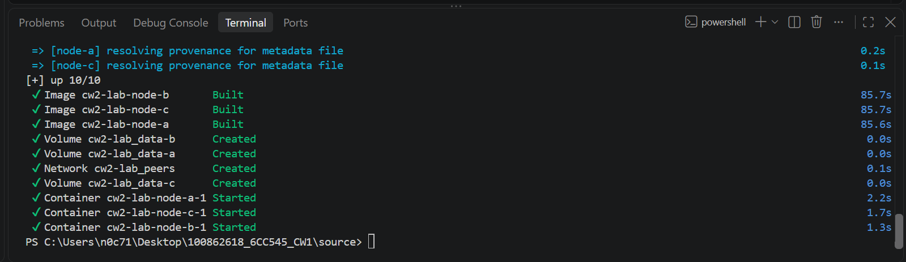

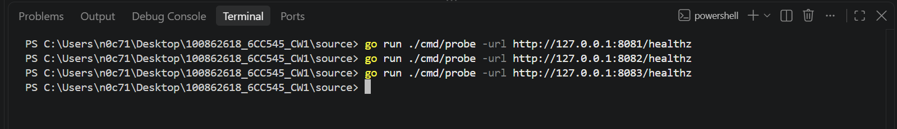

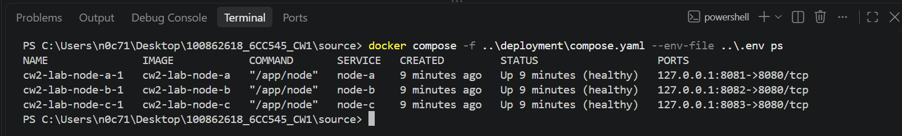

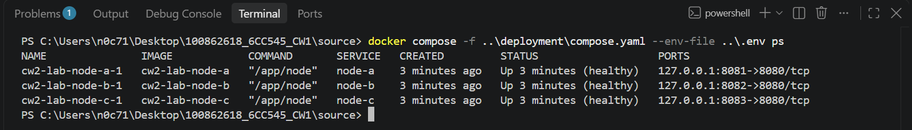

---

## Record 2: Real node deployment and health checks

**Student number:** 100862618

**Week and task:** Week 8, real node deployment and health checks

**Immutable tag and full commit hash:** `week08`  
`c5f47800ba709429f9eea3a1a544d533af484aef`

The tag identifies the Week 8 checkpoint. Later working-tree changes are not included in that commit.

**Date/time and timezone:** 17 November 2026. Exact time not recorded. GMT Standard Time (UTC+00:00).

**OS, architecture, go version, CGO_ENABLED, C compiler:** Windows 11 Pro, 64-bit; Go `go1.27.1 windows/amd64`; `CGO_ENABLED=0`; configured compiler `gcc`, executable not found in PATH.

Docker Client/Engine: `29.9.3`  
Docker Desktop: `4.99.0`  
Docker Compose: `v5.7.0`

**Docker/Compose versions and image digest where relevant:** Docker and Compose versions are listed above. The image digests are included in Record 9.

**Exact command and working directory:**

Working directory: `C:\Users\n0c71\Desktop\100862618_6CC545_CW1\source`

The following health probes were run:

```powershell
go run ./cmd/probe -url http://127.0.0.1:8081/healthz
go run ./cmd/probe -url http://127.0.0.1:8082/healthz
go run ./cmd/probe -url http://127.0.0.1:8083/healthz
```

**Expected behaviour and requirement ID:** Each deployed node should respond successfully to its local health endpoint and identify itself correctly. The specific requirement ID was not recorded.

**Observed output (attach complete, sanitised transcript):**

The health responses identified the three nodes:

```json
{"node_id":"node-a","status":"ok"}
{"node_id":"node-b","status":"ok"}
{"node_id":"node-c","status":"ok"}
```

The Compose configuration and running container inspection also showed the expected node identities:

```text
node-a  NODE_ID=node-a
node-b  NODE_ID=node-b
node-c  NODE_ID=node-c
```

**Pass / fail / not run and explanation:** Pass. All three local health probes returned successful responses, and the running containers showed the expected node IDs.

**Interpretation and limit of what the test establishes:** The `/healthz` endpoint confirms the local node is responding. It does not establish that all peer nodes are available or that the whole distributed system is healthy. The Compose inspection also did not show an `APP_PACKAGE` environment variable, so it does not independently establish the executable selected inside each running container.

**Failure correction and next action:** I used the explicit environment file when starting the real node deployment. This was necessary because running Compose without it could use the fallback application target.

**AI/source acknowledgement where applicable:** ChatGPT assisted with organising and editing the evidence wording. The probes and container inspection were carried out locally.

**Screenshots:**

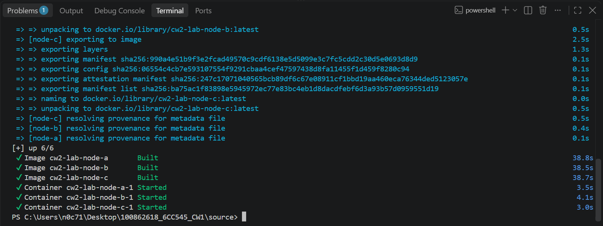


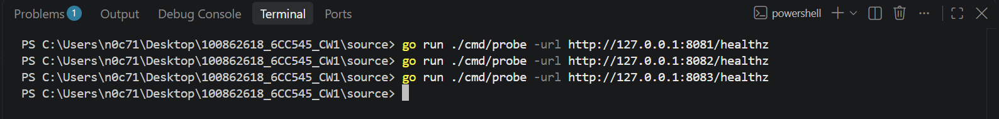

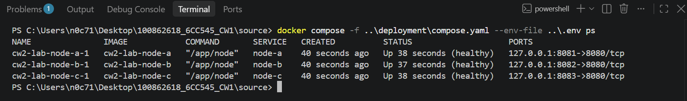

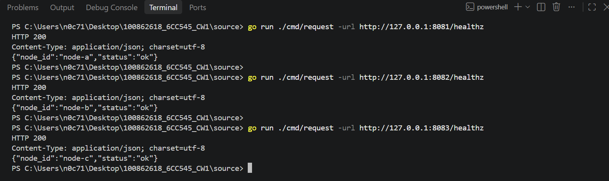

---

## Record 3: Peer registration and remote gRPC request

**Student number:** 100862618

**Week and task:** Week 8, peer registration and remote communication

**Immutable tag and full commit hash:** `week08`  
`c5f47800ba709429f9eea3a1a544d533af484aef`

The tag identifies the Week 8 checkpoint. Later working-tree changes are not included in that commit.

**Date/time and timezone:** 17 November 2026. Exact time not recorded. GMT Standard Time (UTC+00:00).

**OS, architecture, go version, CGO_ENABLED, C compiler:** Windows 11 Pro, 64-bit; Go `go1.27.1 windows/amd64`; `CGO_ENABLED=0`; configured compiler `gcc`, executable not found in PATH.

Docker Client/Engine: `29.9.3`  
Docker Desktop: `4.99.0`  
Docker Compose: `v5.7.0`

**Docker/Compose versions and image digest where relevant:** The three-node deployment was running through Docker Compose. Image digests are recorded in Record 9.

**Exact command and working directory:**

Working directory: `C:\Users\n0c71\Desktop\100862618_6CC545_CW1\source`

The peer registration request was:

```powershell
go run ./cmd/request -url "http://127.0.0.1:8081/v1/peers" -method POST -file "$env:TEMP\peer-b-compose.json" -type "application/json" -expect 201
```

The remote request was:

```powershell
go run ./cmd/request -url "http://127.0.0.1:8081/v1/remote-files?peer_id=node-b"
```

**Expected behaviour and requirement ID:** Node A should accept the peer registration request and allow a request to be sent to the registered remote peer. The specific requirement ID was not recorded.

**Observed output (attach complete, sanitised transcript):**

The peer registration request returned HTTP `201`.

The remote request returned HTTP `200` with the following response:

```json
{"node_id":"node-b","files":[]}
```

The peer information used for registration was:

```json
{"id":"node-b","http_address":"node-b:8080","grpc_address":"node-b:9090","status":"unknown"}
```

**Pass / fail / not run and explanation:** Pass. The peer registration was accepted and the remote request received a successful response from node B.

**Interpretation and limit of what the test establishes:** This demonstrates that the remote request reached node B and received a response. The returned file list was empty, so this test does not demonstrate the transfer of an actual file between nodes.

**Failure correction and next action:** The peer was registered again when required. The peer registry is in memory, so registration may need to be repeated after the relevant node is recreated.

**AI/source acknowledgement where applicable:** ChatGPT assisted with organising and editing the evidence wording. The requests and responses are based on my local test results.

**Screenshots:**

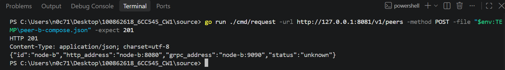

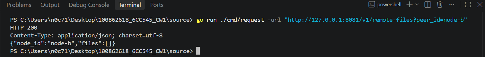

---

## Record 4: Peer recovery test

**Student number:** 100862618

**Week and task:** Week 8, peer availability and recovery testing

**Immutable tag and full commit hash:** `week08`  
`c5f47800ba709429f9eea3a1a544d533af484aef`

The tag identifies the Week 8 checkpoint. Later working-tree changes are not included in that commit.

**Date/time and timezone:** 17 November 2026. Exact time not recorded. GMT Standard Time (UTC+00:00).

**OS, architecture, go version, CGO_ENABLED, C compiler:** Windows 11 Pro, 64-bit; Go `go1.27.1 windows/amd64`; `CGO_ENABLED=0`; configured compiler `gcc`, executable not found in PATH.

Docker Client/Engine: `29.9.3`  
Docker Desktop: `4.99.0`  
Docker Compose: `v5.7.0`

**Docker/Compose versions and image digest where relevant:** The test concerns peer communication and recovery. Docker image digests are recorded in Record 9.

**Exact command and working directory:**

Working directory: `C:\Users\n0c71\Desktop\100862618_6CC545_CW1\source`

```powershell
go test ./internal/rpcfiles -run TestWeek08_PeerUnavailableThenRecovers -count=1 -v
```

The full Go test suite was also run:

```powershell
go test ./...
```

**Expected behaviour and requirement ID:** The test should confirm that a peer request can fail when the peer is unavailable and succeed after the peer becomes available again. The specific requirement ID was not recorded.

**Observed output (attach complete, sanitised transcript):**

The focused peer recovery test passed. The full Go test suite also completed successfully.

The test covered an initial failed request within the configured deadline, followed by a successful request after the gRPC server became available.

**Pass / fail / not run and explanation:** Pass. The focused peer recovery test and the full Go test suite passed.

**Interpretation and limit of what the test establishes:** This confirms the behaviour covered by the test sequence. It does not prove that every possible network failure or recovery scenario has been tested.

**Failure correction and next action:** The peer was made available again and the request was repeated. The successful result confirmed that communication could recover in the tested scenario.

**AI/source acknowledgement where applicable:** ChatGPT assisted with organising and editing the evidence wording. The tests were executed locally.

**Screenshots:**

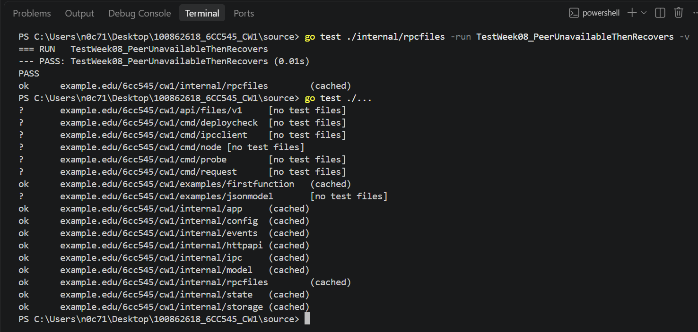

---

## Record 5: File persistence and catalogue recovery

**Student number:** 100862618

**Week and task:** Week 8, storage persistence and recovery

**Immutable tag and full commit hash:** `week08`  
`c5f47800ba709429f9eea3a1a544d533af484aef`

The tag identifies the Week 8 checkpoint. Later working-tree changes are not included in that commit.

**Date/time and timezone:** 17 November 2026. Exact time not recorded. GMT Standard Time (UTC+00:00).

**OS, architecture, go version, CGO_ENABLED, C compiler:** Windows 11 Pro, 64-bit; Go `go1.27.1 windows/amd64`; `CGO_ENABLED=0`; configured compiler `gcc`, executable not found in PATH.

Docker Client/Engine: `29.9.3`  
Docker Desktop: `4.99.0`  
Docker Compose: `v5.7.0`

**Docker/Compose versions and image digest where relevant:** The test used the Docker deployment and its persistent storage volume. Image digests are recorded in Record 9.

**Exact command and working directory:**

Working directory: `C:\Users\n0c71\Desktop\100862618_6CC545_CW1\source`

The synthetic test file was uploaded using:

```powershell
curl.exe -i -X POST "http://127.0.0.1:8081/v1/files" `
  -F "file=@synthetic-week08.txt" `
  -F "sha256=$hash"
```

The file content was:

```text
6CC545 CW2 Week 8 persistence and storage isolation verification.
```

The SHA-256 value was:

```text
3c68cbf148f8cf80b11b53de2f92c5a37004ba9b61ef54d0405cbfcb6cf6f2b4
```

The node was then restarted using:

```powershell
docker compose --env-file ..\.env -f ..\deployment\compose.yaml up -d --build --no-deps node-a
```

**Expected behaviour and requirement ID:** The uploaded file should remain available after the node restarts, and the catalogue should be able to recover the committed file information. The specific requirement ID was not recorded.

**Observed output (attach complete, sanitised transcript):**

The upload returned a successful result. The recorded file details included:

- File size: 65 bytes
- SHA-256: `3c68cbf148f8cf80b11b53de2f92c5a37004ba9b61ef54d0405cbfcb6cf6f2b4`
- Event ID: `new-file-1`
- Delivered events: `3`
- Dropped events: `0`
- Event published: `true`

The file was present in node A's storage. Node B's physical storage and catalogue remained empty during this test.

During the first restart, the file remained on disk but the catalogue was empty. I then restarted node A using the explicit Compose environment file and the real node application target. The catalogue recovered the file information afterwards.

**Pass / fail / not run and explanation:** Pass after correction. The initial restart did not restore the catalogue, but the corrected restart restored it successfully.

**Interpretation and limit of what the test establishes:** This test demonstrates persistence and catalogue recovery for the uploaded file on node A. The event delivery count of three does not mean the file was replicated to three nodes. Node B's storage and catalogue remained empty, so this test does not establish file replication between nodes.

**Failure correction and next action:** I corrected the restart command to include `--env-file ..\.env` so the intended application configuration was loaded. After restarting node A with that configuration, the catalogue recovered the stored file.

**AI/source acknowledgement where applicable:** ChatGPT assisted with organising and editing the evidence wording. The upload, restart and recovery checks were carried out locally.

**Screenshots:**

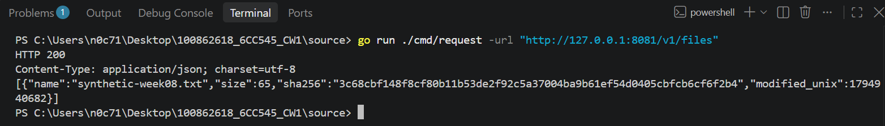

---

## Record 6: Behaviour when a peer is stopped and restarted

**Student number:** 100862618

**Week and task:** Week 8, peer failure and recovery

**Immutable tag and full commit hash:** `week08`  
`c5f47800ba709429f9eea3a1a544d533af484aef`

The tag identifies the Week 8 checkpoint. Later working-tree changes are not included in that commit.

**Date/time and timezone:** 17 November 2026. Exact time not recorded. GMT Standard Time (UTC+00:00).

**OS, architecture, go version, CGO_ENABLED, C compiler:** Windows 11 Pro, 64-bit; Go `go1.27.1 windows/amd64`; `CGO_ENABLED=0`; configured compiler `gcc`, executable not found in PATH.

Docker Client/Engine: `29.9.3`  
Docker Desktop: `4.99.0`  
Docker Compose: `v5.7.0`

**Docker/Compose versions and image digest where relevant:** The test used the three-node Docker Compose deployment. Image digests are recorded in Record 9.

**Exact command and working directory:**

Working directory: `C:\Users\n0c71\Desktop\100862618_6CC545_CW1\source`

Node B was stopped:

```powershell
docker compose -f ..\deployment\compose.yaml stop node-b
```

The remote request was then tested:

```powershell
go run ./cmd/request -url "http://127.0.0.1:8081/v1/remote-files?peer_id=node-b"
```

Node B was restarted:

```powershell
docker compose -f ..\deployment\compose.yaml start node-b
```

The same remote request was run again after the restart.

**Expected behaviour and requirement ID:** The other nodes should continue responding to their local health checks while node B is stopped. A request to the unavailable peer should fail within a bounded period, and communication should work again after node B restarts. The specific requirement ID was not recorded.

**Observed output (attach complete, sanitised transcript):**

While node B was stopped, the local health probes for nodes A and C succeeded.

The remote request to node B returned:

```text
context deadline exceeded (Client.Timeout exceeded while awaiting headers)
```

After node B was restarted, its health probe succeeded and the remote request returned HTTP `200`:

```json
{"node_id":"node-b","files":[]}
```

**Pass / fail / not run and explanation:** Pass. The observed behaviour matched the expected result for the stop and restart sequence.

**Interpretation and limit of what the test establishes:** The test shows that A and C could still respond to their local health checks while B was stopped, that the remote request timed out, and that communication worked again after B restarted. It does not establish that all operations remain available during every possible peer failure.

**Failure correction and next action:** Node B was started again and the health and remote request checks were repeated. Both succeeded.

**AI/source acknowledgement where applicable:** ChatGPT assisted with organising and editing the evidence wording. The stop, restart and request tests were carried out locally.

**Screenshots:**

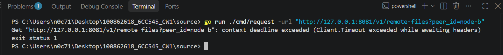

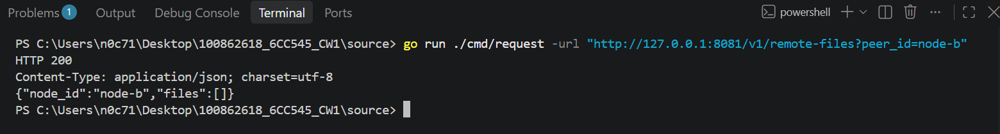

---

## Record 7: Node shutdown

**Student number:** 100862618

**Week and task:** Week 8, node shutdown behaviour

**Immutable tag and full commit hash:** `week08`  
`c5f47800ba709429f9eea3a1a544d533af484aef`

The tag identifies the Week 8 checkpoint. Later working-tree changes are not included in that commit.

**Date/time and timezone:** 17 November 2026. Exact time not recorded. GMT Standard Time (UTC+00:00).

**OS, architecture, go version, CGO_ENABLED, C compiler:** Windows 11 Pro, 64-bit; Go `go1.27.1 windows/amd64`; `CGO_ENABLED=0`; configured compiler `gcc`, executable not found in PATH.

Docker Client/Engine: `29.9.3`  
Docker Desktop: `4.99.0`  
Docker Compose: `v5.7.0`

**Docker/Compose versions and image digest where relevant:** The shutdown evidence relates to the Docker deployment. Image digests are recorded in Record 9.

**Exact command and working directory:**

The shutdown evidence was captured during the Week 8 node deployment tests. The exact shutdown command and working directory were not recorded in the available transcript.

**Expected behaviour and requirement ID:** The node should shut down cleanly. The specific requirement ID was not recorded.

**Observed output (attach complete, sanitised transcript):**

The shutdown screenshot is included below. The complete terminal transcript is not available in the evidence supplied for this record.

**Pass / fail / not run and explanation:** Not fully verified from the available transcript. The screenshot was captured as shutdown evidence, but the exact command and complete output were not recorded here.

**Interpretation and limit of what the test establishes:** The screenshot provides supporting evidence of the shutdown activity. Without the complete command and output, I cannot use this record alone to establish every detail of graceful shutdown behaviour.

**Failure correction and next action:** No correction was recorded for this test.

**AI/source acknowledgement where applicable:** ChatGPT assisted with organising and editing the evidence wording. The screenshot was captured during my local testing.

**Screenshots:**

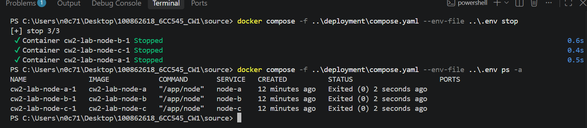

---

## Record 8: Go regression and acceptance tests

**Student number:** 100862618

**Week and task:** Week 8, regression and acceptance testing

**Immutable tag and full commit hash:** `week08`  
`c5f47800ba709429f9eea3a1a544d533af484aef`

The tag identifies the Week 8 checkpoint. Later working-tree changes are not included in that commit.

**Date/time and timezone:** 17 November 2026. Exact time not recorded. GMT Standard Time (UTC+00:00).

**OS, architecture, go version, CGO_ENABLED, C compiler:** Windows 11 Pro, 64-bit; Go `go1.27.1 windows/amd64`; `CGO_ENABLED=0`; configured compiler `gcc`, executable not found in PATH.

Docker Client/Engine: `29.9.3`  
Docker Desktop: `4.99.0`  
Docker Compose: `v5.7.0`

**Docker/Compose versions and image digest where relevant:** The regression tests were run with Go. Docker acceptance testing was also carried out as part of the deployment work. Image digests are recorded in Record 9.

**Exact command and working directory:**

Working directory: `C:\Users\n0c71\Desktop\100862618_6CC545_CW1\source`

The full Go test suite was run using:

```powershell
go test ./...
```

The storage acceptance test was run using:

```powershell
go test -tags acceptance ./internal/storage -run TestRecoverCommittedData -v
```

**Expected behaviour and requirement ID:** The regression tests should complete successfully without introducing failures in the existing Go packages. The storage acceptance test should verify recovery of committed data. The specific requirement IDs were not recorded.

**Observed output (attach complete, sanitised transcript):**

The full Go test suite completed successfully. The storage acceptance test also passed.

The Docker regression and acceptance test screenshots are included below.

**Pass / fail / not run and explanation:** Pass. The recorded Go regression and storage acceptance tests passed.

**Interpretation and limit of what the test establishes:** These results show that the tests included in the commands passed at the time they were run. They do not prove that untested cases or every possible deployment environment will behave in the same way. No race-detector result is claimed in this record.

**Failure correction and next action:** The tests were rerun after the relevant implementation work. No remaining test failure was recorded in the supplied results.

**AI/source acknowledgement where applicable:** ChatGPT assisted with organising and editing the evidence wording. The tests were run locally, and the results are based on my terminal output.

**Screenshots:**

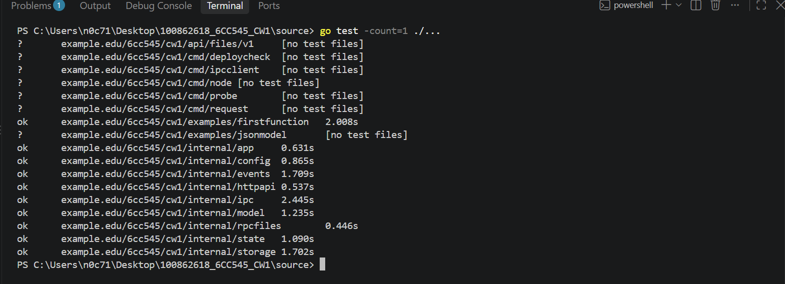

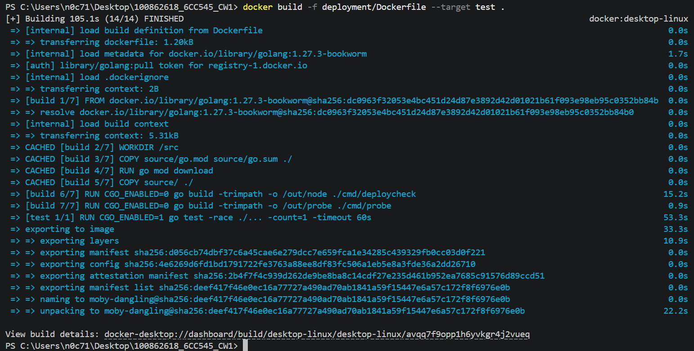

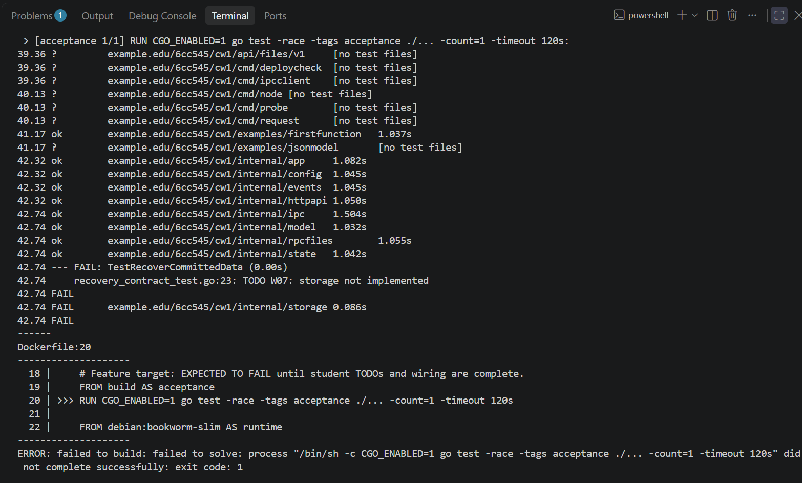

---

## Record 9: Docker image digests and three-node build

**Student number:** 100862618

**Week and task:** Week 8, Docker image build and deployment evidence

**Immutable tag and full commit hash:** `week08`  
`c5f47800ba709429f9eea3a1a544d533af484aef`

The tag identifies the Week 8 checkpoint. Later working-tree changes are not included in that commit.

**Date/time and timezone:** 18 November 2026. Exact time of the image inspection not recorded. GMT Standard Time (UTC+00:00).

**OS, architecture, go version, CGO_ENABLED, C compiler:** Windows 11 Pro, 64-bit; Go `go1.27.1 windows/amd64`; `CGO_ENABLED=0`; configured compiler `gcc`, executable not found in PATH.

Docker Client/Engine: `29.9.3`  
Docker Desktop: `4.99.0`  
Docker Compose: `v5.7.0`

**Docker/Compose versions and image digest where relevant:**

The local image inspection returned these image IDs and repository digests:

| Image | Image ID / digest |
|---|---|
| `cw2-lab-node-a` | `sha256:f6212fab6661e1f30f8afe95ec151484e31923aa60aecd1326f479e3096d09c5` |
| `cw2-lab-node-b` | `sha256:db15c014eecb52cddc071b97c65bd4ba03f3fff59e0e15513e044b491c06bb14` |
| `cw2-lab-node-c` | `sha256:dc66ed79442e3170d3bdf3d92b90dbb1997914131944bc9029fe0a2959a4d17f` |

The running node B and node C containers reported different image IDs from the latest local images inspected:

- Running node B: `sha256:3ff4a48491c76dbcc7d8ecdb023950a71ab34cf94fd96619b6d7eb66949c37d8`
- Running node C: `sha256:a67fdbb5d5140ae630cec1017805d8342c2e98df29c1f48d01cbc49ae2a7b836`

Those two running image IDs were not available as local images when I attempted to inspect them. I have kept this distinction in the record rather than treating the local image digests as the digests of all running containers.

**Exact command and working directory:**

Working directory: `C:\Users\n0c71\Desktop\100862618_6CC545_CW1\source`

The image inspection was carried out using Docker image inspection commands. The exact full command transcript was not recorded in the available evidence.

**Expected behaviour and requirement ID:** The three node images should be built and identifiable, with their image IDs or digests available for deployment evidence. The specific requirement ID was not recorded.

**Observed output (attach complete, sanitised transcript):**

The local image inspection returned the three image IDs listed above. The three-node Docker build screenshot is included below.

**Pass / fail / not run and explanation:** Pass for identifying the three local images and recording their digests. The running image IDs for node B and node C did not match the latest local image IDs inspected, so I have recorded that difference rather than claiming they matched.

**Interpretation and limit of what the test establishes:** Image digests identify the inspected images. They do not, on their own, prove which exact application executable is running inside every container or that all three running containers use the latest local images.

**Failure correction and next action:** No correction was recorded for the image ID difference. It is documented here as a limitation of the evidence.

**AI/source acknowledgement where applicable:** ChatGPT assisted with organising and editing the evidence wording. The image information was obtained from my local Docker inspection.

**Screenshots:**

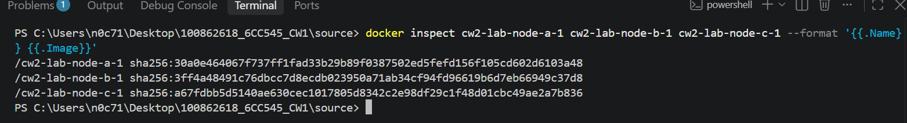

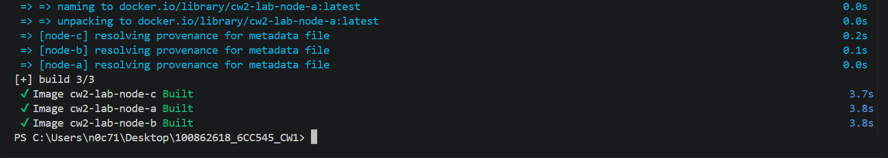