# Weekly evidence record

**Student number:** 100862618  
**Week:** 1  
**Repository URL:** [https://github.com/emmanuelmanu-devCyberSec/6CC545-CW1](https://github.com/emmanuelmanu-devCyberSec/6CC545-CW1)  
**Immutable tag:** Not recorded  
**Commit hash:** `0d7c93d`  
**Go version / OS:** Go 1.27.1 / Windows

## Commands actually executed

I used the following commands to check my development environment, build the project, run the tests and check how the two nodes behaved.

**Check Go, Git and the project location**

```powershell
go version
git --version
go env GOMOD
```

**Build the project and run the smoke tests**

```powershell
go build ./...
go test ./... -run "^TestSmoke_"
```

**Run the initial test suite**

```powershell
go test ./... -count=1 -timeout 20s
```

**Test configuration validation**

```powershell
go test ./internal/config -run "^TestWeek01_" -v
```

**Test the health endpoint**

```powershell
go test ./internal/httpapi -run "^TestWeek01_Health" -v
```

**Run the tests again and check the code**

```powershell
go test ./... -count=1 -timeout 20s
go vet ./...
```

**Start Node A and Node B**

```powershell
powershell -ExecutionPolicy Bypass -File .\scripts\run-node-a.ps1
powershell -ExecutionPolicy Bypass -File .\scripts\run-node-b.ps1
```

**Send requests to both health endpoints**

```powershell
go run ./cmd/request -url http://127.0.0.1:8081/healthz
go run ./cmd/request -url http://127.0.0.1:8082/healthz
```

**Check how the application handles invalid input**

```powershell
go run ./cmd/node -id "invalid id" -http "127.0.0.1:8083"
go run ./cmd/node -id "node-invalid-port" -http "127.0.0.1:70000"
go run ./cmd/node -unknownflag
```

## Observed results (do not paste expected examples as results)

### Environment and build

I started by checking that Go and Git were available and that Go was using the correct project directory. The project built successfully, and the smoke tests passed.

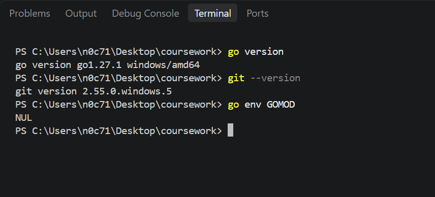

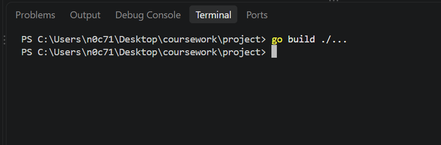

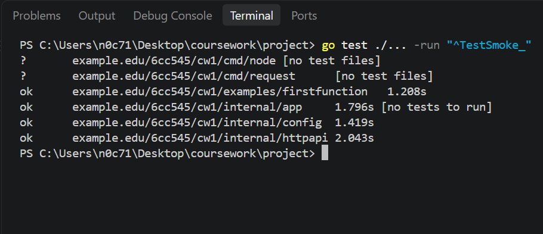

### Initial test results

My first full test run did not pass because some of the Week 1 functionality was still incomplete. The configuration validation and health endpoint tests highlighted areas that needed to be finished.

I used these failures to identify what needed attention before running the affected tests again.

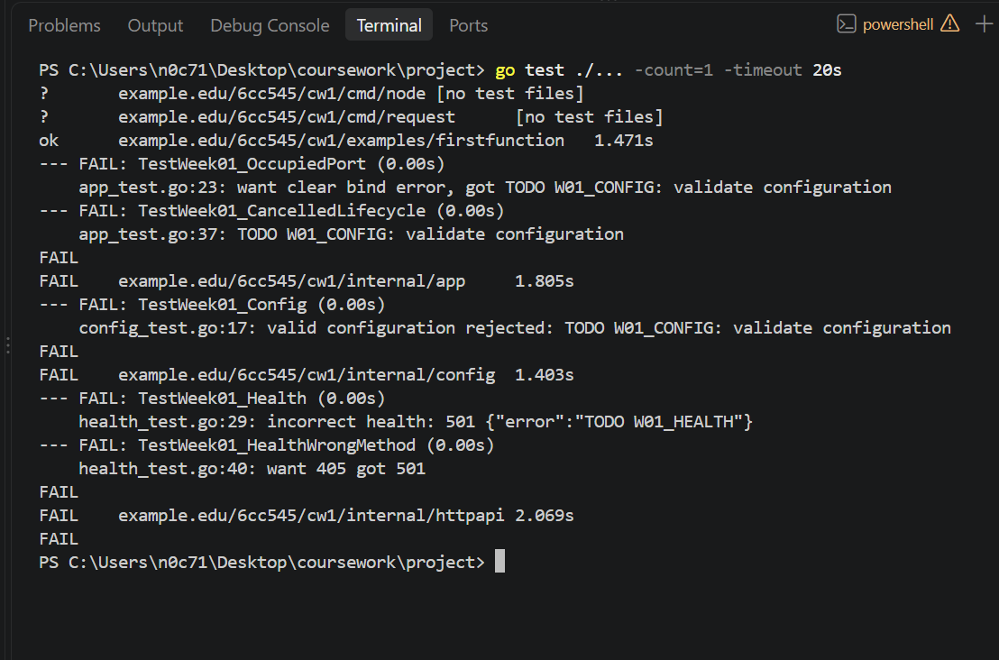

### Configuration validation

I worked on the configuration checks to make sure the application rejected invalid settings before starting. These checks covered the node ID, HTTP address, optional TCP, UDP and gRPC addresses, and timeout.

After making the changes, I ran the configuration tests again. The tests passed, including the checks for invalid optional TCP and UDP addresses and a timeout longer than 30 seconds.

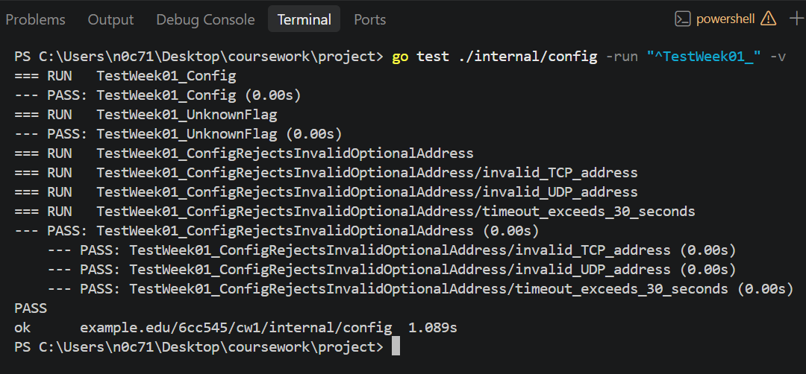

### Health endpoint tests

I also implemented the health endpoint so that a client could check whether a node was responding.

A valid GET request returns a JSON response containing the node ID and its `ok` status. When a client uses an unsupported HTTP method, the handler returns HTTP 405, includes an `Allow: GET` header and provides a JSON error response.

The health endpoint tests passed, including the checks for the unsupported method and its error response.

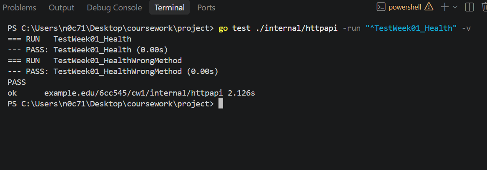

### Node startup and health checks

I started Node A on `127.0.0.1:8081` and Node B on `127.0.0.1:8082`. Both nodes started successfully, and I sent a health request to each one.

Node A returned HTTP 200 with a JSON response containing `node-a` and the status `ok`. Node B returned HTTP 200 with the same response structure, but with `node-b` as its node ID.

This confirmed that both nodes could run on their separate addresses and respond to health requests with their own IDs.

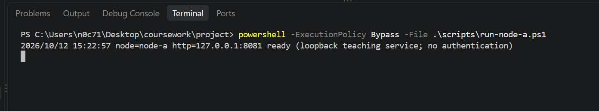

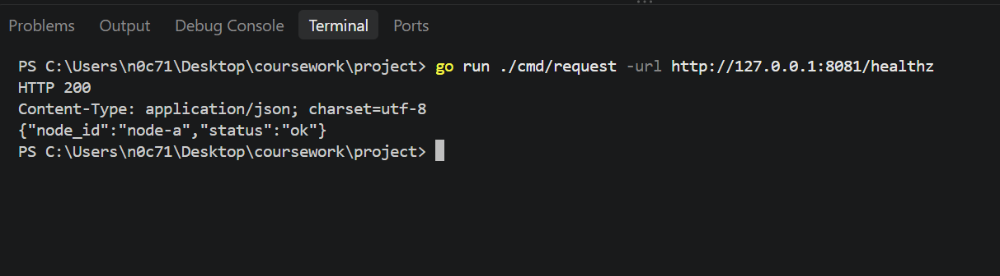

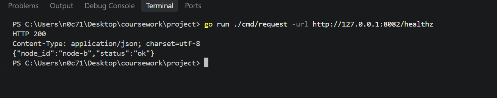

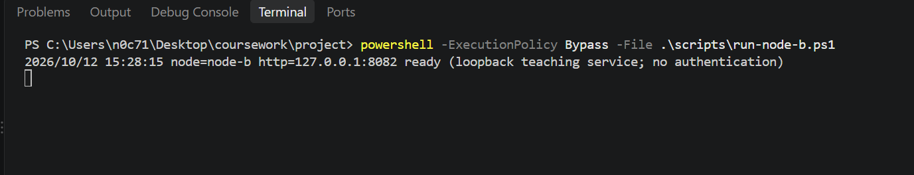

### Occupied port and shutdown behaviour

I tried starting another instance of Node A while the original instance was still running. The second instance failed because the address was already in use, while the original node remained available.

I then stopped Node A using Ctrl+C and sent another health request. The request failed with a connection-refused error because the node was no longer listening on that address. After restarting Node A, the health request worked again and returned HTTP 200.

These checks helped me understand how the application behaved when a port was occupied, when a node stopped and when it started again.

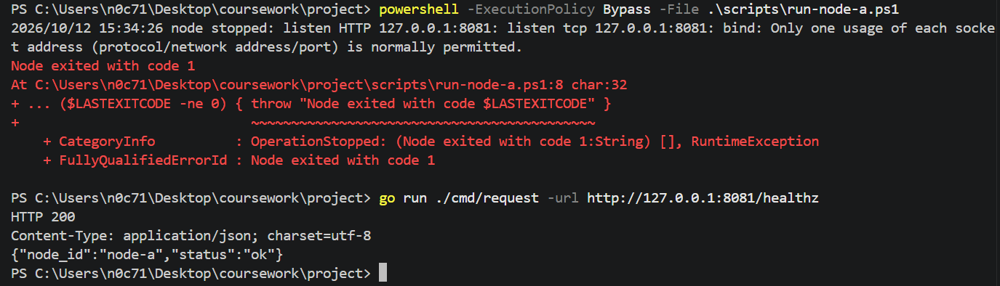

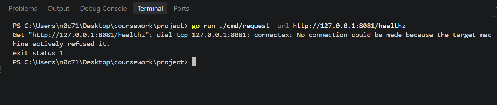

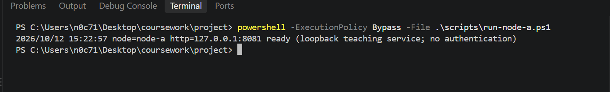

### Invalid configuration and command-line arguments

I tested three invalid inputs to see how the application handled them.

First, I supplied a node ID containing a space. The application rejected it because it did not match the accepted format. Next, I supplied port `70000`, which is outside the valid port range, and the application rejected that as well.

Finally, I used an unknown command-line flag. The command failed and displayed a flag parsing error and usage information.

These checks showed that the application rejected the invalid inputs I tried instead of starting with those settings.

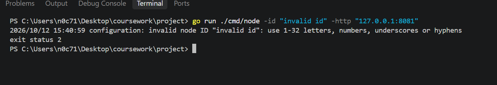

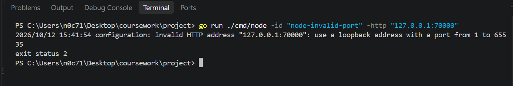

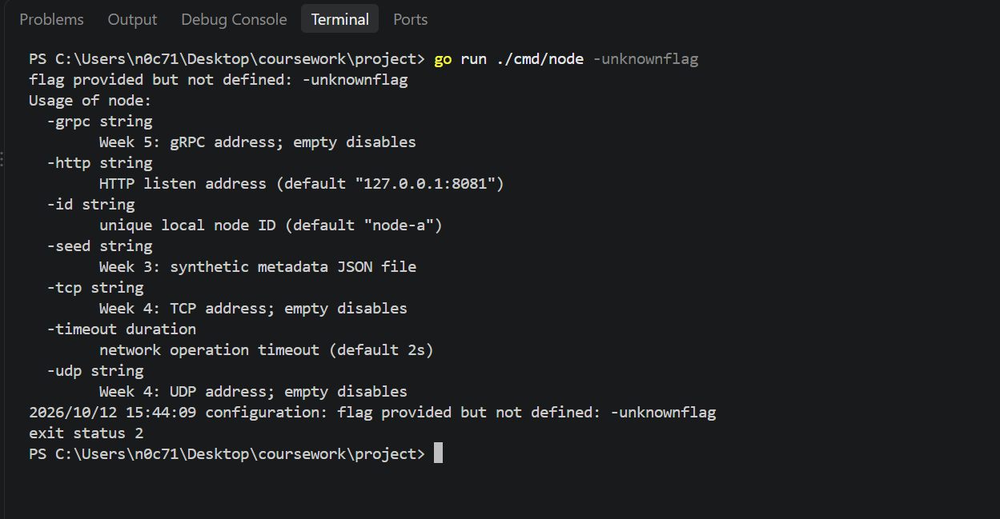

### Final verification results

After addressing the issues identified during the initial test run, I ran the full test suite again. It passed without reporting any failures. I also ran `go vet ./...`, which completed without reporting any issues.

This gave me confidence that the Week 1 implementation passed the tests and static checks I had run. It does not mean that every possible situation has been tested.

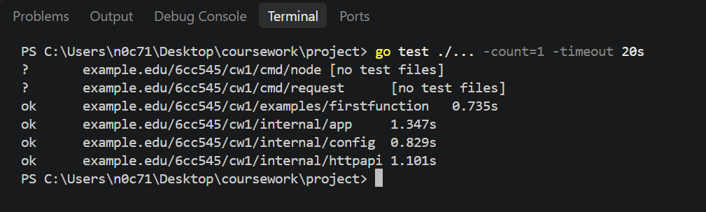

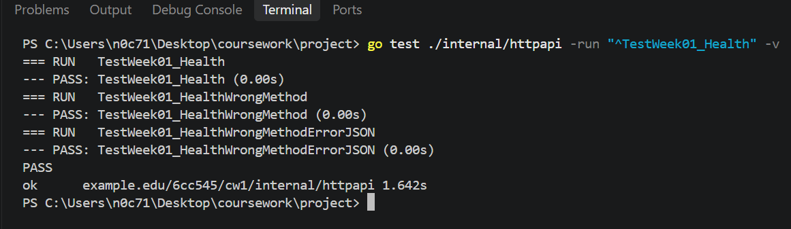

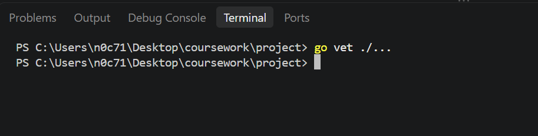

## Failure case and diagnosis

The main issue during my first full test run was that some of the Week 1 functionality was not complete. The configuration tests highlighted problems with the validation checks, while the health endpoint tests showed that the handler still needed work.

I addressed these issues by completing the configuration validation and implementing the health handler. I then ran the affected tests again, and they passed.

The other errors came from checks I carried out deliberately. Starting a second node on an address that was already in use resulted in a bind error. Sending a request after stopping Node A resulted in a connection-refused error. Both results matched what I expected in those situations.

The invalid node ID, invalid port and unknown command-line flag were also rejected as expected.

## Design decision and alternative

I kept configuration validation separate from the HTTP handler and application startup code. This means the application can check its settings before starting, and each part of the code has a clear responsibility.

I used JSON for the health endpoint responses so that clients can read the node ID and status in a consistent format. The handler also returns an appropriate HTTP error response when a client uses an unsupported method.

I also kept server startup and shutdown under the application's control rather than terminating the whole process from inside a request handler. This allows the application to follow its normal shutdown process.

A basic health endpoint was enough for this stage of the project. A more advanced monitoring system could be added later, but it was not needed for the Week 1 requirements.

## Remaining limitations

The tests and screenshots in this record cover the cases I checked during Week 1, including configuration validation, health requests, starting and stopping nodes, occupied ports and invalid command-line arguments.

I have not tested every possible runtime or network failure. More testing would be needed to understand how the application behaves under heavier concurrent use, unexpected failures and different deployment conditions.

The results show that the checks I ran passed. They should not be taken as proof that the application is free from every possible issue.

## Sources and AI-use disclosure

This record is based on my project files, the commands I ran, the test output and the behaviour I observed while running the nodes.

I used AI assistance to help me understand some implementation requirements, investigate test failures and organise this evidence record. The commands and results documented here relate to the work carried out on the project.