# Weekly Evidence Record

**Student number:** [Your student number]  
**Week:** 2  
**Repository URL:** [https://github.com/emmanuelmanu-devCyberSec/6CC545-CW1.git](https://github.com/emmanuelmanu-devCyberSec/6CC545-CW1.git)  
**Immutable tag:** `week02`  
**Commit hash:** [Actual commit hash]  
**Go version / OS:** [Actual Go version] / Windows

---

## Commands actually executed

The following commands were used to test the Week 2 implementation and check the status behaviour of both nodes.

**Automated tests**

```powershell
go test ./internal/httpapi -run "TestWeek02_REST" -v -count=1
```

**Start Node A**

```powershell
powershell -ExecutionPolicy Bypass -File ./scripts/run-node-a.ps1
```

**Read and update Node A's status**

```powershell
go run ./cmd/request -url http://127.0.0.1:8081/v1/status

go run ./cmd/request -url http://127.0.0.1:8081/v1/status -method POST -file testdata/status-degraded.json

go run ./cmd/request -url http://127.0.0.1:8081/v1/status
```

**Start Node B and check its status**

```powershell
powershell -ExecutionPolicy Bypass -File ./scripts/run-node-b.ps1

go run ./cmd/request -url http://127.0.0.1:8082/v1/status
```

**Test malformed JSON**

```powershell
go run ./cmd/request -url http://127.0.0.1:8081/v1/status -method POST -file testdata/status-malformed.json -expect 400
```

## Observed results (do not paste expected examples as results)

The REST tests passed. Node A initially returned `healthy`. After I sent the POST request with the degraded status, a subsequent GET request returned `degraded`, confirming that the update had been applied.

Node B continued to return `healthy` while Node A was `degraded`. This showed that the two nodes maintained their own status values rather than sharing the same in-memory state.

The malformed JSON request returned HTTP `400` with the error `invalid_json`. A separate test also confirmed that trailing characters after a valid JSON object were rejected without changing the existing status.

### Test evidence

**Figure 1. Week 1 tests passed before the Week 2 changes**

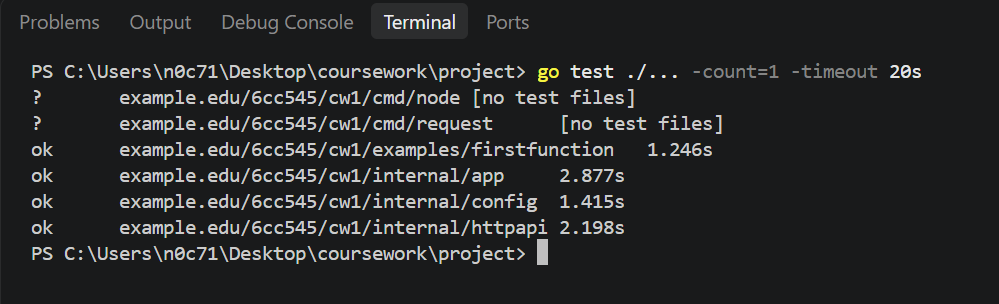

**Figure 2. Post-merge tests identified unfinished TODOs**

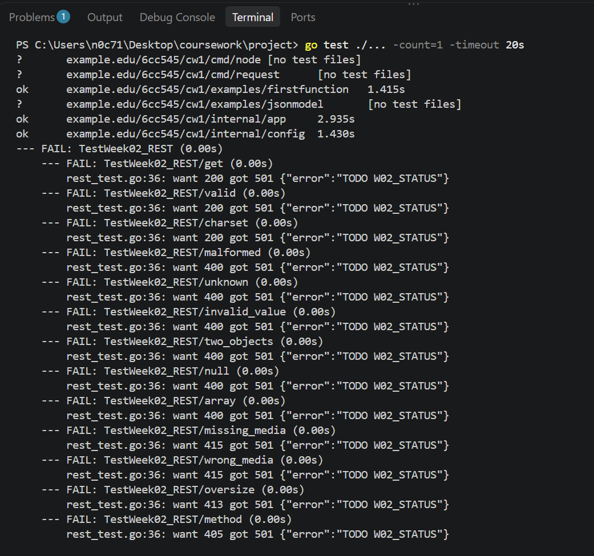

**Figure 3. Current test result**

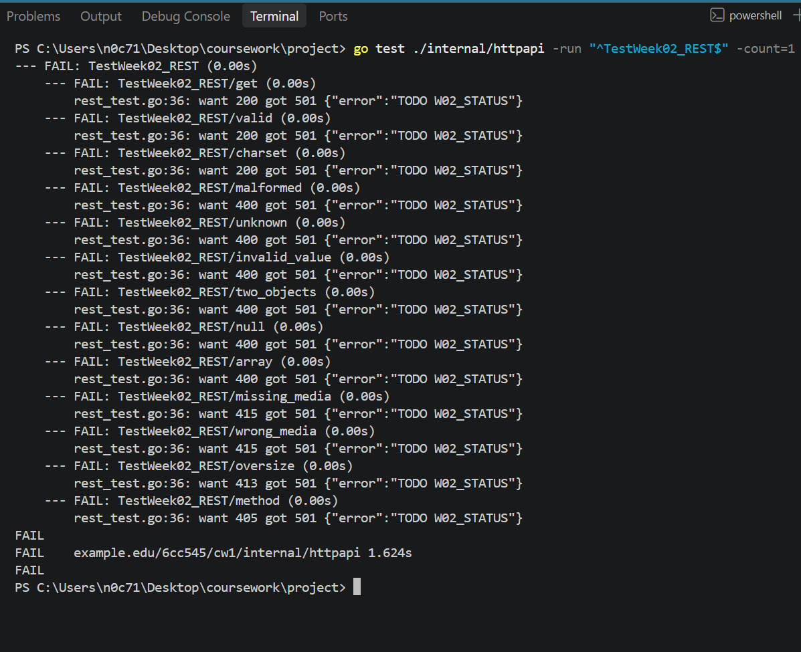

**Figure 4. Status resource tests passed**

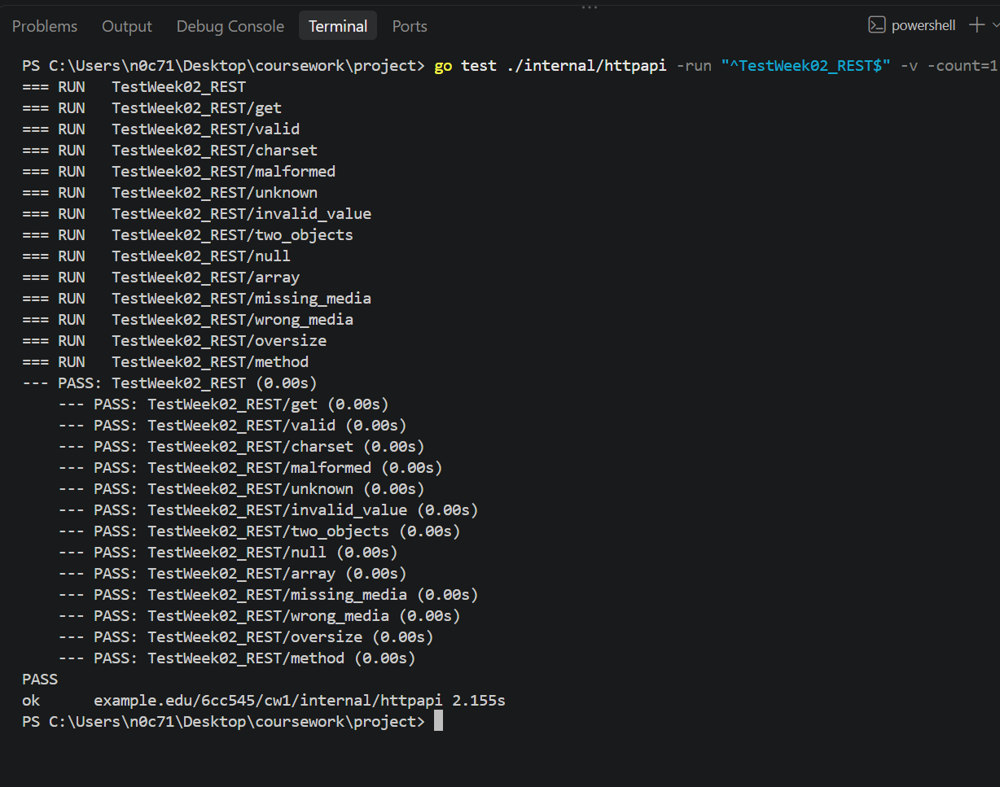

**Figure 5. Table-driven REST tests passed**

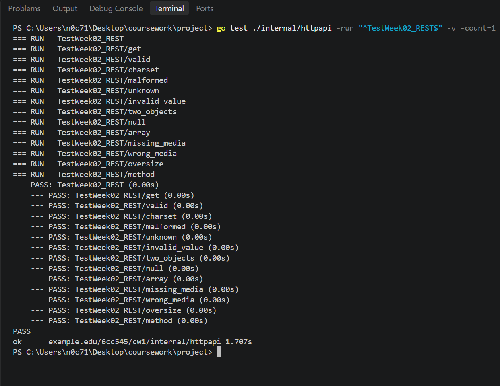

**Figure 6. All Task 2.6 tests passed**

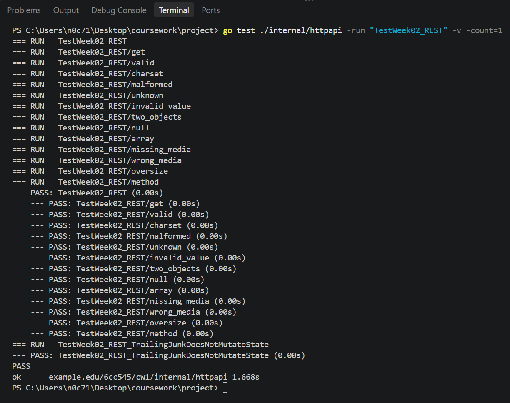

### Manual request evidence

**Figure 7. Node A started successfully**

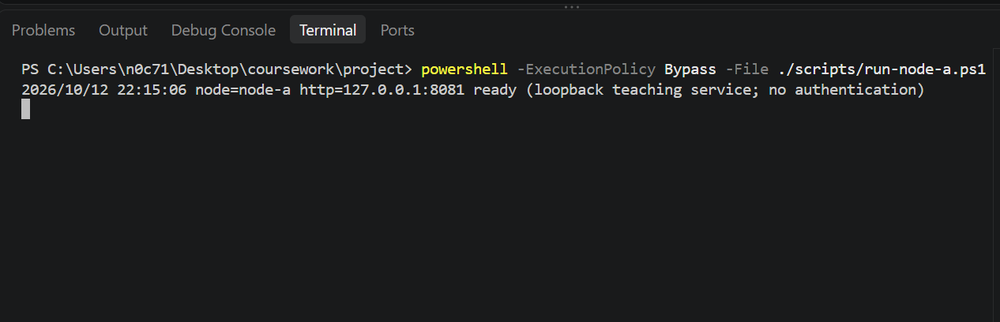

**Figure 8. Node A returned its initial status**

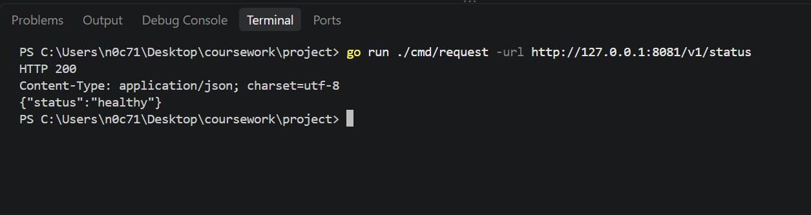

**Figure 9. POST request changed Node A to degraded**

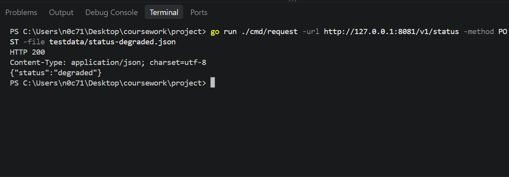

**Figure 10. Node A retained the updated status**

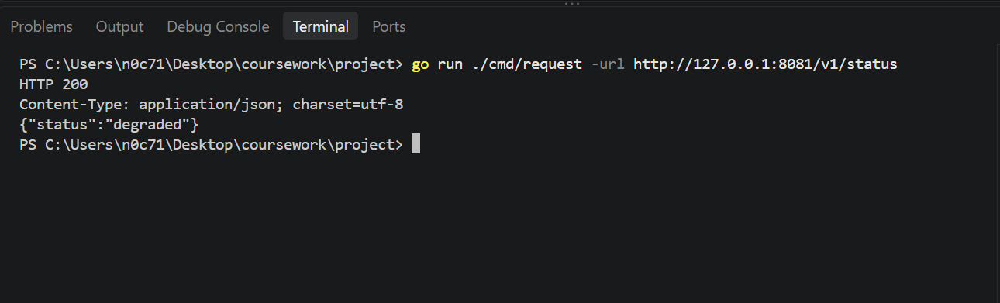

**Figure 11. Node B started successfully**

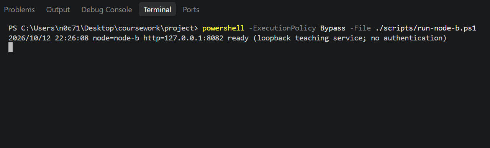

**Figure 12. Node B retained its independent healthy status**

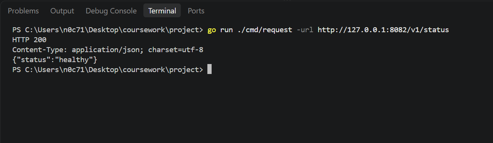

### Invalid request and state protection evidence

**Figure 13. Malformed JSON was rejected**

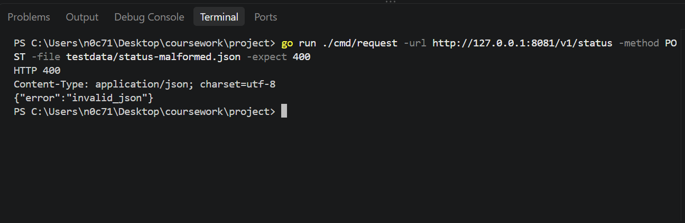

**Figure 14. Trailing characters were rejected without changing the status**

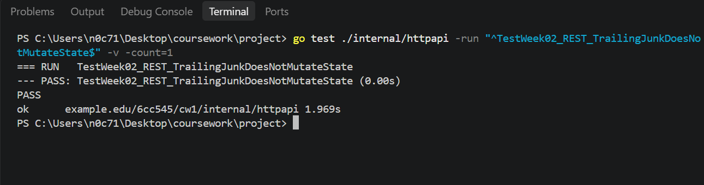

**Figure 15. State before and after a rejected request**

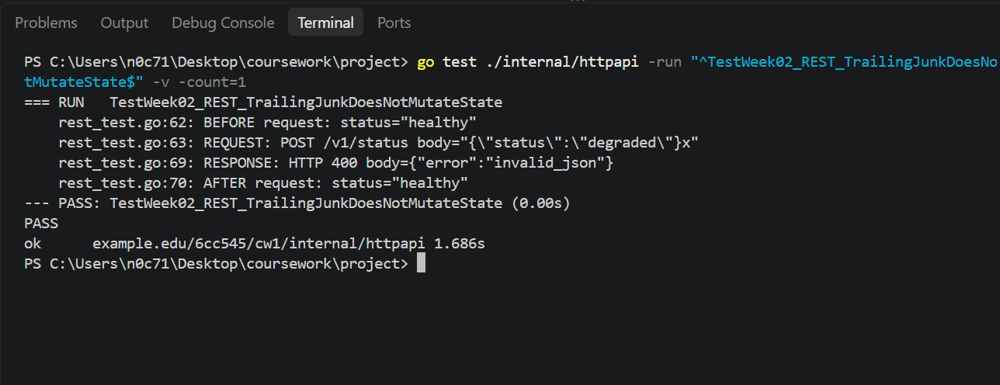

## Failure case and diagnosis

A request containing a valid JSON object followed by extra characters returned HTTP `400` with `invalid_json`. The status remained unchanged because the handler checked the complete request before applying the update.

This was important because accepting only the first valid JSON object could allow a request with extra, unintended content to be treated as valid. Rejecting the request meant that the existing status was preserved.

## Design decision and alternative

I used a temporary request value and validated it before updating the stored status. The decoder rejects unknown fields and checks for additional content after the first JSON value.

Another approach would be to update the stored status while decoding the request. However, this would make it harder to ensure that an invalid request leaves the previous value unchanged. Validating the request first keeps the behaviour easier to understand and test.

## Remaining limitations

- The service is intended for local testing and does not implement authentication.
- Status values are stored in memory and are lost when the process stops.
- Node A and Node B maintain independent status values. Synchronisation between the nodes is not implemented in this week's work.

## Sources and AI-use disclosure

The coursework specification, supplied project files and implementation test results were used to prepare this record. AI assistance was used to help review explanations, troubleshoot issues and organise the documentation. The commands and results recorded above reflect the work performed.