# Weekly evidence record

**Student number:** [Enter student number]  
**Week:** 5  
**Repository URL:** https://github.com/emmanuelmanu-devCyberSec/6CC545-CW1  
**Immutable tag:** [Enter verified Week 5 tag]  
**Commit hash:** [Enter verified commit hash]  
**Go version / OS:** [Enter exact Go version from screenshot] / Windows

## Commands actually executed

### Toolchain and generated code

```powershell
go mod verify
go build ./...
go test ./... -count=1 -timeout 20s
go vet ./...
go env CGO_ENABLED
go test -race ./... -count=1 -timeout 20s
protoc --version
protoc-gen-go --version
protoc-gen-go-grpc --version
Get-ChildItem .\api\files\v1 -File | Select-Object Name, Length
```

### RPC and HTTP adapter tests

```powershell
go test ./internal/rpcfiles -run 'TestWeek05_(RemoteList|Unavailable|Cancelled)$' -count=1 -v
go test ./internal/rpcfiles -run '^TestWeek05_ServiceInvalidRequesterAndEmptyCatalogue$' -count=1 -v
go test ./internal/httpapi -run '^TestWeek05_RemoteFilesUnavailableMapping$' -count=1 -v
```

### Node and remote metadata checks

```powershell
powershell -ExecutionPolicy Bypass -File .\scripts\run-node-a.ps1
powershell -ExecutionPolicy Bypass -File .\scripts\run-node-b.ps1
go run ./cmd/request -url "http://127.0.0.1:8081/v1/remote-files?peer_id=node-b"
go run ./cmd/request -url "http://127.0.0.1:8082/v1/remote-files?peer_id=node-a"
go run ./cmd/request -url "http://127.0.0.1:8082/v1/files"
go run ./cmd/request -url "http://127.0.0.1:8081/healthz"
go run ./cmd/request -url "http://127.0.0.1:8081/v1/files"
```

## Observed results (do not paste expected examples as results)

The `go mod verify` command returned `all modules verified`. The full build completed without reporting errors. The full regression test command passed for the packages containing tests, and `go vet ./...` completed without reporting issues.

The project contains `files.proto`, `files.pb.go`, `files_grpc.pb.go` and `generate.go` under `api/files/v1`. The Protocol Buffers compiler reported `libprotoc 36.2`, and the gRPC generator reported `protoc-gen-go-grpc 1.6.2`.

The RPC tests for remote listing, unavailable services and cancellation passed. The invalid-requester and empty-catalogue test also passed. The HTTP adapter test confirmed that an unavailable remote service is mapped to HTTP 503.

Node A's local catalogue contains `alpha.txt`, while Node B's local catalogue contains `diagram.txt` and `notes.txt`. A remote query through Node A returned Node B's files rather than A's local file. The reverse remote query also returned Node A's `alpha.txt`. This demonstrates that the remote result differs from the requesting node's local metadata.

When Node B was stopped, a remote request through Node A returned HTTP 503 with the error identifier `remote_unavailable`. Node A's health and local file endpoints continued to respond. After Node B restarted, the remote query succeeded again.

### Screenshot evidence

The following screenshots record the toolchain, generated code, test results, remote metadata requests and final integration checks completed during Week 5.

**Toolchain and generated code**

The toolchain screenshot records the development environment and installed Go version.

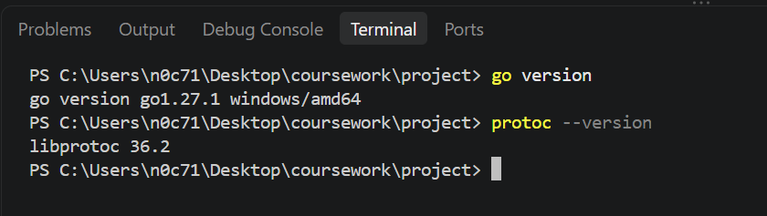

This screenshot records the dependency verification and code generation checks carried out before the integration tests.

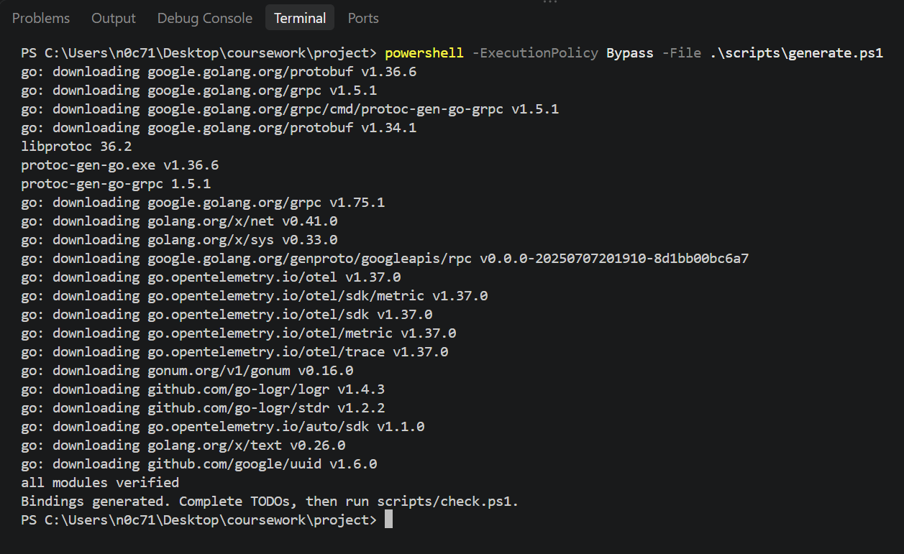

The build check confirms that the project compiled without reporting errors.

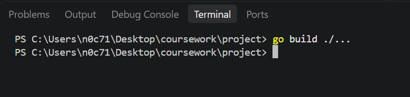

This screenshot identifies the generated files used by the Protocol Buffers and gRPC implementation.

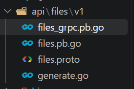

The generated server interface defines the methods that the gRPC service implementation must provide.

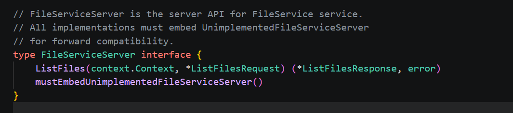

This screenshot shows the generated client interface used to call the remote gRPC service.

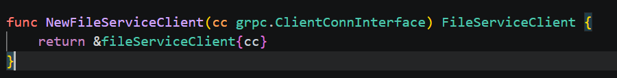

This screenshot shows the generated function used to register the service with a gRPC server.

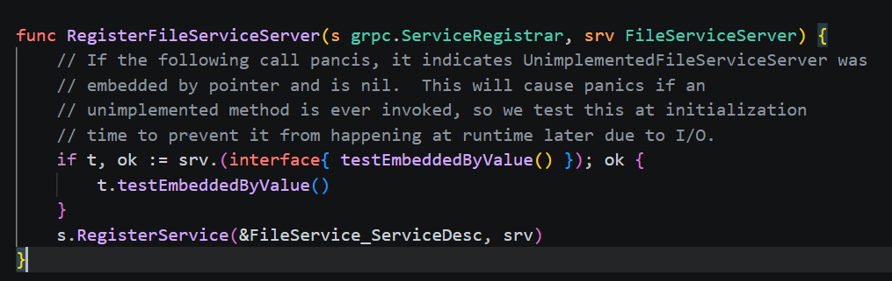

This screenshot shows the generated request message types used when requesting file metadata.

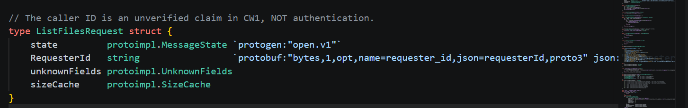

This screenshot shows the generated response message types used to return file metadata.

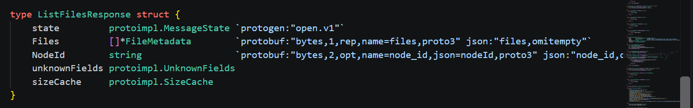

The following screenshot records the installed Go Protocol Buffers generator version.

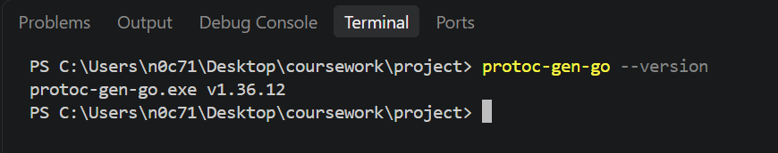

This screenshot records the installed gRPC code generator version.

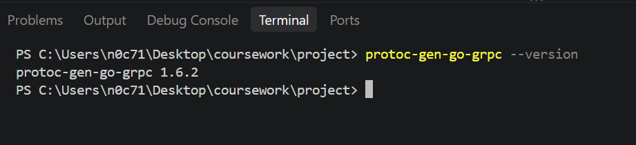

**RPC and HTTP tests**

This test checks that cancellation is handled by the RPC service.

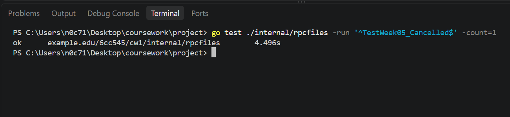

This test covers invalid requester input and the case where the catalogue contains no files.

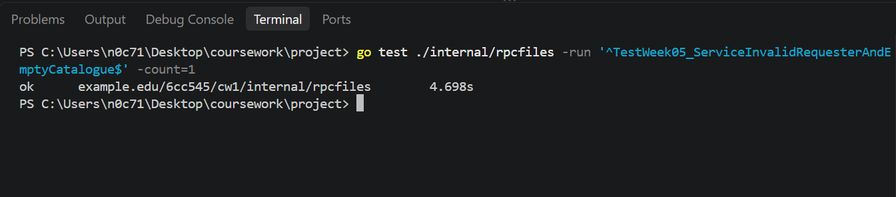

This screenshot records the test of mapping file metadata into the service response.

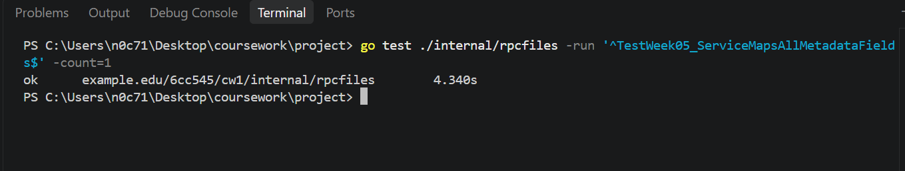

These tests provide evidence of the RPC client's behaviour when making remote service calls.

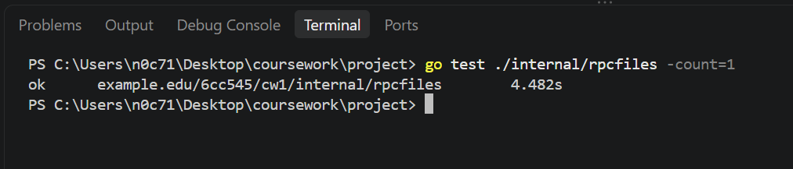

These tests check the HTTP API behaviour for remote file metadata requests.

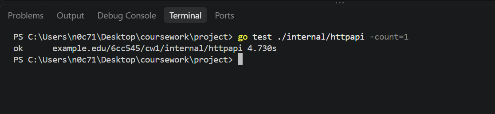

This screenshot records the RPC error-case tests, including remote service failures and cancellation behaviour.

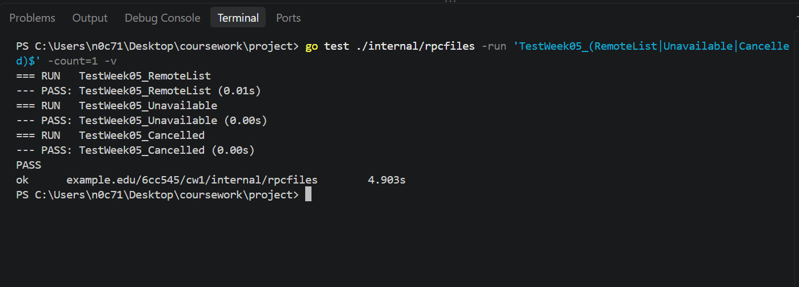

This test checks that an empty catalogue can produce a valid response rather than being treated as a failed call.

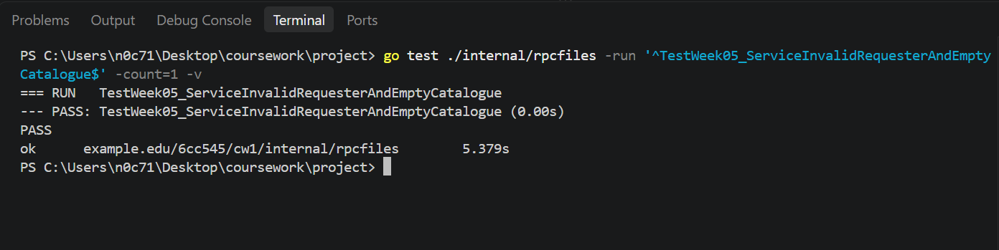

This test verifies how the HTTP adapter maps an unavailable RPC service to an HTTP error response.

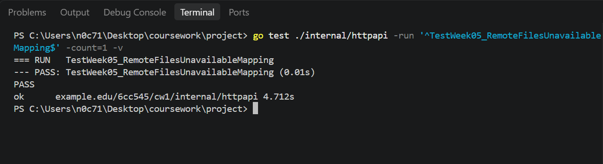

**Two-node integration**

This screenshot records Node A starting with its own configuration and listening services.

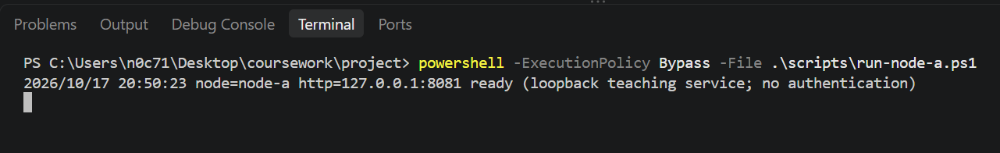

This screenshot records Node B starting separately from Node A.

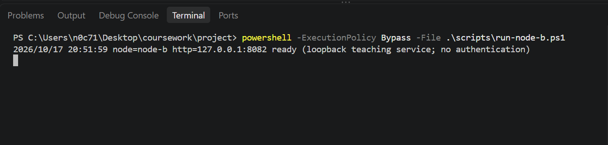

This request registers Node B as a peer in Node A's registry.

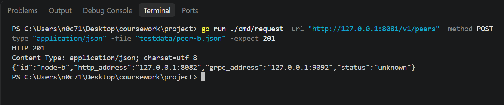

This screenshot demonstrates that Node A can retrieve remote file metadata from Node B.

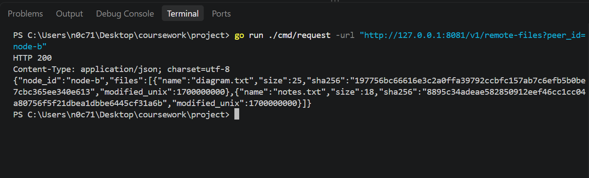

This screenshot shows the files held in Node B's local catalogue for comparison with the remote result.

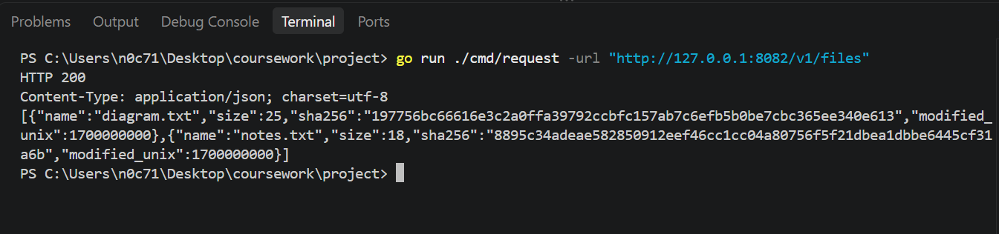

This request registers Node A as a peer in Node B's registry so the reverse remote query can be tested.

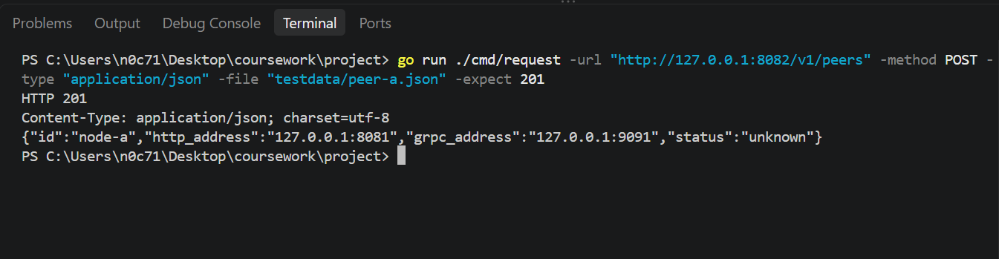

This screenshot demonstrates Node B retrieving Node A's remote file metadata.

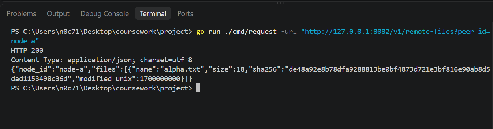

**Failure and recovery**

This screenshot records the remote request failure when Node B is stopped. The request returns `remote_unavailable` rather than a successful remote result.

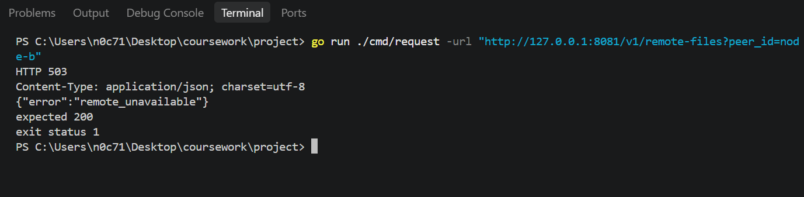

This check shows that Node A's health endpoint remains available while Node B is stopped.

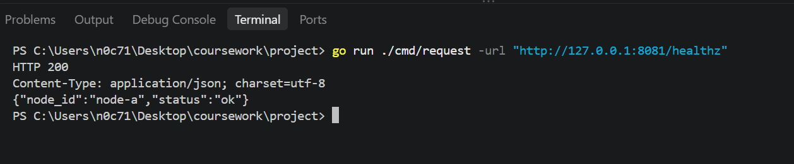

This screenshot confirms that Node A can still return its own local file metadata while the remote node is unavailable.

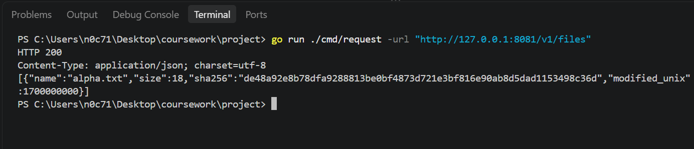

After Node B restarts, this request succeeds again and returns Node B's remote metadata.

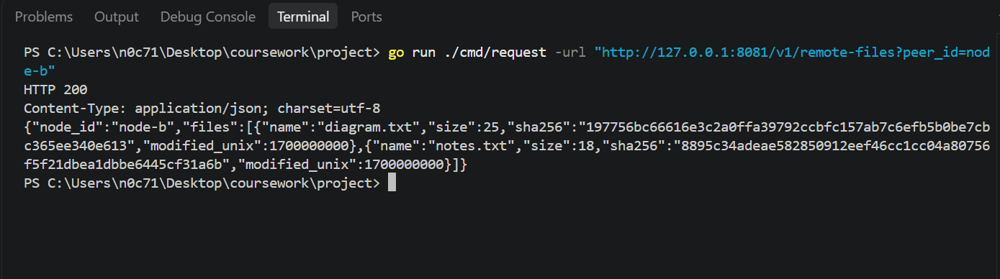

**Final integration checks**

The module verification result confirms that the downloaded Go modules passed verification.

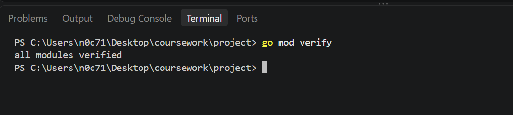

This screenshot records the successful build of all project packages.

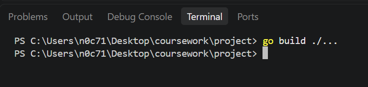

The full regression test output records the results across the project packages after the Week 5 changes.

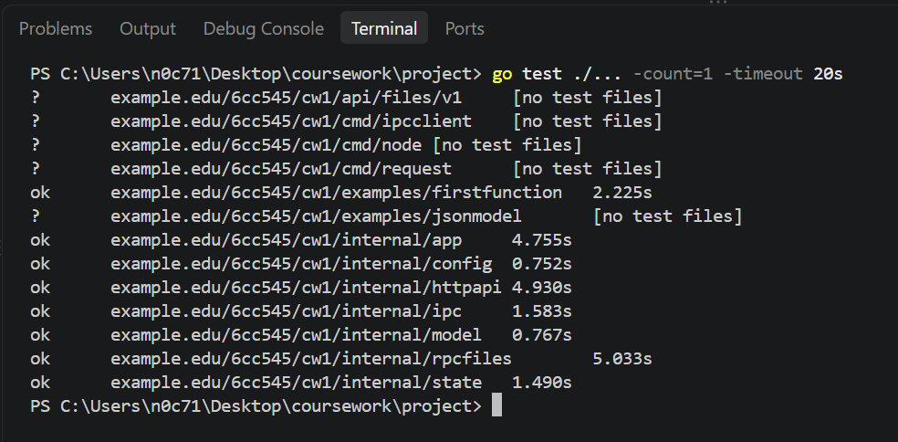

This screenshot records the result of running `go vet ./...` to check for common Go code issues.

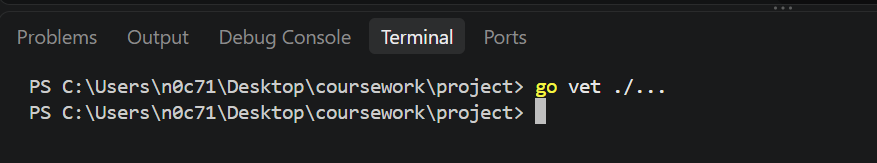

This screenshot records the CGO setting checked before attempting the race tests.

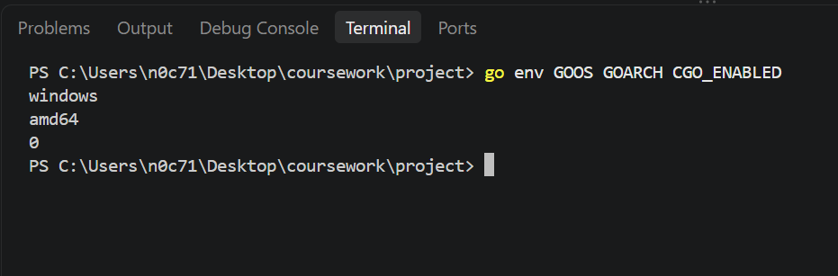

The race-test command could not run because CGO was disabled. This screenshot preserves the error and documents the limitation of the current environment.

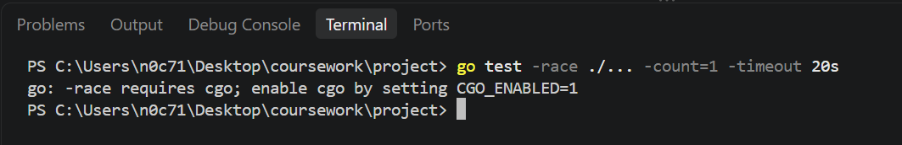

## Failure case and diagnosis

The race test did not run because CGO was disabled. The `go env CGO_ENABLED` command returned `0`, and `go test -race ./... -count=1 -timeout 20s` reported that race testing requires CGO. Therefore, race testing remains unverified in this environment.

When Node B was stopped, the remote metadata request returned HTTP 503 with `remote_unavailable`. Node A's health and local file endpoints continued to work. The remote query succeeded again after Node B restarted.

Peer registration returned HTTP 409 when a peer was already registered. This demonstrated that duplicate registrations are rejected.

## Design decision and alternative

I used the existing Protocol Buffers contract to define the gRPC messages and service. The `files.proto` file is the source contract, while `files.pb.go` and `files_grpc.pb.go` are generated files. The service implementation, RPC client use, HTTP adapter, validation and error handling are part of the handwritten application code.

I used separate Node A and Node B processes so that each node has its own configuration and local catalogue. This allowed me to compare local and remote metadata and check that a remote request returned the other node's files.

Creating a gRPC client does not prove that a remote service is reachable. A completed RPC call provides stronger evidence because the call has actually been made. An empty successful list means the request succeeded but no records were returned. A failed RPC means the request did not complete successfully and should not be treated as an empty result.

The HTTP request context is passed into the RPC call so cancellation and deadlines can propagate. The HTTP adapter maps remote unavailability to HTTP 503 rather than presenting it as a successful result. Protocol Buffer field numbers are kept stable because reusing them can cause compatibility problems when messages are encoded and decoded by different versions.

The TCP and UDP implementations also demonstrate different approaches to message boundaries. TCP uses a length prefix to identify messages in a byte stream, while UDP carries each message as a datagram.

## Remaining limitations

Peer registrations are stored in memory and are lost when a node restarts. Manual registrations may need to be added again, and there is no automatic peer discovery.

The `requester_id` field is a claimed identity and does not authenticate the caller. A metadata digest can help compare file contents, but it does not authenticate a peer or provide confidentiality.

Race testing could not be completed because CGO was disabled. The project remains a coursework prototype and does not provide production-grade authentication, persistent peer registration or confidentiality.

## Sources and AI-use disclosure

- 6CC545 CW1 coursework brief and Week 5 task instructions.
- Week 5 Final Integration Guide.
- Project source files, tests and recorded command output.
- AI assistance was used to organise and improve the wording of this evidence record. 